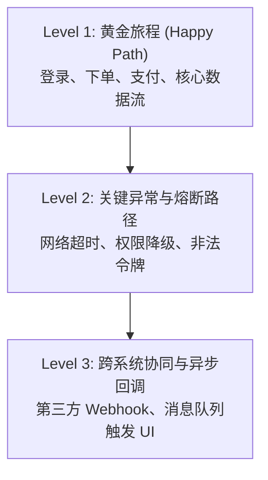

# 端到端测试与用户旅程验收协议 (E2E Testing Protocol)

本文档定义全链路端到端（E2E）自动化测试的设计规范、用户旅程建模原则、网络等待策略与缺陷诊断标准。

---

## 目录 (Table of Contents)

- [1. 核心用户旅程分级与测试边界](#1-核心用户旅程分级与测试边界)
- [2. 测试架构与页面对象模型 (POM)](#2-测试架构与页面对象模型-pom)
- [3. 确定性等待与网络异步同步策略](#3-确定性等待与网络异步同步策略)
- [4. 测试数据治理与运行环境隔离](#4-测试数据治理与运行环境隔离)
- [5. 失败排查与 Trace 轨迹留痕体系](#5-失败排查与-trace-轨迹留痕体系)

---

## 1. 核心用户旅程分级与测试边界

端到端测试聚焦于系统核心业务链路的可用性，应避免在 E2E 层面过度覆盖细微的边界值计算（相关逻辑下沉至单元测试）。

### 1.1 分级判定基线
1. **P0 冒烟链路**：主干业务最简路径（Happy Path），任何失败直接阻断发布；
2. **P1 关键分支**：具备高商业价值的替代路径（如使用优惠券、修改发票抬头）；
3. **P2 容灾与降级**：后端非核心接口故障时的降级提示与友好引导。

---

## 2. 测试架构与页面对象模型 (POM)

### 2.1 页面对象模式 (Page Object Model)
- **行为与定位解耦**：将页面选择器（Selectors）与页面操作封装在独立的 Page Object 类中；
- **自解释动作方法**：方法名表述用户业务意图（如 `submitLoginForm()` 而非 `clickSubmitButton()`）；
- **链式流转支持**：跨页面跳转动作应返回目标页面的 Page Object 实例。

### 2.2 稳健定位器推荐优先级
1. **语义角色与文本**：`getByRole('button', { name: '确认支付' })`（推荐，模拟真实用户操作）；
2. **表单标签与占位符**：`getByLabel('手机号')`、`getByPlaceholder('请输入密码')`；
3. **测试专用标识**：`getByTestId('checkout-btn')`（当语义定位器不稳定时使用）；
4. **严禁脆弱定位**：杜绝依赖易变的 CSS 类名或深层绝对 XPath（如 `div > div:nth-child(3) > span`）。

---

## 3. 确定性等待与网络异步同步策略

### 3.1 零硬编码睡眠红线 (Zero Arbitrary Sleep)
- **严禁使用 `sleep(3000)`**：随意休眠会导致流水线极度缓慢且无法彻底根除随机偶发失败（Flaky Tests）；
- **自动化事件驱动等待**：
  - 等待特定元素变为可见（`toBeVisible()`）；
  - 等待特定接口网络响应到达（`page.waitForResponse('/api/orders')`）；
  - 等待页面达到网络空闲状态（`networkidle` 或加载状态完成）。

### 3.2 接口网络控制与隔离
- **全链路真实联调**：冒烟验证阶段连接真实 Staging 后端，验证端到端集成；
- **接口精准拦截 (Mocking)**：针对第三方不可控服务（如短信通道、银行收银台），使用网络拦截注入确定性响应数据。

---

## 4. 测试数据治理与运行环境隔离

### 4.1 数据独立性与原子性
- **按需即时生成**：每个测试用例应使用动态唯一标识（如 UUID 或时间戳后缀）创建独立的账号与订单数据；
- **自包含生命周期**：测试前置钩子（`beforeEach`）负责初始化数据，后置钩子（`afterEach`）负责清理垃圾数据；
- **杜绝用例顺序依赖**：所有测试用例必须能够以任意顺序或并行方式独立运行。

---

## 5. 失败排查与 Trace 轨迹留痕体系

### 5.1 现场证据全景采集
- **自动失败截图**：用例断言失败时立即保存当前视口与完整页面截图；
- **视频与操作录制**：在 CI 环境下启用首轮重试时的视频录像（`video: 'on-first-retry'`）；
- **全量 Trace 轨迹记录**：启用 Playwright Trace Viewer 留痕，记录 DOM 快照、网络请求时序、控制台日志与执行调用栈。

### 5.2 失败分类与分类处置
- **应用逻辑缺陷**：断言失败且网络响应正常，立即向开发团队提交 Bug 缺陷工单；
- **测试环境不稳定**：网络瞬时丢包或超时，应结合指数退避重试（最多重试 1 次）并优化等待策略。
