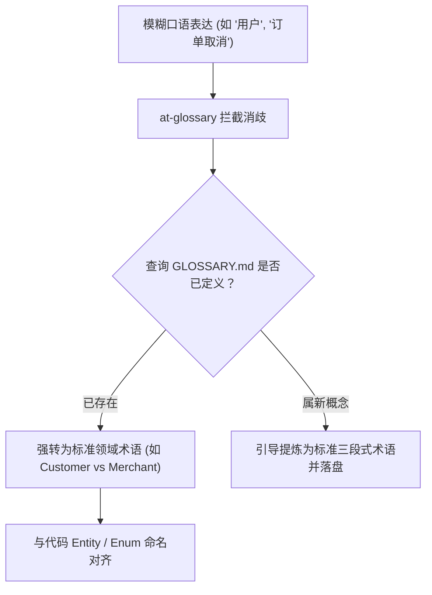

# 统一领域语言提炼与术语消歧协议 (Ubiquitous Language Protocol)

本文档规范了 `at-glossary` 技能在提炼、维护与校验项目通用领域语言（`GLOSSARY.md`）时的消歧标准、反模糊化准则与代码对齐纪律。

---

## 目录 (Table of Contents)
- [1. 核心理论：统一语言防腐层](#1-核心理论统一语言防腐层)
- [2. 歧义词与重载术语消歧规则](#2-歧义词与重载术语消歧规则)
- [3. 术语卡片标准三段式结构](#3-术语卡片标准三段式结构)
- [4. 代码实体与术语一致性交叉核验](#4-代码实体与术语一致性交叉核验)
- [5. 术语表纯粹性与防膨胀门禁](#5-术语表纯粹性与防膨胀门禁)

---

## 1. 核心理论：统一语言防腐层

在长周期研发中，“同词不同义”或“同义不同词”是滋生系统 Bug 与 Agent 上下文漂移的最大元凶（例如：前端叫 `User`、后端叫 `Account`、财务叫 `Customer`、运营叫 `Member`）。
`at-glossary` 借鉴领域驱动设计（DDD）思想：
- **全项目唯一权威字典**：根目录维护 `GLOSSARY.md`；
- **跨角色零歧义通信**：产品经理、开发工程师与 AI Agent 100% 共享相同的领域词汇表；
- **大幅瘦身 Token**：消除会话中反复解释专业名词的通信开销。



---

## 2. 歧义词与重载术语消歧规则

遇到以下常见模糊用词时，Agent 必须立即主动阻断并进行概念锐化：
1. **多重身份混淆**：
   - 严禁泛称“用户 (User)”：必须明确区分是终端消费者（Customer）、平台商家（Merchant）、还是系统运营员（Operator）；
2. **状态动作混淆**：
   - 严禁泛称“取消 (Cancel)”：必须澄清是用户主动撤单（Revoke）、超时系统关闭（Expire）、还是售后逆向退款（Refund）；
3. **计费与结算混淆**：
   - 严格区分“扣款 (Deduct)”、“冻结 (Freeze)”与“清算 (Settle)”。

---

## 3. 术语卡片标准三段式结构

每一个录入 `GLOSSARY.md` 的词条必须遵循严格的结构化格式：
```markdown
### 术语名 (Canonical Term) [英文标识]
- **业务定义 (Definition)**：客观、精炼陈述该概念在当前业务上下文中的唯一法定含义；
- **边界约束与不变式 (Invariants)**：该术语所涵盖的业务刚性规则与排他性约束；
- **反例与澄清 (What it is NOT)**：明确它不是什么，与其他易混淆概念划清物理界线。
```

---

## 4. 代码实体与术语一致性交叉核验

- **命名一致性**：代码库中的核心实体类（`Entity`）、领域对象（`Value Object`）与状态枚举（`Enum`）必须与 `GLOSSARY.md` 英文标识 100% 对齐；
- **反向冲突预警**：若发现代码库中某 Enum 含义与 `GLOSSARY.md` 存在冲突，立即向开发者发出矛盾告警并提示对齐。

---

## 5. 术语表纯粹性与防膨胀门禁

- **纯业务概念红线**：`GLOSSARY.md` 严禁塞入纯底层技术实现细节（如“主键采用雪花算法”、“使用 Redis 存储”）；它只承载业务领域模型；
- **单条精炼度**：单词条描述控制在 200 字符内，保持字典高密度、高可读。
