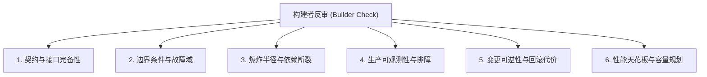

# 构建者视角反审执行协议 (Builder Check Protocol)

本文档规范了 `at-grill` 技能在共识收敛前必须执行的“构建者反审 (Builder Check)”硬性工程门禁。

---

## 目录 (Table of Contents)
- [1. 构建者心智模型](#1-构建者心智模型)
- [2. 六大落地审讯维度](#2-六大落地审讯维度)
- [3. 权衡决策矩阵模板](#3-权衡决策矩阵模板)
- [4. 反审交付门禁与流转](#4-反审交付门禁与流转)

---

## 1. 构建者心智模型

在设计树前沿收敛之后，设计方案常停留在高层理论美感阶段。此时 Agent 必须切换为**资深落地构建者 (Hardcore Builder)** 视角：
> *“如果明天早上 9:00 由我负责编写此模块的生产代码，并在下周上线扛大促流量，方案中还有哪些未定义的黑盒？哪处细节会让我深夜被告警唤醒？”*

构建者反审不是推倒重来，而是针对已达成共识的决策树，展开深度的现实落地防御性质询与压力测试。

---

## 2. 六大落地审讯维度

Agent 必须逐项核查以下 6 项硬核工程维度：

### 2.1 契约与接口完备性 (Contracts & Interfaces)
- 输入/输出的确定性数据结构是否已有显式定义？
- 是否包含任何含糊不清的 `Map<String, Object>` 或裸 `any` 类型？
- 幂等性如何保障？业务唯一键（Idempotency Key）生命周期有多长？

### 2.2 边界条件与故障域 (Edge Cases & Failure Domains)
- 空集合、并发击穿、长尾延迟、网络超时（Socket Timeout）时的表现是什么？
- 下游服务持续报错时，系统是否具备熔断、降级或死信队列策略？
- 数据库连接池耗尽或缓存雪崩时，系统第一受害点在哪里？

### 2.3 爆炸半径与外部依赖 (Blast Radius & Dependencies)
- 本次改动是否对存量接口产生破坏性变更（Breaking Change）？
- 新引入的第三方组件或 SDK 是否引入了间接脆弱依赖？
- 方案是否导致核心业务与边缘业务强耦合？

### 2.4 生产可观测性与排障 (Observability & Debuggability)
- 链路追踪 Trace ID 是否全链路透传？
- 关键业务节点的日志是能够快速定位根因，还是会引发海量无效日志风暴？
- 核心指标（P99 延迟、错误率、QPS、资源饱和度）是否有明确暴露口？

### 2.5 变更可逆性与回滚代价 (Reversibility & Rollback)
- 一旦上线发现重大设计缺陷，能否在 5 分钟内完成灰度降级或平滑回滚？
- 是否涉及双写迁移（Dual-writing）？数据结构变更是否向前兼容？

### 2.6 性能天花板与容量规划 (Bottlenecks & Scale)
- 方案在 10 倍当前数据量或并发流量下，首要瓶颈是 CPU、内存还是 I/O？
- 是否存在隐蔽的 N+1 数据库查询或跨网络大循环？

---

## 3. 权衡决策矩阵模板

经过构建者反审后，所有关键决策必须收敛至结构化的权衡决策矩阵：

| 决策点标识 | 采纳方案 | 备选被否方案 | 核心权衡考量 (Pros vs Cons) | 关键风险点与防范预案 |
| :--- | :--- | :--- | :--- | :--- |
| **DEC-01** | 基于 Redis + Lua 脚本实现分布式限流 | 基于应用本地 Guava RateLimiter | **优势**：多实例全局一致。 **代价**：强依赖 Redis 可用性。 | **风险**：Redis 抖动导致限流失效。 **防范**：增加本地降级熔断开关。 |
| **DEC-02** | 事件驱动异步写审计日志 | 主事务同步落库 | **优势**：核心交易耗时下降 40%。 **代价**：审计数据最终一致。 | **风险**：消息队列丢消息。 **防范**：落本地发件箱表 (Outbox Pattern)。 |

---

## 4. 反审交付门禁与流转

1. **反审结论判定**：
   - **PASS (绿灯)**：6 维考查均已给出清晰解答，关键权衡已形成书面矩阵；
   - **BLOCKED (红灯)**：发现高危阻断项（如缺乏回滚能力、数据强破坏），必须立即拉回设计树重新发问；
2. **生成《共识与权衡备忘录》**：交付包含完整设计树总结与权衡矩阵的结构化产物；
3. **向后流转建议**：
   - 若进入系统规格制定，流转至 `at-spec` 编写增量契约；
   - 若直接进入工序拆解，流转至 `at-plan` 拆解微任务清单。
