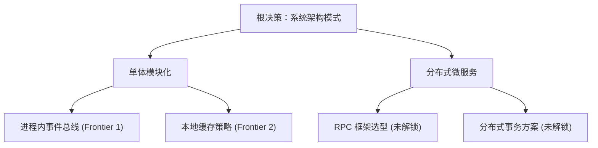

# 设计树分轮质询执行协议 (Grilling Protocol)

本文档规范了 `at-grill` 技能在开展需求与架构决策深度质询时的状态机推演、前沿树演进与交互输出格式。

---

## 目录 (Table of Contents)
- [1. 核心理论：设计树与前沿推进](#1-核心理论设计树与前沿推进)
- [2. 职责边界：事实探查与价值决策](#2-职责边界事实探查与价值决策)
- [3. 前沿提问交互规范](#3-前沿提问交互规范)
- [4. 轮次收敛与依赖解锁状态机](#4-轮次收敛与依赖解锁状态机)
- [5. 假共识防御与退出准则](#5-假共识防御与退出准则)

---

## 1. 核心理论：设计树与前沿推进

在面对模糊需求、前瞻架构设计或技术选型时，严禁使用发散式闲聊，必须将整个方案形式化抽象为**设计树 (Design Tree)**：
- **节点 (Node)**：每一个需要敲定的技术或业务决策点；
- **边 (Edge)**：决策之间的前后依赖关系。决策 B 的选择依赖于决策 A 的结论时，B 为 A 的子节点；
- **决策前沿 (Frontier)**：所有**前置依赖已全部清零、当前即可独立判定**的未决问题集合。



---

## 2. 职责边界：事实探查与价值决策

Agent 与用户交互时必须遵循严格的分工红线：

| 关注点 | 责任方 | 执行准则 |
| :--- | :---: | :--- |
| **客观事实 (Facts)** | **Agent** | 本地代码库结构、现有依赖库版本、API 现状、配置文件等由 Agent 自主使用工具链扫描查明。**严禁向用户询问可通过自身探查获知的事实**。若探查正在进行，仅阻塞依赖该事实的下游分支，其余平行分支继续推进。 |
| **主观决策 (Decisions)** | **人类用户** | 架构权衡、业务偏好、成本容忍度、演进阶段优先级等主观意图，必须且只能由用户做出最终决断。Agent 负责穷举完备选项并给出推荐基线。 |

---

## 3. 前沿提问交互规范

### 3.1 单轮集中发问
在每一轮质询中，Agent 必须将当前决策前沿中的所有独立问题一次性集中呈现。单轮发问包含：
1. **当前轮次与前沿总览**：告知用户本轮正在解决的决策层级；
2. **结构化问题卡片**：包含编号、问题标题、背景展开、选项对比；
3. **确定性推荐倾向**：在每个问题末尾明确给出 `➡️ 推荐方案` 及依据。

### 3.2 问题卡片标准语法
```markdown
❓ **Q{序号}** - **{问题简明标题}**：{问题背景阐述与关键分歧点}
- **选项 A**：{方案描述与优势/代价}
- **选项 B**：{方案描述与优势/代价}

➡️ **推荐决策**：{首选选项}。理由：{结合项目现实的技术与工程依据}
```

### 3.3 交互反模式红线
- ❌ **禁止一次抛出孤立问题**：单轮只问一个微小细节，导致会话往返严重拖沓；
- ❌ **禁止提问未就绪分支**：在父决策未定前提前追问子分支（如未确定采用微服务就追问分布式事务）；
- ❌ **禁止无倾向发问**：只列选项不给专业推荐，将全部思考负担推卸给用户。

---

## 4. 轮次收敛与依赖解锁状态机

1. **第一轮 (Round 1)**：聚焦根节点与宏观拓扑（架构形态、核心约束、技术栈选型）；
2. **状态更新与树剪枝**：
   - 用户给出反馈后，Agent 立即固化已选节点；
   - 裁减掉未选分支（如选择了单体，直接剪除所有分布式专属分支）；
   - 解锁下一层依赖节点，重新计算决策前沿；
3. **第二轮 (Round 2)**：聚焦核心交互与数据流（模块边界、持久层选型、状态同步契约）；
4. **后续轮次 (Round N)**：逐层细化至边界处理、异常容错与运维切入点；
5. **前沿清空**：当设计树的所有有效叶子节点全部敲定、无任何悬空隐性假设时，前沿收敛为 $\emptyset$。

---

## 5. 假共识防御与退出准则

在宣称质询完成前，Agent 必须进行假共识自检：
1. **零隐式假设**：检查是否存在“未经用户确认却在后续推演中默认成立”的前提；
2. **单段落汇总确认**：将所有锁定的决策点汇编为短段落摘要清单，要求用户最终审阅确认；
3. **触发下游流转**：用户确认后，平滑流转至 `builder-check-protocol.md` 进入构建者反审阶段。
