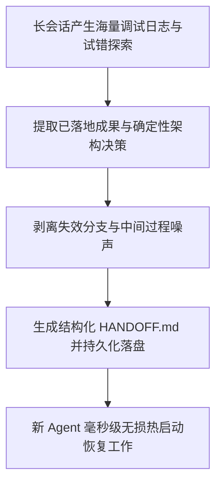

# 跨会话上下文无损压缩与交接协议 (Context Compaction & Handoff Protocol)

本文档定义在长对话超出上下文窗口、切换 Agent 实例或跨研发阶段时，进行核心记忆深度提炼、噪声剥离与无损交接棒构建的标准协议。

---

## 目录 (Table of Contents)

- [1. 上下文衰减危机与交接核心目标](#1-上下文衰减危机与交接核心目标)
- [2. 四象限信息无损提炼模型](#2-四象限信息无损提炼模型)
- [3. 冗余噪声剥离与信息压缩准则](#3-冗余噪声剥离与信息压缩准则)
- [4. 断点恢复与自解释唤醒指令设计](#4-断点恢复与自解释唤醒指令设计)
- [5. 状态持久化与落盘位置规范](#5-状态持久化与落盘位置规范)

---

## 1. 上下文衰减危机与交接核心目标

随着对话轮次增加，大语言模型的长上下文面临注意力稀释（Needle In A Haystack 衰减）、计算开销剧增与幻觉扩散风险。



### 1.1 触发交接的关键时机
1. **上下文窗口阈值预警**：当前会话 Token 消耗接近模型上下文窗口的 70% 时；
2. **生命周期阶段跃迁**：从需求探讨/架构设计阶段正式进入代码实现阶段时；
3. **关键任务接力交付**：负责前置探针/预研的 Agent 向负责主线工程实现的 Agent 移交工作。

---

## 2. 四象限信息无损提炼模型

交接内容必须严格结构化为四个核心信息象限：

```mermaid
quadrantChart
    title 交接信息四象限模型
    x-axis 低时效性 (事实资产) --> 高时效性 (当前断点)
    y-axis 过程细节 --> 战略决策
    "已落地成果与制品": [0.25, 0.25]
    "架构决策与排他共识": [0.25, 0.75]
    "当前断点与工作树状态": [0.75, 0.25]
    "未完待办与下一跳指令": [0.75, 0.75]
```

### 2.1 象限要素解析
- **Q1 已落地成果 (Done)**：明确列出已落盘的绝对路径文件、已提交的 Commit 哈希与通过的测试指标；
- **Q2 架构决策与排他共识 (Decisions)**：记录已选定的方案及**为何否决其他备选方案**，防止下一任 Agent 倒退重试；
- **Q3 当前断点 (In-Progress)**：精确描述正在修改的代码行号、当前工作树 Dirty 状态与临时环境变量；
- **Q4 下一跳指令 (Next Steps)**：明确下一步的第一项具体任务，消除冷启动推理迟疑。

---

## 3. 冗余噪声剥离与信息压缩准则

### 3.1 必须剔除的噪声项
- **过程性试错日志**：排错过程中打印的大段中间异常堆栈与终端临时输出；
- **已被否决的废案细节**：早先讨论过但被架构师否决的代码草稿；
- **礼节性客套话**：对话中的寒暄、重复提问与冗余解释。

### 3.2 必须保留的高价值原子
- 确切的数据结构定义、接口契约路径、重要环境变量名称与版本依赖；
- 难以直观从源码推导出的隐性业务约束与特殊边界逻辑。

---

## 4. 断点恢复与自解释唤醒指令设计

交接文档必须在末尾附带一段可供人类或自动化管道一键复制发送给下一会话的“**唤醒提示词 (Wake-up Prompt)**”：
- **自解释性**：即使下一任 Agent 没有任何历史上下文，仅凭该提示词与交接文档即可完全理解全局；
- **防发散约束**：显式声明继承全局工程规约（如盘古之白排版、Git 两级授权、微内核行数红线）。

---

## 5. 状态持久化与落盘位置规范

- 统一将交接文件落盘于特性工件目录 `.specs/<feature-slug>/HANDOFF.md`（或受管 Artifact 目录），并在项目 `.gitignore` 中声明忽略 `**/HANDOFF.md`，防范瞬态交接文档污染主干代码库；
- 严禁将包含真实机密（数据库密码、Token）写入交接文档，凭据一律使用环境变量占位符。
