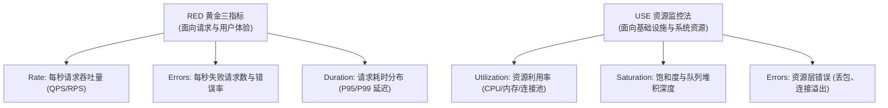

# 生产级指标、日志与可观测性标准协议 (Metrics, Logging & Observability Protocol)

本文档定义企业级微服务与分布式系统在指标度量（Metrics）、结构化日志（Logging）、全链路追踪（Tracing）与健康探针（Health Probes）四位一体的可观测性设计规范与工程防腐标准。

---

## 目录 (Table of Contents)

- [1. 可观测性核心模型与 RED/USE 范式](#1-可观测性核心模型与-reduse-范式)
- [2. Prometheus 指标命名与基数治理规范](#2-prometheus-指标命名与基数治理规范)
- [3. 结构化日志分级与上下文传递规范](#3-结构化日志分级与上下文传递规范)
- [4. 分布式链路追踪与 W3C 上下文透传](#4-分布式链路追踪与-w3c-上下文透传)
- [5. 容器健康检查深浅探针契约](#5-容器健康检查深浅探针契约)

---

## 1. 可观测性核心模型与 RED/USE 范式

系统监控必须聚焦于量化用户体验与资源瓶颈，杜绝无意义的指标泛滥。



### 1.1 服务端 SLA 分级判定基线
1. **P99 响应耗时**：核心交易与同步查询接口 P99 延迟应控制在 200ms 以内；
2. **错误率熔断红线**：服务 5xx 错误率突增超过 1% 持续 1 分钟，必须触发 P1 级告警；
3. **饱和度水位预警**：数据库连接池或工作线程池使用率达到 80% 触发饱和度预警。

---

## 2. Prometheus 指标命名与基数治理规范

### 2.1 指标命名规范 (Naming Conventions)
- **命名结构**：统一使用 Snake_case 风格，遵循 `<namespace>_<subsystem>_<name>_<unit>` 模式；
  - 示例：`http_server_requests_seconds`、`order_payment_transactions_total`；
- **类型匹配**：
  - **Counter（计数器）**：单调递增指标，必须以 `_total` 结尾；
  - **Gauge（仪表盘）**：可增可减的瞬时状态值（如当前内存占用、并发连接数）；
  - **Histogram（直方图）**：度量耗时分布，必须以对应时间单位（如 `_seconds`）结尾。

### 2.2 标签低基数防爆红线 (Cardinality Defense)
- **严禁使用高基数标签**：绝对禁止将用户 ID（`user_id`）、订单号（`order_id`）、UUID、手机号或完整 URL 查询参数作为 Prometheus Label，防止时序库内存撑爆（OOM）；
- **收敛 Label 取值**：标签仅用于业务状态（`status`）、调用方法（`method`）、服务名（`service`）等有限枚举集合（通常每个维度基数 < 50）。

---

## 3. 结构化日志分级与上下文传递规范

### 3.1 JSON 结构化日志标准输出
所有日志统一输出为纯 JSON 字符串至标准输出（Stdout），字段必须包含核心上下文元数据：

```json
{
  "timestamp": "2026-10-12T21:10:00.123+08:00",
  "level": "INFO",
  "service": "order-service",
  "trace_id": "4bf92f3577b34da6a3ce929d0e0e4736",
  "span_id": "00f067aa0ba902b7",
  "logger": "c.a.order.service.PaymentService",
  "thread": "http-nio-8080-exec-1",
  "message": "用户完成支付操作",
  "order_id": "ORD_20261012_001",
  "amount_cents": 12800,
  "elapsed_ms": 42
}
```

### 3.2 严格日志分级规范 (Logging Levels)
- **ERROR**：系统运行异常且无法自我恢复，需要人工介入（如数据库连接断开、外部核心依赖熔断）；
- **WARN**：存在潜在风险但已被兜底处理（如触发降级缓存、重试成功、配置缺失采用默认值）；
- **INFO**：关键业务主干节点与状态迁移记录（如订单创建、支付成功、批量任务开始/结束）；
- **DEBUG**：本地与测试环境详细调试信息，生产环境默认禁止开启。

### 3.3 敏感信息自动脱敏
- 绝对禁止在日志中打印未脱敏的用户密码、银行卡号、身份证号、JWT 鉴权凭证及私钥明文。

---

## 4. 分布式链路追踪与 W3C 上下文透传

### 4.1 W3C Trace Context 兼容基线
- 跨进程与跨网络 RPC 调用统一采用标准 HTTP Header 传递跟踪上下文：
  - `traceparent`: `00-4bf92f3577b34da6a3ce929d0e0e4736-00f067aa0ba902b7-01`；
  - `tracestate`: 承载供应商特定路由状态；
- 所有同步 HTTP、gRPC 与异步消息队列（Kafka/RocketMQ）必须实现上下文透明透传。

### 4.2 Span 边界与慢调用判定
- 数据库 SQL 查询、外部 HTTP 依赖、Redis 访问必须显式创建子 Span；
- 单个 Span 耗时超过 100ms 时自动标记为慢调用，并记录对应参数摘要。

---

## 5. 容器健康检查深浅探针契约

### 5.1 存活探针 (Liveness Probe - `/healthz/live`)
- **定位**：判断服务主进程是否存活，用于 Kubernetes 决定是否重启容器；
- **实现红线**：必须执行轻量极速内存自检，**严禁在 Liveness 探针中检测数据库、缓存或外部服务连接**，防止外部故障引发级联雪崩重启。

### 5.2 就绪探针 (Readiness Probe - `/healthz/ready`)
- **定位**：判断服务是否具备承载流量的能力，用于负载均衡器路由分配；
- **实现准则**：检测核心持久化连接池是否建立、本地缓存预热是否完成，未就绪时返回 HTTP 503 移出流量。
