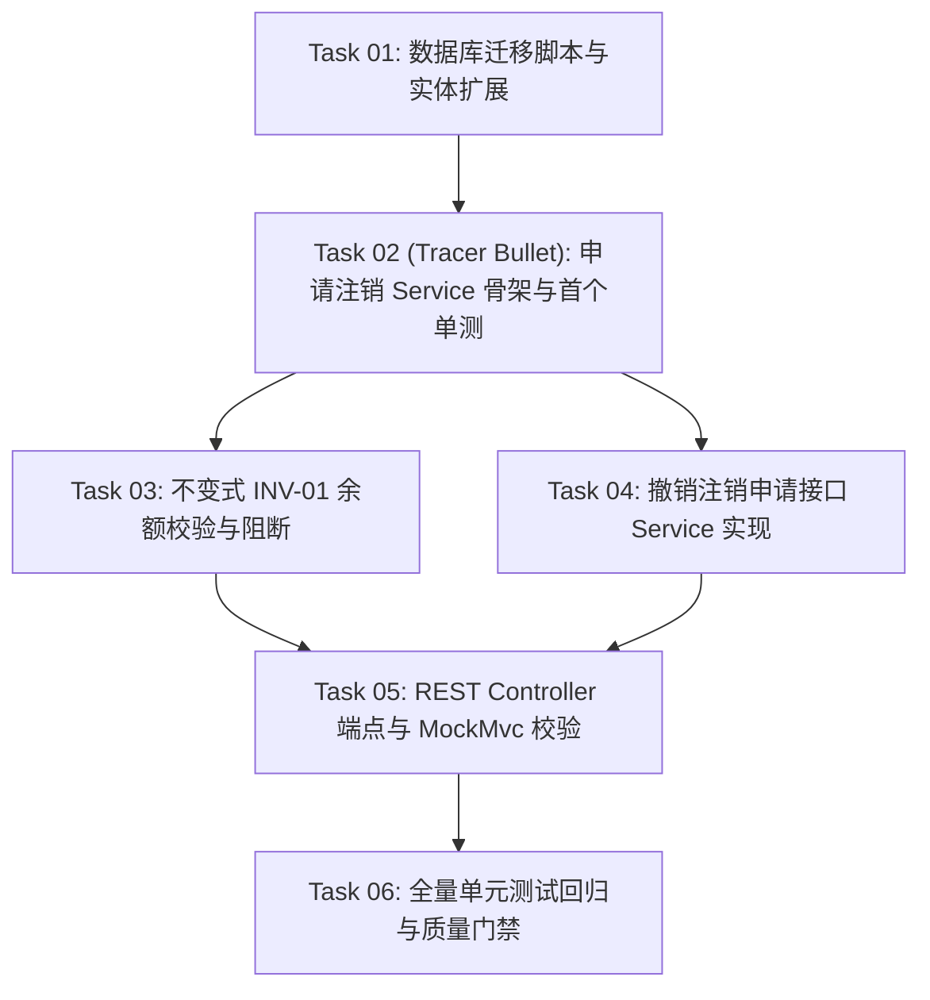

# 任务拆解实战样例：注销冷静期开发计划 (Sample Plan Tasks)

本文档呈现了基于 `sample-delta-spec.md` 编译出的标准化 2~5 分钟极小颗粒度微任务清单。

---

# 实施任务清单：用户注销 7 天冷静期机制 (Implementation Tasks)

> **关联契约**：[sample-delta-spec.md](./sample-delta-spec.md)
> **基线环境**：Java 17 / Spring Boot 3.3 / Maven / JUnit 5
> **总任务数**：6 个原子微任务（单任务耗时 2~5 分钟）
> **生成时间**：2026-10-12

---

## 1. 关键路径拓扑图 (Dependency Graph)

---

## 2. 原子任务清单 (Tasks)

### Phase 1：持久层与数据模型 (Persistence)

- [ ] **Task 01** - **增加冷静期状态枚举与数据库字段**
  - **前置依赖**：无
  - **涉及文件**：
    - 新建：`src/main/resources/db/migration/V2.4.1__add_cooling_off.sql`
    - 修改：`src/main/java/com/example/user/entity/UserAccount.java`
    - 修改：`src/main/java/com/example/user/enums/AccountStatus.java`
  - **核心动作**：
    1. SQL 中追加 `cooling_deadline DATETIME NULL`；
    2. 枚举中追加 `CANCEL_COOLING_OFF("注销冷静期")`；
    3. 实体类中补齐对应字段与 Getter/Setter。
  - **验证命令**：`mvn compile -DskipTests`

---

### Phase 2：核心业务与示踪线贯通 (Domain & Tracer Bullet)

- [ ] **Task 02 (Tracer Bullet)** - **申请注销主流程红灯单测与 Service 最小实现**
  - **前置依赖**：`Task 01`
  - **涉及文件**：
    - 新建：`src/test/java/com/example/user/service/UserCancellationServiceTest.java`
    - 新建：`src/main/java/com/example/user/service/UserCancellationService.java`
    - 新建：`src/main/java/com/example/user/service/impl/UserCancellationServiceImpl.java`
  - **核心动作**：
    1. 编写单测 `testApplyCancellation_Normal_ShouldEnterCoolingOff`（验证写入截止时间并修改状态）；
    2. 实现 `applyCancellation(Long userId)` 最小业务代码使其通过测试。
  - **验证命令**：`mvn test -Dtest=UserCancellationServiceTest#testApplyCancellation_Normal_ShouldEnterCoolingOff`

- [ ] **Task 03** - **实现不变式 INV-01 余额大于零时阻断注销**
  - **前置依赖**：`Task 02`
  - **涉及文件**：
    - 修改：`src/test/java/com/example/user/service/UserCancellationServiceTest.java`
    - 修改：`src/main/java/com/example/user/service/impl/UserCancellationServiceImpl.java`
  - **核心动作**：
    1. 编写单测 `testApplyCancellation_WithBalance_ShouldThrowBusinessException`；
    2. 在 Service 中前置查询用户资产，若 `balance > 0` 抛出 `BusinessException("422", "账户存在未结余额")`。
  - **验证命令**：`mvn test -Dtest=UserCancellationServiceTest`

- [ ] **Task 04** - **实现 SPEC-ADD-01 自助撤销注销功能**
  - **前置依赖**：`Task 02`
  - **涉及文件**：
    - 修改：`src/test/java/com/example/user/service/UserCancellationServiceTest.java`
    - 修改：`src/main/java/com/example/user/service/impl/UserCancellationServiceImpl.java`
  - **核心动作**：
    1. 编写单测 `testCancelCancellation_WhenInCoolingOff_ShouldReactivate`；
    2. 校验当前状态为冷静期，重置状态为 `ACTIVE` 并清空 `cooling_deadline`。
  - **验证命令**：`mvn test -Dtest=UserCancellationServiceTest`

---

### Phase 3：接入端点与回归核验 (API & Delivery Gate)

- [ ] **Task 05** - **暴露 REST API 路由与参数校验切面**
  - **前置依赖**：`Task 03`, `Task 04`
  - **涉及文件**：
    - 新建：`src/test/java/com/example/user/controller/UserCancellationControllerTest.java`
    - 修改：`src/main/java/com/example/user/controller/UserController.java`
  - **核心动作**：
    1. 编写 Controller MockMvc 单元测试；
    2. 在 Controller 中暴露 `POST /api/v1/users/apply-cancellation` 与 `POST /api/v1/users/cancel-cancellation`。
  - **验证命令**：`mvn test -Dtest=UserCancellationControllerTest`

- [ ] **Task 06** - **全模块测试回归与零绝对路径门禁**
  - **前置依赖**：`Task 01 ~ Task 05`
  - **涉及文件**：工程全量源码与文档
  - **核心动作**：
    1. 运行工程全量测试套件；
    2. 核验提交前无临时测试打印与未防护绝对路径。
  - **验证命令**：`mvn clean test && python scripts/validate.py`
