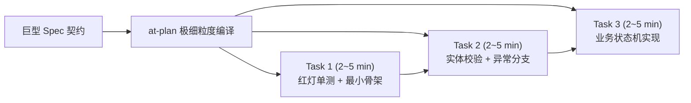

# 任务依赖图谱与工序拆解协议 (Dependency Graph Protocol)

本文档规范了 `at-plan` 技能在将规格契约（Spec）编译为落地实施计划时的拆解粒度、依赖拓扑判定与示踪线优先纪律。

---

## 目录 (Table of Contents)
- [1. 核心理论：2~5 分钟原子微任务法则](#1-核心理论25-分钟原子微任务法则)
- [2. 示踪线 (Tracer Bullet) 优先纪律](#2-示踪线-tracer-bullet-优先纪律)
- [3. DAG 拓扑依赖与阻塞边判定](#3-dag-拓扑依赖与阻塞边判定)
- [4. 微任务四要素完备性门禁](#4-微任务四要素完备性门禁)
- [5. 状态推进与跨会话断点续做机制](#5-状态推进与跨会话断点续做机制)

---

## 1. 核心理论：2~5 分钟原子微任务法则

大模型在处理超过单次注意力窗口的大任务时，极易发生“意图漂移”与“写漏细节”。因此 `at-plan` 强制执行极细粒度拆解：
- **单任务执行窗口**：一个人类资深工程师或 Agent 在 2~5 分钟内可单次专注完成的规模；
- **单点触达原则**：一个微任务通常只涉及 1~2 个直接关联的文件（如“一个测试文件 + 一个被测类”）；
- **独立可验证性**：每个任务完成后必须有一条确定性的系统命令可以立即验证其正确性（如单个测试方法执行或工程编译）。

---

## 2. 示踪线 (Tracer Bullet) 优先纪律

严禁采用传统的“全量横切分层”拆解方式（即一口气写完所有数据库表，再写完所有 DAO，最后写 Service，导致最后一刻才发现架构死锁）：
- **示踪线定义**：选取核心业务主路径（Happy Path），用最小代价从数据层直穿到 API 层；
- **尽早见光**：在 Plan 的第 3~4 个任务就完成示踪线的端到端红绿灯测试验证，确保上下文、框架注解与容器能真实跑通；
- **分支辐射**：在示踪线跑通后，再并行或顺延拆解异常分支、边缘情况（Edge Cases）与性能缓存。

---

## 3. DAG 拓扑依赖与阻塞边判定

任务编排必须形式化构建为**有向无环图 (Directed Acyclic Graph, DAG)**：
1. **入度为 0 的任务**：前置依赖为空的任务，属于项目起点（通常为契约类型定义或测试脚手架搭设）；
2. **阻塞边声明 (Blocked By)**：任务 $B$ 必须在任务 $A$ 验证成功后才能开工，则必须在任务卡片显式标注 `前置依赖：Task A`；
3. **关键路径识别**：计算从起点到终点的最长依赖链，此路径上的任务不可有任何拖延或跳步。

---

## 4. 微任务四要素完备性门禁

每一个被拆解出的微任务，必须严格具备以下**四要素**，任一要素缺失直接判定为 Plan 不合格：

| 要素 | 规范约束 | 反模式示例 |
| :--- | :--- | :--- |
| **1. 显式前置依赖** | 必须标明具体 Task 编号或明确为“无” | 模糊写“需要等前面做完” |
| **2. 精确相对路径** | 必须写明具体的文件名与包路径，不得使用统配符 | 模糊写“修改 Controller 模块” |
| **3. 核心代码动作** | 简明陈述改动的类名、方法名、增加的字段或异常拦截 | 模糊写“实现业务逻辑” |
| **4. 确定性自检命令** | 必须是一条可以直接在终端复制执行的真实命令 | 模糊写“人工在浏览器测试一下” |

---

## 5. 状态推进与跨会话断点续做机制

1. **统一复选框标记**：未开始为 `- [ ]`，已完成必须更新为 `- [x]`；
2. **单任务完成即打卡**：每完成一个微任务并通过其验证命令后，立即回写 `tasks.md` 更新复选框；
3. **断点恢复能力**：新会话或子代理接手时，通过扫描首个 `- [ ]` 节点，即可毫秒级锁定当前开工锚点，无缝续跑。
