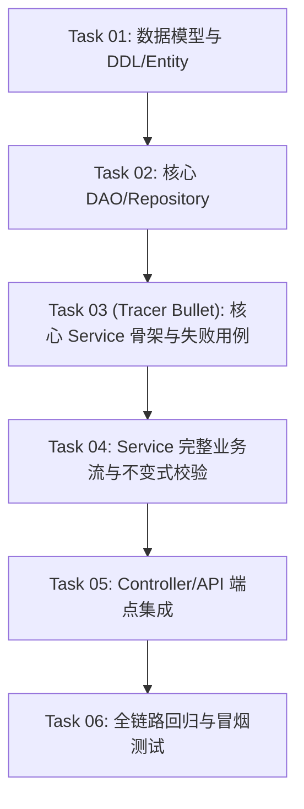

# 极小颗粒度原子微任务清单模板 (Tasks Template)

本文档定义了 `at-plan` 技能生成的开发实施任务清单（统一落盘为 `.specs/<feature-slug>/tasks.md`，严禁在工程根目录平铺）标准结构。

---

## 目录 (Table of Contents)
- [1. 任务清单元数据头 (Header)](#1-任务清单元数据头-header)
- [2. 关键路径拓扑图 (Dependency Graph)](#2-关键路径拓扑图-dependency-graph)
- [3. 原子任务卡片集合 (Atomic Tasks)](#3-原子任务卡片集合-atomic-tasks)
- [4. 端到端完工总验收标准 (DoD Checklist)](#4-端到端完工总验收标准-dod-checklist)

---

## 1. 任务清单元数据头 (Header)

```markdown
# 实施任务清单：{特性简明标题} (Implementation Tasks)

> **关联契约**：[delta.md](./delta.md)
> **基线环境**：{开发环境技术栈与测试工具}
> **总任务数**：{N} 个原子微任务（单任务耗时估算 2~5 分钟）
> **生成时间**：{YYYY-MM-DD}
```

---

## 2. 关键路径拓扑图 (Dependency Graph)

采用 Mermaid 描述任务之间的先序阻塞关系与示踪线（Tracer Bullet）路径：



---

## 3. 原子任务卡片集合 (Atomic Tasks)

每一个任务必须自包含：**绝对精确的相对路径**、**具体代码意图**、**测试与验证命令**。

### Phase 1：骨架与基础设施 (Skeleton & Persistence)

- [ ] **Task 01** - **{任务简短标题}**
  - **前置依赖**：无
  - **涉及文件**：
    - 新建：`src/main/java/com/example/model/entity/AccountCoolingEntity.java`
    - 修改：`src/main/resources/db/migration/V2.5.0__add_cooling.sql`
  - **核心动作**：定义冷静期状态字段与截止时间字段，补齐 JPA/MyBatis 实体注解。
  - **验证命令**：`mvn compile -DskipTests`（确保模型编译无报错）

- [ ] **Task 02** - **{任务简短标题}**
  - **前置依赖**：`Task 01`
  - **涉及文件**：
    - 新建：`src/main/java/com/example/repository/AccountCoolingRepository.java`
  - **核心动作**：声明根据 `userId` 查询未过期冷静期记录的方法。
  - **验证命令**：`mvn test -Dtest=AccountCoolingRepositoryTest`

---

### Phase 2：核心领域与断言实现 (Domain & TDD Cycle)

- [ ] **Task 03 (Tracer Bullet)** - **{任务简短标题}**
  - **前置依赖**：`Task 02`
  - **涉及文件**：
    - 新建：`src/test/java/com/example/service/AccountCoolingServiceTest.java`
    - 新建：`src/main/java/com/example/service/AccountCoolingService.java`
  - **核心动作**：
    1. 编写首个断言注销进入冷静期的红灯单测用例；
    2. 实现 Service 最小空方法使其完成红灯向绿灯迁移。
  - **验证命令**：`mvn test -Dtest=AccountCoolingServiceTest#testApplyCoolingOff_Success`

- [ ] **Task 04** - **{任务简短标题}**
  - **前置依赖**：`Task 03`
  - **涉及文件**：
    - 修改：`src/main/java/com/example/service/impl/AccountCoolingServiceImpl.java`
  - **核心动作**：实现余额未清零阻断逻辑（不变式 INV-01）与重复申请幂等防护（ERR-COOL-01）。
  - **验证命令**：`mvn test -Dtest=AccountCoolingServiceTest`

---

### Phase 3：接入端点与回归质检 (API & Gate Verification)

- [ ] **Task 05** - **{任务简短标题}**
  - **前置依赖**：`Task 04`
  - **涉及文件**：
    - 修改：`src/main/java/com/example/controller/UserController.java`
    - 新建：`src/test/java/com/example/controller/UserControllerTest.java`
  - **核心动作**：暴露 REST 端点，校验入参，注入异常处理切面。
  - **验证命令**：`mvn test -Dtest=UserControllerTest`

- [ ] **Task 06** - **全量自动化质量门禁与死链自检**
  - **前置依赖**：`Task 01 ~ Task 05`
  - **核心动作**：执行全套单元测试与项目质量门禁。
  - **验证命令**：`mvn test && python scripts/validate.py`

---

## 4. 端到端完工总验收标准 (DoD Checklist)

- [ ] 所有 Task 复选框全部勾选为 `[x]`；
- [ ] 全套单元测试与集成测试 100% 绿灯通过；
- [ ] 无任何裸打印 `System.out.println` 或临时 Mock 代码；
- [ ] 零本地绝对路径与物理盘符泄漏。
