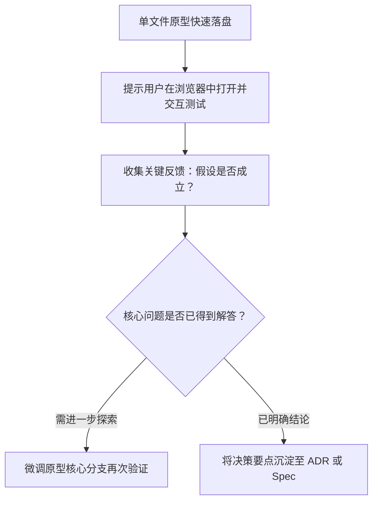

# 抛弃型原型验证协议与边界规约 (Throwaway Prototype Protocol)

本协议规范了在软件研发前期探索与模糊决策阶段，构建低成本抛弃型原型（Throwaway Prototype）的核心原则、执行边界与生命周期。通过快速探针，用最小成本验证设计假设，消除架构与交互的不确定性。

---

## 目录 (Table of Contents)

- [1. 抛弃型原型核心哲学与不变量](#1-抛弃型原型核心哲学与不变量)
- [2. 假设聚焦与范围裁剪法则](#2-假设聚焦与范围裁剪法则)
- [3. 单文件自闭环技术规范](#3-单文件自闭环技术规范)
- [4. 人机交互验证与决策闭环](#4-人机交互验证与决策闭环)
- [5. 严禁生产污染与归档回收红线](#5-严禁生产污染与归档回收红线)

---

## 1. 抛弃型原型核心哲学与不变量

原型（Prototype）的唯一使命是**回答特定的设计问题或技术假设**，而非交付持久化资产：

- **抛弃型不变量 (Throwaway Invariant)**：原型代码天然不具备生产级健壮性、测试覆盖率与防御性，**严禁直接复制或合并入生产代码库**；
- **最小可行探针 (Minimal Probe)**：只编写证明或证伪假设所需的绝对最小代码；
- **零构建零依赖 (Zero-Build Zero-Dependency)**：避免引入打包工具链、复杂配置与脚手架，开箱即用。

---

## 2. 假设聚焦与范围裁剪法则

在动笔编写原型之前，必须明确“要回答的核心问题”：

### 2.1 聚焦核心假设 (Core Hypothesis)
- **状态流转假设**：如“多步骤向导的表单数据在回退、校验失败与异步拉取时的状态机是否顺畅？”
- **算法/数据模型假设**：如“该树形节点的折叠与级联选中算法在大数据量下的交互逻辑是否清晰？”
- **API 体验假设**：如“调用方使用该 SDK 链式调用时的 API 易用性是否符合直觉？”

### 2.2 激进范围裁剪 (Radical Scope Trimming)
- **剔除持久化**：使用内存变量或 `localStorage` 代替真实数据库交互；
- **剔除鉴权体系**：硬编码模拟登录用户与权限上下文；
- **剔除全面防御**：仅做能支撑核心路径的极简校验，免除复杂的全量异常处理；
- **模拟外部服务**：对外部网络请求统一使用 `setTimeout` 配合 Mock 静态数据。

---

## 3. 单文件自闭环技术规范

Web 交互类原型一律采用**单文件自闭环 (Self-contained Single HTML)**：

1. **单文件集成**：所有 HTML 结构、CSS 样式（或轻量 CDN/系统默认原生样式）与 JavaScript 交互逻辑收敛于单一 `.html` 文件中；
2. **零安装双击运行**：任何开发者或利益相关者在浏览器中双击文件即可直接交互，无需 `npm install`、`pnpm dev` 等构建前置；
3. **状态可视化面板**：原型界面右侧或底部应内嵌一个半透明的“实时状态监视器 (State Inspector)”，实时打印当前状态机的值与数据快照，方便验证。

---

## 4. 人机交互验证与决策闭环

原型生成后，执行三步决策验证闭环：

1. **落盘至隔离路径**：统一写入 `.gemini/`、系统临时目录或指定的探针隔离路径，杜绝混入源码目录；
2. **直击决策结论**：根据原型实测结果，回答“方案 A 还是方案 B 更可行”；
3. **知识沉淀反哺**：将验证成立的架构结论反哺至 `at-spec` 规格说明或 `at-adr` 架构决策记录中。

---

## 5. 严禁生产污染与归档回收红线

- **严禁直接转正**：即使原型表现完美，正式生产实现也必须从第一行测试开始遵循 `at-tdd` 或严密工程架构全新编写；
- **源码树零污染**：严禁在生产模块源码目录（如 `src/`）下创建或遗留原型文件；
- **显式标记与清理**：所有原型文件顶部必须显式包含注释警告：`<!-- PROTOTYPE: THROWAWAY EXPERIMENTAL ONLY, DO NOT USE IN PRODUCTION -->`。
