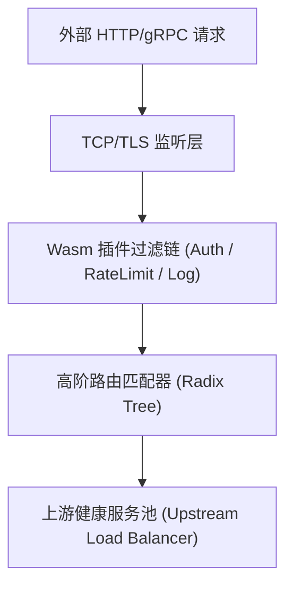

# 工业级项目 README 完整实战案例 (Sample Project README)

本案例展示了一个名为 `cloud-mesh` 的高性能分布式微服务网关项目的真实 `README.md`。

---

## 完整范例文档

```markdown
# CloudMesh

<p align="center">
  <strong>基于 Rust 打造的超低延时、云原生 API 微服务网关</strong>
  <br />
  High-performance, ultra-low latency cloud-native API gateway built with Rust.
</p>

<p align="center">
  <a href="https://github.com/example/cloud-mesh/actions"></a>
  <a href="https://crates.io/crates/cloud-mesh"></a>
  <a href="LICENSE"></a>
</p>

---

## 📖 项目简介

CloudMesh 是面向现代微服务集群设计的高吞吐、内存安全型 API 网关。采用异步事件驱动架构，在单机 100,000 QPS 并发流量下维持 P99 延时小于 1.5 毫秒。

### 🌟 核心特性

- **⚡ 极限性能**：Rust 零成本抽象，内存零拷贝（Zero-Copy）网络转发；
- **🛡️ 动态安全防护**：内置分布式滑动窗口限流、WAF 防注入与 JWT 验签中间件；
- **🧩 插件化生态**：支持基于 WebAssembly (Wasm) 的跨语言动态热插拔插件；
- **📊 全链路可观测**：原生输出 OpenTelemetry 格式分布式追踪、Prometheus 度量指标与结构化日志。

---

## 🏗️ 架构拓扑



---

## 🚀 快速开始

### 运行环境准备
- Rust 1.75+ (稳定版)
- Docker 24.0+ (可选)

### 源码编译与启动

```bash
# 1. 获取代码仓库
git clone https://github.com/example/cloud-mesh.git
cd cloud-mesh

# 2. 编译 Release 二进制文件
cargo build --release

# 3. 运行本地开发网关
./target/release/cloud-mesh --config configs/gateway.toml
```

---

## 📁 目录结构

```text
├── src/                  # 网关核心源码
│   ├── engine/           # 异步转发事件循环
│   ├── plugins/          # 内置安全与路由插件
│   └── main.rs           # 启动入口
├── configs/              # 官方基准配置文件
├── docs/                 # 架构设计与性能压测报告
├── tests/                # 集成测试与模糊测试 (Fuzzing)
└── Cargo.toml            # Rust 项目配置
```

---

## 🤝 参与贡献

我们欢迎社区的每一份贡献！在提交 PR 前，请参阅我们的 [贡献指南 (CONTRIBUTING.md)](CONTRIBUTING.md)。

---

## 📄 开源许可证

本项目基于 [Apache-2.0 许可证](LICENSE) 发布。
```
