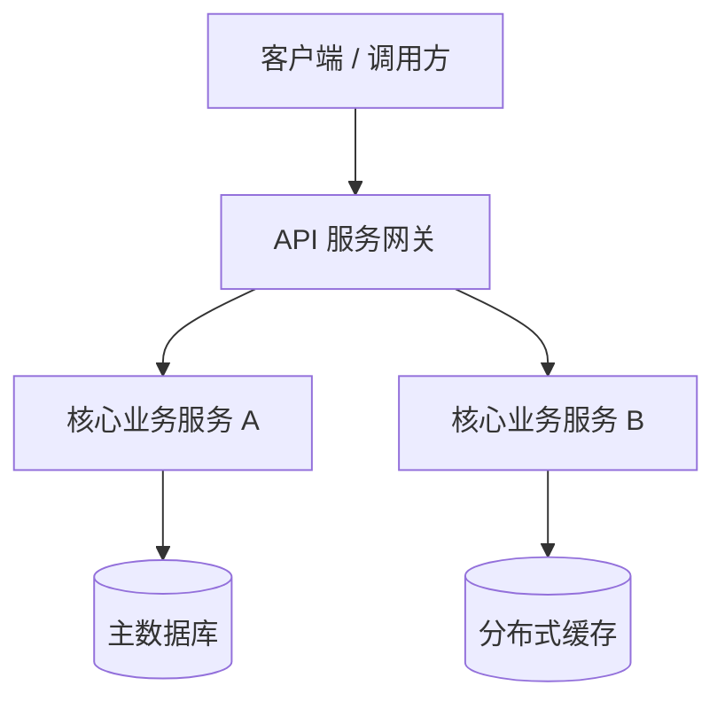

# 工业级项目门户 README 标准模板 (README Standard Template)

本模板提供了一个符合国际开源规范与顶级工程实践的标准项目根目录 `README.md` 骨架。

---

## 模板正文

```markdown
# <!-- PROJECT_NAME -->

<p align="center">
  <strong><!-- PROJECT_TAGLINE_CHINESE --></strong>
  <br />
  <!-- PROJECT_TAGLINE_ENGLISH -->
</p>

<p align="center">
  <a href="https://github.com/<!-- REPO -->/actions">/ci.yml?branch=main&style=flat-square" alt="CI Status" /></a>
  <a href="https://github.com/<!-- REPO -->/releases">?style=flat-square" alt="Latest Release" /></a>
  <a href="LICENSE"></a>
  <a href="https://github.com/<!-- REPO -->/stargazers">?style=flat-square" alt="GitHub Stars" /></a>
</p>

---

## 📖 简介 (Introduction)

<!-- PROJECT_LONG_DESCRIPTION -->

### 🌟 核心特性 (Key Features)

- **⚡ 特性 1**：核心特性一的简短说明，强调业务价值与效率提升；
- **🛡️ 特性 2**：核心特性二的简短说明，强调安全性与健壮性；
- **🧩 特性 3**：核心特性三的简短说明，强调高扩展性与模块化解耦；
- **📊 特性 4**：核心特性四的简短说明，强调监控与可观测性。

---

## 🏗️ 架构拓扑 (Architecture)



---

## 🚀 快速开始 (Quick Start)

### 前置环境 (Prerequisites)

- Node.js >= 18.0.0 / Java >= 17 / Python >= 3.10
- Git 2.30+

### 一键安装与启动 (Installation)

```bash
# 1. 克隆代码仓库
git clone https://github.com/<!-- REPO -->.git
cd <!-- REPO_DIR -->

# 2. 安装项目依赖
npm install # 或 pnpm install / mvn clean install

# 3. 复制本地环境配置
cp .env.example .env.local

# 4. 启动本地开发服务
npm run dev
```

---

## 📁 目录结构 (Directory Layout)

```text
├── src/                  # 核心源代码目录
├── tests/                # 单元测试与端到端测试套件
├── docs/                 # 项目架构与设计文档
├── scripts/              # 自动化构建与质量门禁脚本
├── .github/workflows/    # CI/CD 自动化流水线
├── README.md             # 项目核心门面
└── LICENSE               # 开源许可证
```

---

## ⚙️ 核心配置说明 (Configuration)

| 配置变量名 | 说明 | 默认值 | 是否必填 |
| :--- | :--- | :---: | :---: |
| `SERVER_PORT` | 服务启动监听端口 | `8080` | 否 |
| `DATABASE_URL` | 数据库连接字符串 | `${DATABASE_URL}` | 是 |
| `LOG_LEVEL` | 日志输出级别 (`DEBUG`/`INFO`/`WARN`) | `INFO` | 否 |

---

## 🤝 参与贡献 (Contributing)

欢迎任何形式的贡献！请在提交 Pull Request 前阅读我们的 [贡献指南 (CONTRIBUTING.md)](CONTRIBUTING.md)。

---

## 📄 开源许可证 (License)

本项目采用 [Apache-2.0 许可证](LICENSE) 开源。
```
