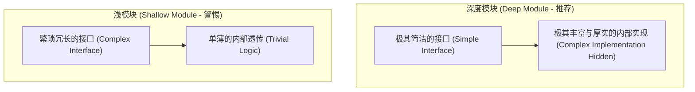

# 深度模块架构演进与微重构协议 (Deep Module Design & Refactor Protocol)

本文档规范了 `at-refactor` 技能在系统模块演进、架构异味治理、接口深浅度权衡以及安全受控重构方面的核心设计准则与执行协议。

---

## 目录 (Table of Contents)
- [1. 核心哲学：深模块与高信息隐藏](#1-核心哲学深模块与高信息隐藏)
- [2. 浅接口与深实现：对抗认知负荷](#2-浅接口与深实现对抗认知负荷)
- [3. 警惕形式主义与过度碎片化陷阱](#3-警惕形式主义与过度碎片化陷阱)
- [4. 双安全网微步进重构协议](#4-双安全网微步进重构协议)
- [5. 存量大文件增量外拆的最小爆炸半径原则](#5-存量大文件增量外拆的最小爆炸半径原则)

---

## 1. 核心哲学：深模块与高信息隐藏

源自 John Ousterhout 教授《软件设计的哲学》(A Philosophy of Software Design) 理念：
- **最好的模块是“深模块 (Deep Module)”**：提供极其简洁清晰的对外接口，但在内部封装并隐藏了极其庞大而复杂的业务处理与技术细节；
- **最差的模块是“浅模块 (Shallow Module)”**：接口极其复杂繁重，但内部逻辑却只有几行透传或浅显处理（接口带来的心智负担甚至超过了其实现的价值）；
- **信息隐藏 (Information Hiding)**：每一个模块都应当把一到两项关键设计决策（如并发同步机制、底层存储数据结构、特定协议编解码）彻底隐藏在模块内部，不让调用方感知。

---

## 2. 浅接口与深实现：对抗认知负荷

设计深度模块的核心目标是降低整个系统调用方的认知负荷（Cognitive Load）：
1. **接口通用性与专业性的平衡**：优秀的深模块接口倾向于通用且有力（Somewhat General-Purpose），隐藏专业复杂的内部细节；
2. **隐藏不可避免的复杂性**：如果一个复杂机制无法被消除，那就将它完整封装在深模块内部，绝不向外暴露或转嫁给调用者；
3. **消除接口泄漏 (Leakage of Implementation Details)**：严禁通过接口方法暴露内部异常、私有数据结构或内部执行状态。

---

## 3. 警惕形式主义与过度碎片化陷阱

重构不是为了盲目追求“每类不超过 50 行”的代码行数教条：
- **形式主义拆分的危害**：将语义强关联、逻辑紧密的私有小逻辑机械拆分为十几个微小文件，会导致“散弹式修改（Shotgun Surgery）”与跨文件上下文迷失，极度损害代码可读性与 AI 协同推理效率；
- **高内聚优先**：仅供当前模块内部使用的私有辅助类或小函数，应当在文件内部或包私有作用域闭环内聚；
- **拆分的正当理由**：唯有当承担了完全不同维度的独立职责、具备跨业务复用价值、或者模块复杂度已威胁到可维护性时，才应当拆分为独立深度模块。

---

## 4. 双安全网微步进重构协议

重构过程中严禁“盲人骑瞎马”，必须依托双安全网实施受控推进：

1. **第一道安全网：基线回归测试**：在开始重构前，必须确保既有测试套件 100% 绿灯；若缺失测试，必须前置补充特征测试（Characterization Tests）；
2. **第二道安全网：面向新接口的契约测试**：在新模块实现前，先基于新接口编写高覆盖单测；
3. **原子微步进原则 (Micro-steps)**：每一步只做一个细小动作（提取方法 -> 改变签名 -> 移动职责），每一步完成后立即运行测试，严禁大面积推倒重来。

---

## 5. 存量大文件增量外拆的最小爆炸半径原则

面对历史遗留数千行的“上帝类”或存量历史大文件：
- **严禁全量推倒重写**：禁止无显式授权的全量大重构，防止引发不可控的生产回归故障与 Git 冲突风暴；
- **绞杀者演进模式 (Strangler Fig Pattern)**：
  - 新增复杂业务逻辑必须独立新建为专用深度模块；
  - 在原历史大文件中保留极简的委托代理调用；
  - 既遏制存量文件继续恶性膨胀，又保持每一次 Git Diff 干净最小、安全可控。
