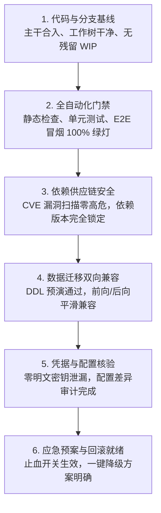

# 上线前起飞检查单协议 (Pre-Flight Launch Checklist Protocol)

本文档定义系统生产版本正式发布前的起飞检查（Pre-Flight）核验标准、依赖安全审计流程与回滚预案准入基线。

---

## 目录 (Table of Contents)

- [1. 起飞前六维核验矩阵](#1-起飞前六维核验矩阵)
- [2. 依赖安全性审计与脆弱性阻断](#2-依赖安全性审计与脆弱性阻断)
- [3. 数据库迁移与双向兼容性预演](#3-数据库迁移与双向兼容性预演)
- [4. 配置与环境机密安全合规](#4-配置与环境机密安全合规)
- [5. 应急回滚策略与灰度放量阶梯](#5-应急回滚策略与灰度放量阶梯)

---

## 1. 起飞前六维核验矩阵

在执行版本发布打标（Tagging）与镜像构建前，发布负责人必须逐项确认以下六维检查点：

### 1.1 核心检查清单表

- [ ] **分支与代码状态**：目标发布分支无冲突，所有相关 PR 已合入并经过 Peer Review；
- [ ] **自动化测试门禁**：CI 流水线全绿，代码覆盖率未出现回退（Regression）；
- [ ] **安全审计通过**：依赖检查与代码静态分析无 Critical/High 级漏洞；
- [ ] **数据变更安全**：数据库迁移脚本已在预发环境演练验证，且具备可执行的反向 Rollback 脚本；
- [ ] **配置与变量同步**：生产环境变量与 Secret 已在目标集群或密钥管理中心配置完毕；
- [ ] **监控与告警就绪**：核心业务看板活跃，值班负责人在线，应急响应通道畅通。

---

## 2. 依赖安全性审计与脆弱性阻断

### 2.1 供应链版本锁定
- 依赖描述文件必须包含确定性的锁定版本文件（如 `package-lock.json`、`poetry.lock`、`Cargo.lock`）；
- 严禁在生产构建中使用动态开放版本范围（如 `latest` 或宽泛通配符 `*`）。

### 2.2 漏洞门禁拦截红线
- 运行原生依赖审计命令（如 `npm audit --audit-level=high`）；
- 存在已知远程代码执行（RCE）、SQL 注入或权限绕过高危漏洞时，发布流程绝对熔断。

---

## 3. 数据库迁移与双向兼容性预演

### 3.1 扩展示例双向兼容原则 (Expand and Contract)
- 涉及数据表结构变更（如列重命名、列删除）时，必须分步执行：
  - 第一步（Expand）：新增字段，旧代码与新代码同时兼容写入；
  - 第二步（Contract）：待新版本全量平稳运行后，再异步清理旧字段；
- 禁止直接执行阻断性锁表 DDL（如 MySQL 亿级大表直接裸跑 `ALTER TABLE`）。

### 3.2 回滚演练验证
- 必须预先编写并验证对应的反向迁移脚本（Down Migration），确保回滚动作在 5 分钟内可执行完成。

---

## 4. 配置与环境机密安全合规

- 校验生产配置文件中绝对无开发测试环境的 Mock URL 或临时账号；
- 生产所有数据库密码、云平台 API Key、私钥等必须通过受管 Secret 机制注入；
- 检查是否存在新增配置项未在配置中心填报导致的启动崩溃。

---

## 5. 应急回滚策略与灰度放量阶梯

### 5.1 灰度放量节奏 (Canary Rollout)
- 建议采用金丝雀（Canary）渐进放量策略：
  - **10% 流量**：观察 15 分钟，验证核心 RED 指标与错误率；
  - **50% 流量**：观察 30 分钟，监控系统资源水位与连接池表现；
  - **100% 全量**：观察 1 小时，确认系统无隐蔽内存泄漏或慢调用堆积。

### 5.2 熔断止血与极速回滚条件
- 当灰度实例 5xx 错误率超过 0.5% 或 P99 延迟翻倍时，立即终止发布；
- 自动或一键回切至上一个稳定版本镜像与路由权重，止血耗时控制在 3 分钟内。
