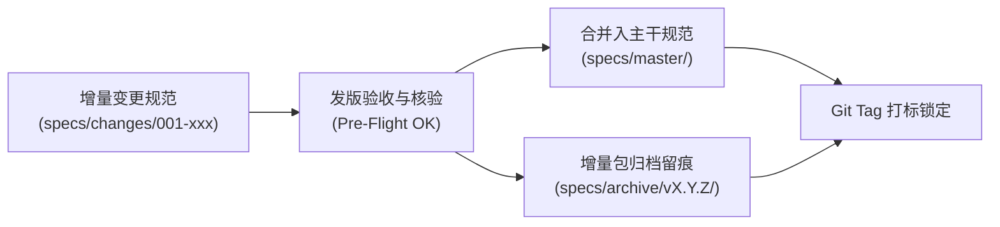

# 增量规范合并与归档协议 (Spec Archiving & SemVer Protocol)

本文档定义系统版本发布时增量规范（Delta Specs）向全局主干规范（Master Specs）合并、归档留痕与语义化版本号（SemVer）晋升操作标准。

---

## 目录 (Table of Contents)

- [1. 规范生命周期与增量演进模型](#1-规范生命周期与增量演进模型)
- [2. 增量规范向主干规范合并流程](#2-增量规范向主干规范合并流程)
- [3. 历史变更归档留痕目录结构](#3-历史变更归档留痕目录结构)
- [4. SemVer 语义化版本号判定规则](#4-semver-语义化版本号判定规则)
- [5. Git 附注标签打标与发布锁定](#5-git-附注标签打标与发布锁定)

---

## 1. 规范生命周期与增量演进模型

在规范驱动开发（Spec-Driven Development）中，新特性的开发依托局部增量规范，发版时必须完成向系统全局规格书的汇流与归档：



---

## 2. 增量规范向主干规范合并流程

### 2.1 主干规范更新 (Master Specs Merging)
1. **API 契约合并**：将增量规范中新引入的 API 端点、请求/响应结构体合入 `specs/master/api-spec.md` 或 OpenAPI 文件；
2. **数据模型更新**：将数据表 Schema 新增字段或关系合入 `specs/master/data-model.md`；
3. **架构拓扑维护**：将新组件或微服务节点合入系统全局架构图。

### 2.2 冲突与版本裁决
- 若增量规范推翻了原有架构决策，必须同步在 `specs/master/` 废除过时条款，并在相关 ADR 中记录替换关系。

---

## 3. 历史变更归档留痕目录结构

已发布的变更目录必须从工作区迁移至归档区，保持活动目录整洁：

```text
specs/
├── master/                      # 系统当前活跃的全局真实规格 (Single Source of Truth)
│   ├── api-spec.yaml
│   ├── data-model.md
│   └── architecture.md
├── changes/                     # 正在进行中的增量变更规范 (待发版)
└── archive/                     # 已发布并归档的历史变更留痕
    ├── v1.0.0/
    │   └── 001-initial-auth/
    └── v1.1.0/
        └── 002-points-system/
```

---

## 4. SemVer 语义化版本号判定规则

版本号严格遵循 `MAJOR.MINOR.PATCH` 规范：

| 变更类型 | 触发条件 | 版本号晋升示例 |
| :--- | :--- | :--- |
| **MAJOR (主版本)** | 包含向后不兼容的破坏性 API 变更或重大架构重构 | `1.2.3 -> 2.0.0` |
| **MINOR (次版本)** | 包含向后兼容的新功能特性（增量规范合并） | `1.2.3 -> 1.3.0` |
| **PATCH (修订号)** | 包含向后兼容的缺陷修复（Bug Fixes）或性能微调 | `1.2.3 -> 1.2.4` |

---

## 5. Git 附注标签打标与发布锁定

### 5.1 附注标签规范 (Annotated Tag)
- 必须使用带有签名与详细说明的附注标签，严禁使用轻量标签（Lightweight Tag）；
- 标准打标指令：
  ```bash
  git tag -a v1.1.0 -m "release: 发布 v1.1.0 版本 - 引入多租户工作台与积分扣减闭环"
  ```

### 5.2 变更日志联动 (Changelog Alignment)
- 在打标前，必须将 `CHANGELOG.md` 中的 `[Unreleased]` 变更为具体版本号与真实发布日期（YYYY-MM-DD）。
