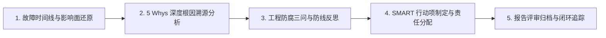

# 事故复盘与工程防腐演进技能 (Incident Postmortem Engine)

本技能提供面向生产事故与研发缺陷的无指责（Blameless）事后复盘、5 Whys 溯源推导与工程长效防腐治理体系。

## 执行流程状态机 (Execution State Machine)

### 阶段 1：故障时间线与影响面还原 (Timeline Reconstruction)
- 收集生产告警、网关指标、业务日志与运维操作记录等客观证据；
- 以分钟为精度梳理事件演进时间线（发生、感知、响应、止血、恢复）；
- 量化事故对用户、业务成交量、系统 SLA 与错误预算造成的实际损失；
- 详尽复盘原则参考 [5 Whys 复盘与工程防腐协议](./references/protocols/five-whys-protocol.md)。

### 阶段 2：5 Whys 深度根因溯源分析 (5 Whys Root Cause)
- 恪守无指责文化，将分析焦点从“人为失误”转向“系统脆弱性与流程漏洞”；
- 运用 5 Whys 逆向溯源因果链条，由浅层直接诱因穿透至底层架构机制缺失；
- 避免因果跳跃或主观臆断，每一级推导必须具备客观技术依据支撑；
- 标准复盘结构参考 [无指责事后复盘报告模板](./references/templates/postmortem-report-template.md)。

### 阶段 3：工程防腐三问与防线反思 (Defensive Reflection)
- 深入反思“何种自动化测试（单测/集成/E2E/变异）本可提前拦截此缺陷”；
- 剖析“何种静态检查、类型契约或架构守卫（熔断/降级）本可阻止故障扩散”；
- 检查“何种可观测性指标、告警策略或日志上下文能在第一时间预警”；
- 典型案例分析参考 [缓存击穿故障复盘实战样例](./examples/sample-postmortem.md)。

### 阶段 4：SMART 行动项制定与责任分配 (Action Items Design)
- 围绕架构防御、门禁补全与监控优化输出具有技术针对性的整改任务；
- 严格遵循 SMART 原则，确保任务具体、可量化、可达成且具备明确完成时限；
- 为每个行动项指定明确的个人责任人与跟踪工单（GitHub/GitLab Issue）；
- 行动项设计规范参考 [5 Whys 复盘与工程防腐协议](./references/protocols/five-whys-protocol.md)。

### 阶段 5：报告评审归档与闭环追踪 (Review & Archiving)
- 召集跨职能团队评审复盘报告，达成技术共识与整改承诺；
- 将复盘报告统一归档至长期知识资产目录 `docs/retros/XXXX-title.md`，并将防腐规则回流至工程规约与流水线；
- 校验交付物中中西文排版空格与相对路径引用的工程合规性。

## 质量控制与合规自检 (Quality Checklist)
- [ ] 复盘分析全篇贯彻无指责文化，严禁归咎个人或使用主观情绪化措辞；
- [ ] 故障时间线每个关键节点均有系统日志或监控指标支撑，数据客观准确；
- [ ] 5 Whys 根因分析最终落脚在工程机制、自动化测试或架构体系的改进上；
- [ ] 所有整改行动项必须具备明确责任人、截止时间与可验证的验收指标；
- [ ] 交付报告 100% 满足盘古之白排版规范与零绝对路径引用要求。

## 知识索引地图 (Knowledge Map)

| 知识模块 | 相对路径 | 核心内容说明 |
| :--- | :--- | :--- |
| 复盘防腐协议 | `./references/protocols/five-whys-protocol.md` | 无指责原则、5 Whys 溯源法、防腐三问与 SMART 规范 |
| 复盘报告模板 | `./references/templates/postmortem-report-template.md` | 事故基本信息、详细时间线、根因推导与行动项模板 |
| 实战案例样本 | `./examples/sample-postmortem.md` | 生产环境缓存击穿与数据库雪崩故障复盘实战报告 |

## 交付成果规范 (Deliverables Benchmark)
- **事后复盘报告**：结构清晰、数据详实的无指责 Markdown 复盘总结文档（统一归档至 `docs/retros/XXXX-title.md`）；
- **故障时间线全景**：以时序图或结构化列表呈现的关键事件与处置演进表；
- **5 Whys 因果推导图**：由表象穿透到底层工程根因的逻辑关系分析图；
- **SMART 改进工单表**：包含责任人、截止时间与验收标准的行动项清单；
- **工程防腐防御清单**：涵盖测试补充、架构拦截与监控加固的技术落地方案。
