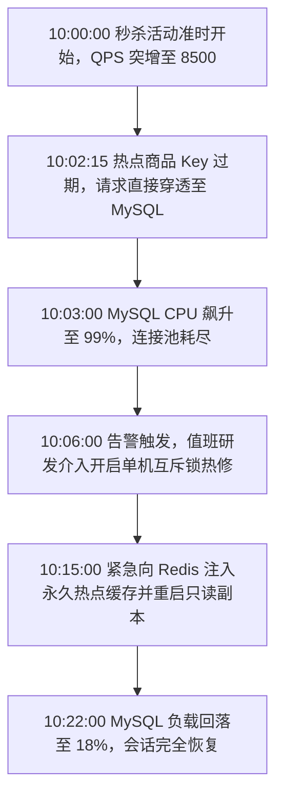

# 缓存击穿故障复盘实战样例 (Sample Postmortem: Cache Stampede Incident)

本案例记录了一起因热点商品缓存失效导致大量请求击穿至数据库、引发连接池打满的服务雪崩事故完整复盘过程。

---

## 1. 事故基础档案

- **事故代号**：`INC-20261008-FLASH-SALE`
- **等级**：`P1`
- **故障起止时间**：`2026-10-08 10:00:00 ~ 10:22:00 (持续 22 分钟)`
- **业务影响**：大促秒杀会场商品详情页白屏，受影响 PV 约 12 万，预估交易损失约 8 万元；
- **报告编写人**：Ateng (核心交易架构组)

---

## 2. 事故过程时间线

---

## 3. 5 Whys 深度根因溯源

1. **Why 1: 为什么秒杀商品详情页持续报错 500？**
   后端商品服务无法获取数据库只读连接，查询线程全部因等待连接超时被中断。
2. **Why 2: 为什么数据库只读连接在 10:02 瞬间被占满？**
   瞬时有超过 3000 个并发查询直接穿透缓存落到数据库相同的一行记录上（缓存击穿）。
3. **Why 3: 为什么热点商品的 Redis 缓存会同时失效？**
   该商品的缓存在后台配置时设置了固定 2 小时 TTL，恰好在 10:02:15 准点自然过期。
4. **Why 4: 为什么没有互斥锁（Mutex）或逻辑过期机制保护？**
   现有的缓存读取层采用的是简单 `getOrQueryDb` 模式，未封装分布式互斥锁或双检锁。
5. **Why 5: 为什么在重大活动前没有发现此隐患？**
   压测用例仅模拟了“缓存命中”的高并发场景，缺少“热点 Key 突然失效时的雪崩容灾压测演练”。

---

## 4. 防腐机制反思与整改

### 4.1 何种自动化测试本可拦截？
- 在集成压测套件中，增加“缓存预热失效场景”的并发混沌工程注入用例。

### 4.2 何种架构契约本可阻止？
- 统一重构底层 `CacheManager`，强制针对热点数据采用“逻辑过期 + 异步重建”或“互斥锁”策略，禁止裸查数据库。

### 4.3 何种监控本可提前暴露？
- 监控缓存命中率突降告警与热点 Key TTL 即将到期提前预警。

---

## 5. 行动项跟踪 (Action Items)

| 任务 | 类别 | 负责人 | 截止时间 | 验收标准 |
| :--- | :---: | :---: | :---: | :--- |
| 重构缓存防穿透/防击穿公共组件，集成 SingleFlight 互斥加载机制 | 架构治理 | 张工 | 2026-10-12 | 代码通过单测并在预发压测验证 |
| 梳理所有营销大促活动商品，配置 TTL 随机偏移（Jitter）与永久热点策略 | 业务防线 | 李工 | 2026-10-14 | 消除固定整数 TTL 配置 |
| 新增 Redis 缓存命中率低于 95% 突降告警与慢查询数量突增告警 | 监控告警 | 赵工 | 2026-10-15 | 触发告警钉钉/邮件实时通知 |
| 将混沌缓存失效场景纳入上线前压测自动化流水线 | 门禁规范 | 王工 | 2026-10-18 | 压测报告需附带失效降级证明 |
