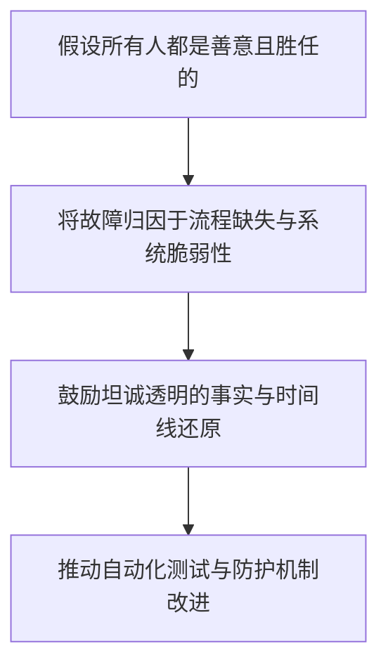
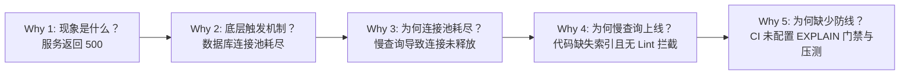

# 5 Whys 故障复盘与工程防腐协议 (5 Whys Retro & Postmortem Protocol)

本文档定义生产故障、重大缺陷与研发复盘分析的核心方法论、无指责（Blameless）文化原则与工程防腐机制。

---

## 目录 (Table of Contents)

- [1. 无指责复盘文化与核心原则](#1-无指责复盘文化与核心原则)
- [2. 5 Whys 逆向溯源分析法](#2-5-whys-逆向溯源分析法)
- [3. 工程防腐三问与拦截防线反思](#3-工程防腐三问与拦截防线反思)
- [4. SMART 整改行动项治理与闭环追踪](#4-smart-整改行动项治理与闭环追踪)
- [5. 故障复盘报告评审与归档基线](#5-故障复盘报告评审与归档基线)

---

## 1. 无指责复盘文化与核心原则

事故复盘的根本目的在于改进系统设计与研发流程的鲁棒性，杜绝同类故障再次发生，而不是寻找替罪羊。

### 1.1 复盘守则
1. **对事不对人**：严禁在复盘记录中使用指责性语言（如“某人粗心遗漏”），必须转化为“系统未能在编译期阻断非法参数”；
2. **客观事实优先**：所有时间点（故障发生、告警触发、介入排障、止血恢复）必须以监控指标与系统日志为准；
3. **避免事后诸葛亮**：从当事人当时所拥有的信息与系统上下文出发理解决策原因。

---

## 2. 5 Whys 逆向溯源分析法

通过多层因果链条连续追问“为什么”，穿透表象症状，直达深层机制缺陷：

### 2.1 追问准则
- **停止条件**：当追问推导触及可落地的“工程规约缺失”、“自动化门禁盲区”或“架构单点”时即可收敛；
- **发散防护**：若因果链条出现多重分支，应分别记录并针对各分支提出防护措施。

---

## 3. 工程防腐三问与拦截防线反思

在复盘会议中，核心研发团队必须针对以下三个关键问题给出明确答复：

### 3.1 何种自动化测试本可提前拦截此缺陷？
- 是否缺少单元测试对边界条件的覆盖？
- 是否需要补充集成测试或端到端用户旅程冒烟用例？
- 是否可以通过变异测试（Mutation Testing）发现测试断言漏洞？

### 3.2 何种架构契约或静态检查本可阻止它？
- 是否应在 API 契约层强制进行入参格式校验？
- 是否需要配置 Linter、类型系统或静态安全扫描规则？
- 是否需要引入熔断器（Circuit Breaker）或降级保护机制？

### 3.3 何种监控告警本可提前暴露故障？
- 告警触发耗时是否过长？
- 是否缺少针对关键业务路径的 RED 指标或错误率突增告警？
- 容器探针与基础设施指标是否真实反映了服务降级？

---

## 4. SMART 整改行动项治理与闭环追踪

复盘产出的改进动作（Action Items）必须严格服从 SMART 原则：

| 原则 | 规范要求 | 错误范例 | 正确范例 |
| :--- | :--- | :--- | :--- |
| **S (具体)** | 明确改动文件与机制 | “加强代码评审” | “在 CI 增加 SQL EXPLAIN 全表扫描阻断脚本” |
| **M (可衡量)** | 具备清晰的验收标准 | “提高测试覆盖率” | “补充订单退款边界单测，分支覆盖率达到 90%” |
| **A (可达成)** | 方案具备技术可行性 | “彻底重构全部历史遗留代码” | “对支付核心方法提取防腐层，增设超时重试” |
| **R (相关性)** | 直接针对故障根因 | “升级无关的前端打包工具” | “配置数据库连接池泄露检测并报警” |
| **T (时效性)** | 明确指定截止日期 | “近期完成” | “2026-10-20 前合并 PR 并发布至预发” |

---

## 5. 故障复盘报告评审与归档基线

1. **时效性要求**：P0/P1 级严重故障必须在故障解决后 48 小时内完成初稿并召开复盘会；
2. **评审人员组成**：涉及的主责研发、架构师、测试人员、SRE 工程师与相关产品负责人；
3. **长期归档机制**：复盘报告统一归档至项目知识库，Action Items 转换为 GitHub/GitLab 独立 Issue 持续跟踪直至 100% 验收关闭。
