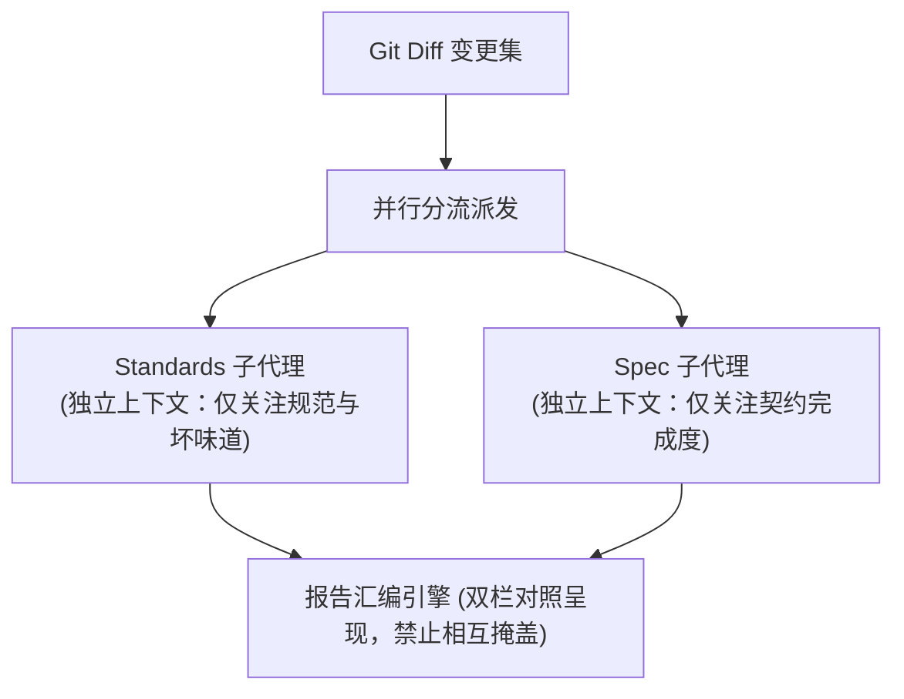

# 双轴审查隔离与合并执行协议 (Dual-Axis Review Protocol)

本文档规范了 `at-review` 技能在执行代码审查时的双轴并行隔离机制、子代理派发约束、多模块依赖拓扑审查与报告汇编标准。

---

## 目录 (Table of Contents)

- [1. 核心理论：双轴正交审查机制](#1-核心理论双轴正交审查机制)
- [2. 审查锚点与 Diff 范围锁定](#2-审查锚点与-diff-范围锁定)
- [3. 并行子代理派发与上下文防污染](#3-并行子代理派发与上下文防污染)
- [4. 多模块与 Monorepo 依赖拓扑审查标准 (Module Dependency Review)](#4-多模块与-monorepo-依赖拓扑审查标准-module-dependency-review)
- [5. 五轴健康模型度量标准](#5-五轴健康模型度量标准)
- [6. 报告汇编与阻断分级准则](#6-报告汇编与阻断分级准则)

---

## 1. 核心理论：双轴正交审查机制

传统代码审查常陷入“主观混乱”：评审者要么死抠命名缩进却漏掉了核心功能缺漏，要么只看跑通了功能却无视代码坏味道堆积。因此，`at-review` 强制采用**双轴正交审查**：
- **Standards 轴 (规范与坏味道)**：代码是否遵循本项目编码规范与 Martin Fowler 经典坏味道基线；
- **Spec 轴 (规格与意图契约)**：代码是否忠实、完整且无冗余地实现了关联的 Spec/Issue 契约。

---

## 2. 审查锚点与 Diff 范围锁定

1. **确定比对锚点 (Fixed Point)**：
   - 用户显式指定的分支名、Commit SHA 或 Tag（如 `main`、`HEAD~3`、`origin/main`）；
   - 若用户未指定，自动探查当前分支的 `merge-base`：`git merge-base origin/main HEAD`；
2. **提取物理差异**：
   - 执行三点 Diff：`git diff <fixed-point>...HEAD`；
   - 提取提交列表：`git log <fixed-point>..HEAD --oneline`；
   - **空 Diff 熔断**：若差异为空，直接退出并提示用户无需审查。

---

## 3. 并行子代理派发与上下文防污染

为了避免审查偏见，两个轴必须通过独立上下文运行：
- **Standards 轴调度约束**：
  - 输入：变更 Diff、仓库 `AGENTS.md` / `CONSTITUTION.md`、`code-smell-checklist.md`；
  - 职责：逐文件/代码段指出硬性违规与坏味道建议，禁止评估业务需求是否合理。
- **Spec 轴调度约束**：
  - 输入：变更 Diff、关联的 `delta.md`、RFC 或 Issue 文本；
  - 职责：检查（1）要求实现却遗漏的项；（2）未要求却擅自扩充的范围蔓延（Scope Creep）；（3）实现逻辑与契约存在偏差的项。禁止死抠命名排版。

---

## 4. 多模块与 Monorepo 依赖拓扑审查标准 (Module Dependency Review)

在多模块工程中，Standards 轴审查必须强制覆盖构建清单文件的变动：
1. **构建清单改动专项审查**：审查变更中是否修改了 `pom.xml`、`package.json` 或 `build.gradle`；
2. **反向依赖与架构腐化阻断**：
   - 检查新增的模块依赖是否违反 DAG 单向流：底层接口契约模块（`*-api`）绝不允许引入对具体实现模块（`*-service`）或特定持久层库的依赖；
   - 任何发现的反向依赖或双向循环依赖直接标记为 **🔴 BLOCKER** 阻断项；
3. **公共模块波及面自检**：若改动涉及底层公共模块，检查本次提交是否同步验证了下游依赖模块的编译兼容性。

---

## 5. 五轴健康模型度量标准

报告汇编时，结合 Addy Osmani 五轴健康度模型进行综合雷达体检：
1. **契约正确性 (Correctness)**：是否 100% 满足 Spec，有无逻辑暗坑；
2. **代码可维护性 (Maintainability)**：是否单一职责，坏味道密度如何；
3. **安全防御度 (Security)**：是否存在 SQL 注入、越权、敏感信息裸露；
4. **性能与效率 (Performance)**：是否存在 N+1 查询、死锁隐患或未释放资源；
5. **测试健壮度 (Testability)**：单测是否挂在公开接缝，有无假通过。

---

## 6. 报告汇编与阻断分级准则

发现项强制按严重程度标注标签：
- **🔴 BLOCKER (阻断)**：核心契约违背、模块依赖违规反向引入、高危安全漏洞、死锁破绽，**必须打回修复**；
- **🟠 MAJOR (严重)**：严重违反项目规范、缺少必要异常分支；
- **🟡 MINOR (建议)**：存在局部代码坏味道、缺少特定单测边界；
- **⚪ NIT (轻微)**：变量命名可读性微调。
严格禁止将两个轴的结论加权合并，必须保留双轴独立结论！
