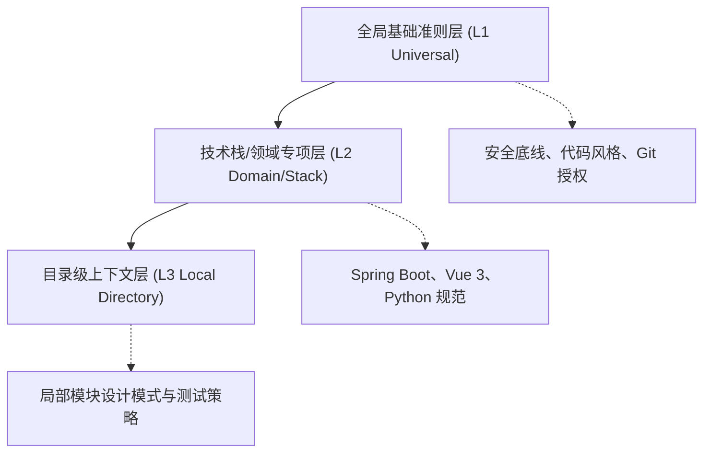

# Agent 提示词工程与行为规约治理协议 (Prompt Governance Protocol)

本文档定义 AI 编码助手与自主智能体在软件工程中的统一行为准则构建、分层上下文收敛及防防御性约束标准。

---

## 目录 (Table of Contents)

- [1. 规约分层架构与路由机制](#1-规约分层架构与路由机制)
- [2. 上下文预算与渐进注入策略](#2-上下文预算与渐进注入策略)
- [3. 核心准则矩阵与防御性约束](#3-核心准则矩阵与防御性约束)
- [4. 规约自动化校验与异味巡检](#4-规约自动化校验与异味巡检)
- [5. 跨工具链与多生态投递基线](#5-跨工具链与多生态投递基线)

---

## 1. 规约分层架构与路由机制

为避免 Agent 上下文过载与注意力发散，工程规约体系遵循三层金字塔架构：

### 1.1 分层准则说明
1. **L1 全局基础准则层 (`AGENTS.md`)**：
   - 规定跨生态 Agent 通用安全规范、两级 Git 授权机制与基本代码道德底线。
   - 控制体积在 150 行以内，常驻各智能体系统提示词中。
2. **L2 技术栈与领域层**：
   - 针对特定技术栈（如 Java、TypeScript、Go）或业务架构模式制定。
   - 采用条件触发或模块化引用，按需激活。
3. **L3 局部目录级层**：
   - 存放于子模块根目录，定义模块自闭环的架构隔离红线。

---

## 2. 上下文预算与渐进注入策略

智能体对 Prompt 的长程注意力衰减规律要求规约遵循“紧凑、明确、零歧义”：

| 规约层级 | 推荐行数 | Token 预算上限 | 注入触发机制 |
| :--- | :--- | :--- | :--- |
| L1 全局规约 | 80 ~ 150 行 | 1,500 tokens | 会话启动自动常驻 |
| L2 专项规约 | 100 ~ 200 行 | 2,000 tokens | 命中特定技术栈文件时加载 |
| L3 局部规约 | 50 ~ 100 行 | 800 tokens | 进入特定目录路径时动态生效 |

### 2.1 负向约束前置法则
- **先定义红线**：智能体对“严禁行为”的遵从度高于泛化的“最佳实践”。必须首先声明“严禁未经用户授权执行提交”、“严禁硬编码生产凭证”。
- **单义化指令**：避免使用“尽量优化”等模棱两可的修饰词，改用“必须返回不可变集合”、“函数行数不得超过 50 行”等可度量规则。

---

## 3. 核心准则矩阵与防御性约束

### 3.1 凭证脱敏与信息安全 (Zero-Leak Security)
- 严禁将真实 API Key、数据库密码、私钥明文提交或持久化写入磁盘；
- 输出示例代码必须强制替换为占位符（如 `YOUR_API_KEY`、`user@example.com`）；
- 探查本地环境捕获到机密信息时，输出日志必须自动脱敏。

### 3.2 Git 操作两级显式授权 (Dual-Stage Authorization)
- **第一级（本地暂存与提交）**：未获得用户显式指令前，严禁自主执行 `git commit`；
- **第二级（远程网络交互）**：未获得用户显式确认前，严禁自主执行 `git push` 或 `git fetch/pull`；
- 暂存必须精准指定相对路径文件，禁止使用 `git add .`。

### 3.3 最小破坏半径 (Minimal Blast Radius)
- 代码修改必须精确聚焦当前任务需求与目标缺陷；
- 严禁在修改单一功能时对无关业务代码、历史遗留格式进行大面积重构或重排。

---

## 4. 规约自动化校验与异味巡检

自动化规则引擎应持续监控规约文件的健康度，拦截常见反模式：

1. **绝对路径污染检测**：检查规约文档是否包含 `C:\`、`file:///` 等环境强依赖路径；
2. **矛盾指令检测**：避免同一文档中出现相互抵触的约束（例如“鼓励拆分”与“禁止增加新文件”）；
3. **格式化合规检测**：规约文档本身必须满足盘古之白与 MarkdownLint 标准。

---

## 5. 跨工具链与多生态投递基线

规约系统设计必须保持中立，便于分发至各类 Agent 生态：

- **Open Agent 规范**：以 `AGENTS.md` 为核心基准标准；
- **Claude 生态**：符号链接或转译为 `CLAUDE.md`；
- **IDE 扩展体系**：投递至 `.cursorrules` 或 `.windsurfrules`，保持核心指令语义一致性。
