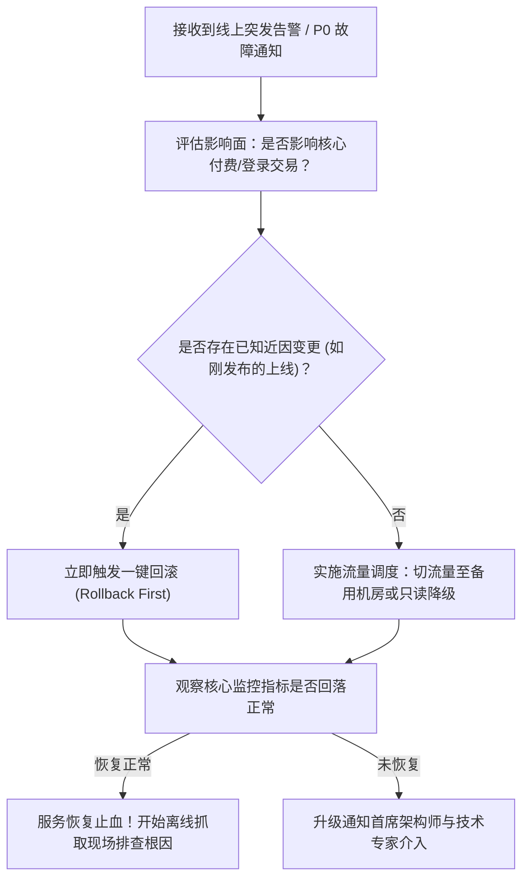

# SRE 故障应急响应与运维操作安全守则 (SRE Incident Protocol)

本协议系统规范了在生产环境发生故障或突发告警时，SRE（Site Reliability Engineering）运维响应准则、黄金指标监控基线、操作安全红线与“1-5-10”止血恢复机制。

---

## 目录 (Table of Contents)

- [1. SRE 核心应急哲学与 1-5-10 黄金基准](#1-sre-核心应急哲学与-1-5-10-黄金基准)
- [2. 黄金监控四指标与分级告警](#2-黄金监控四指标与分级告警)
- [3. 先止血后排障：第一响应决策链](#3-先止血后排障第一响应决策链)
- [4. 高危操作防范与双人复核安全红线](#4-高危操作防范与双人复核安全红线)
- [5. 故障降级、熔断与回滚预案准则](#5-故障降级熔断与回滚预案准则)

---

## 1. SRE 核心应急哲学与 1-5-10 黄金基准

在线上发生生产事故或重大告警时，运维的首要目标是**恢复服务可用性**，而非就地调试代码：

- **1-5-10 黄金止血指标**：
  - **1 分钟发现**：自动化监控与告警在异常发生 1 分钟内精准触达值班人员；
  - **5 分钟响应**：值班工程师在 5 分钟内完成接入并启动应急处理流程；
  - **10 分钟恢复**：在 10 分钟内通过降级、扩容、回滚或流量调度完成服务止血恢复。
- **不可逆操作归零原则**：线上应急处理期间，严禁未经备份直接执行 `DROP TABLE`、`DELETE without WHERE` 或 `rm -rf` 等不可逆破坏性指令。

---

## 2. 黄金监控四指标与分级告警

监控体系必须覆盖四大黄金指标（Four Golden Signals）：

1. **延迟 (Latency)**：请求处理耗时，重点关注 P95/P99 慢请求；
2. **流量 (Traffic)**：系统承受的高峰请求量（QPS / RPS）；
3. **错误 (Errors)**：HTTP 5xx 错误率或业务异常失败率；
4. **饱和度 (Saturation)**：系统资源的饱和程度（CPU 负载、内存占用、数据库连接池、网络带宽）。

### 告警分级响应
- **P0 / 致命 (Critical)**：核心业务阻断，立即电话与短信强通知，全员应急群就位；
- **P1 / 严重 (Major)**：非核心业务降级或部分实例不可用，钉钉/飞书群实时告警，15 分钟内响应；
- **P2 / 警告 (Warning)**：资源接近阈值或单次轻微波动，通知工作群日常跟进。

---

## 3. 先止血后排障：第一响应决策链

---

## 4. 高危操作防范与双人复核安全红线

- **生产机直连禁令**：禁止直接登录生产机器手动修改源码或修改正在运行的配置文件；所有改动必须通过 CI/CD 或受控配置中心下发；
- **高危 DDL/DML 双人复核**：任何针对生产数据库的手动数据订正或索引调整，必须由第二名资深工程师进行双人复核（Peer Review）并前置备份；
- **禁止在业务高峰期做不可控变更**：非致命故障的修复必须在维护窗口期执行。

---

## 5. 故障降级、熔断与回滚预案准则

- **功能降级开关 (Feature Toggle)**：非核心功能（如评论、个性化推荐、历史报表导出）必须具备动态配置降级开关，高负载时一键关闭保主干；
- **服务熔断与限流**：上游服务调用第三方接口时强制配置 Sentinel/Resilience4j 熔断器，避免单点超时引发雪崩效应；
- **回滚预案完备性**：每次生产部署必须验证配套的回滚操作是否秒级生效。
