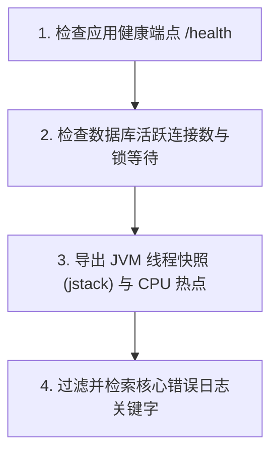

# 运维应急排错手册标准模板 (Runbook Template)

本模板提供了一个符合 SRE 规范的故障应急响应与排错 Runbook 标准骨架（统一落盘至长期知识资产目录 `docs/runbooks/XXXX-title.md`），用于指导运维与值班研发在 10 分钟内完成服务止血与排查。

---

## 模板正文

```markdown
# 故障应急手册: <!-- INCIDENT_TITLE --> (Runbook)

> **故障分级**：<!-- LEVEL (P0 / P1 / P2) -->
> **责任服务**：`<!-- SERVICE_NAME -->`
> **更新时间**：<!-- DATE -->
> **主导负责人**：<!-- OWNER -->

---

## 1. 故障表现与告警特征 (Symptoms & Alerts)

### 典型告警信息
- **告警项**：`<!-- ALERT_NAME (如 DatabaseConnectionPoolExhausted) -->`
- **触发阈值**：<!-- THRESHOLD (如 连接池使用率 > 90% 持续 2 分钟) -->
- **影响范围**：<!-- IMPACT (如 用户无法完成支付，结账接口报 500) -->

---

## 2. 第一时间止血预案 (Emergency Mitigation - 先止血)

> [!IMPORTANT]
> 线上应急优先保障服务可用，切勿在第一时间内追查深层代码逻辑，先执行标准化止血手段！

### 步骤 A：若 30 分钟内有新发版，立即一键回滚
```bash
# 触发发布平台一键回滚指令
<!-- ROLLBACK_COMMAND -->
```

### 步骤 B：流量削峰与服务降级
```bash
# 动态配置中心开启降级熔断开关
<!-- DEGRADE_COMMAND -->
```

### 步骤 C：临时扩容/重启实例
```bash
# 重启无状态计算节点或快速水平扩容 (HPA)
<!-- RESTART_OR_SCALE_COMMAND -->
```

---

## 3. 标准化诊断排查路径 (Diagnostic Workflow)

在止血动作完成且服务指标回落后，开展标准化深层排查：



### 关键诊断指令速查
```bash
# 1. 检查目标服务容器状态
kubectl get pods -l app=<!-- APP_NAME --> -n prod

# 2. 检索实时异常日志堆栈
kubectl logs -l app=<!-- APP_NAME --> -n prod --tail=200 | grep -E "ERROR|Exception"

# 3. 抓取正在运行的线程快照 (排查死锁与卡顿)
jstack <PID> > /tmp/thread_dump_$(date +%s).txt
```

---

## 4. 彻底恢复确认 (Recovery Verification)

确认以下黄金指标恢复正常：
- [ ] 核心 API 接口错误率（HTTP 5xx）回落至 < 0.05%；
- [ ] 接口响应时间 P99 回落至基线水平（< 200ms）；
- [ ] 数据库活跃连接数回落至安全水位（< 50%）。

---

## 5. 事后复盘动作 (Post-Incident Actions)

- [ ] 保存事故期间的线程 Dump、GC 日志与监控快照；
- [ ] 在 24 小时内召开 5 Whys 故障复盘会，产出复盘报告；
- [ ] 建立防止故障再次发生的根因优化工单。
```
