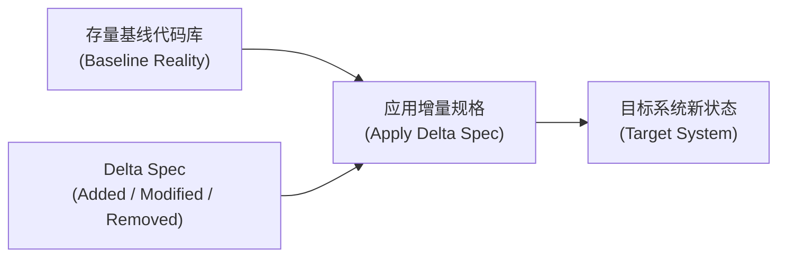

# 增量规格契约设计协议 (Delta Contract Protocol)

本文档规范了 `at-spec` 技能在制定存量系统增量规格（Delta Specs）时的契约原子化、防膨胀守卫、单模块/多模块爆炸半径评级与可检验性标准。

---

## 目录 (Table of Contents)

- [1. 核心理论：增量差分规格 (Delta-First)](#1-核心理论增量差分规格-delta-first)
- [2. 500 字符原子防膨胀守卫](#2-500-字符原子防膨胀守卫)
- [3. 契约可测试性与断言转化律](#3-契约可测试性与断言转化律)
- [4. 基线漂移检测与兼容性防御](#4-基线漂移检测与兼容性防御)
- [5. 多模块与 Monorepo 爆炸半径划界 (Cross-Module Blast Radius)](#5-多模块与-monorepo-爆炸半径划界-cross-module-blast-radius)
- [6. 质量准入与下游移交标准](#6-质量准入与下游移交标准)

---

## 1. 核心理论：增量差分规格 (Delta-First)

传统软件工程中编写数十页的全量规格书（SRS）在敏捷迭代中极易与代码库发生“语义漂移”。`at-spec` 借鉴 Git Diff 与 OpenSpec 思想：
- **存量代码库即绝对基线 (Baseline)**：未显式提及的逻辑默认保持原样；
- **只描述增量差分 (Delta)**：聚焦于 **Added (新增)**、**Modified (修改)**、**Removed (移除)**；
- **闭环可追溯**：每个 Delta 均能一一对应到测试用例（Test Case）与代码提交（Git Commit）。



---

## 2. 500 字符原子防膨胀守卫

为防止规格书重新膨胀为冗长晦涩的巨型面条文档，设定**原子防膨胀守卫 (Atomic Guard)**：
1. **单项契约粒度约束**：每个 `SPEC-ADD` 或 `SPEC-MOD` 块的文字描述严格控制在 **500 字符以内**；
2. **拒绝上下文倾倒**：严禁在增量契约中原样粘贴未受影响的既有历史代码或全量表结构；仅列出变更字段；
3. **分拆原则**：若一项改动文字解释超过 500 字符，说明关注点混杂，必须主动拆分为多个具名的原子 Delta（例如拆分为 `SPEC-MOD-01A 校验逻辑更新` 与 `SPEC-MOD-01B 状态机转移更新`）。

---

## 3. 契约可测试性与断言转化律

增量规格不是散文，而是为后续 `at-tdd` 直接提供测试输入的机器可理解契约。每一条规格必须满足“断言转化三要素”：
- **Given (前置条件与系统状态)**：明确输入参数类型、当前数据库已有数据状态；
- **When (触发动作与行为契约)**：明确调用的公共方法或 HTTP 请求端点；
- **Then (后置断言与不变式验证)**：明确状态码、返回字段值、数据库增量行以及绝不可打破的不变式（Invariants）。

---

## 4. 基线漂移检测与兼容性防御

编写增量规格前，Agent 必须执行**存量基线真理探查**：
1. **逆向探查现有签名**：深入代码库确认当前接口的方法签名、参数注解与抛出异常类型；
2. **破坏性变更拦截 (Breaking Change Defense)**：
   - 严禁在公共 API 中直接删除字段或修改必填性；
   - 必须通过字段兼容标记、默认值或版本号进行过渡；
3. **空安全守卫**：
   - 集合返回增量契约严格禁止声明返回 `null`，必须强制指定返回空集合；
   - 单对象未查询到必须明确声明是返回 `Optional.empty()` 还是触发指定业务异常。

---

## 5. 多模块与 Monorepo 爆炸半径划界 (Cross-Module Blast Radius)

在包含多个子模块的工程体系中，变更的影响面具有层级扩散效应：

### 5.1 影响面等级评定 (Impact Level)
- **Level: Local-Module (局部叶子节点)**：改动仅局限于单一终端子模块（如单个业务微服务内部），无跨模块导出；
- **Level: Cross-Module (跨模块底层辐射)**：改动涉及基础公共库、DTO 契约模块、工具类库或上游服务接口。

### 5.2 跨模块影响契约声明要求
一旦判定为 `Level: Cross-Module`，在 `delta.md` 的前置头中必须强制声明：
```markdown
> **爆炸半径评级**：`Level: Cross-Module`
> **上游受改动模块**：`mall-common-dto`
> **直接受影响下游模块**：`mall-order-service`, `mall-payment-service`, `mall-api-gateway`
> **补偿约束**：下游任务清单必须包含级联编译验证，防止接口或字段改名导致全工程破损。
```

---

## 6. 质量准入与下游移交标准

增量规格就绪判定门禁：
1. **标识完备**：所有增量契约具备全局唯一标识（`SPEC-ADD-*`、`SPEC-MOD-*`、`SPEC-REM-*`）；
2. **不变式不为空**：至少声明 2 条跨本次变更的核心业务或数据不变式（Invariants）；
3. **通过防膨胀检查**：无超长拖沓段落，单块不超 500 字符；
4. **多模块评级齐备**：多模块工程必须具备明确的 Local-Module 或 Cross-Module 评级；
5. **移交下一棒**：
   - 移交 `at-plan`：将规格拆解为 2~5 分钟的微任务流水线，携带模块裁剪参数；
   - 移交 `at-tdd`：依据 Given-When-Then 契约直接编写失败测试。
