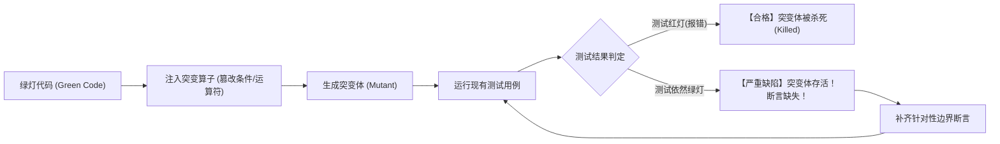

# 突变检验与测试有效性反思协议 (Mutation Testing Protocol)

本文档规范了 `at-tdd` 技能在测试绿灯后开展“突变反思 (Mutation Reflection)”的执行标准，杜绝虚假覆盖率与弱断言假安全感。

---

## 目录 (Table of Contents)
- [1. 核心理论：突变杀死率 vs 行覆盖率](#1-核心理论突变杀死率-vs-行覆盖率)
- [2. 四大经典突变算子 (Mutation Operators)](#2-四大经典突变算子-mutation-operators)
- [3. 突变体存活拦截与根因分析](#3-突变体存活拦截与根因分析)
- [4. Agent 轻量化思维实验突变法](#4-agent-轻量化思维实验突变法)
- [5. 突变自检退出准则](#5-突变自检退出准则)

---

## 1. 核心理论：突变杀死率 vs 行覆盖率

代码覆盖率（Line/Branch Coverage）常带来致命的虚假安全感：
- 一段没有写任何 `assert` 断言的测试代码，其行覆盖率也可以达到 100%；
- **突变测试 (Mutation Testing)** 的本质：如果故意在生产代码中制造一个微小缺陷（生成一个“突变体 Mutant”），已有的测试用例能否**立即亮起红灯并杀死该突变体**？
- **突变杀死率 (Mutant Kill Rate)** 才是衡量单测质量与防护力的终极真理。

---

## 2. 四大经典突变算子 (Mutation Operators)

Agent 在完成业务逻辑让测试变绿后，必须在思维或局部测试中应用以下 4 类经典突变算子：

| 算子类别 | 突变动作 (Original -> Mutant) | 考察能力 |
| :--- | :--- | :--- |
| **1. 边界条件反转** | `if (balance >= price)` -> `if (balance > price)` 或 `<` | 边界等于点是否有单测专门覆盖 |
| **2. 算术/逻辑替换** | `a + b` -> `a - b`；`&&` -> `\|\|` | 运算正确性与复合逻辑判定 |
| **3. 核心返回值置空** | `return result;` -> `return null;` / `return ""` | 调用方是否消费了返回值并做校验 |
| **4. 关键副作用剔除** | 注释掉 `dao.save(...)` 或事件发布行 | 副作用与持久化调用是否有断言或 Verify |

---

## 3. 突变体存活拦截与根因分析

如果注入突变体后测试用例依然成功通过，说明“突变体存活 (Mutant Survived)”。根因通常有二：
1. **测试断言软弱无力 (Weak Assertion)**：测试仅断言了状态码为 200，却从未断言返回体中的金额、状态字段或持久化数据库的变更行；
2. **死代码/冗余代码 (Dead Code)**：被突变的代码实际上无论怎样变动都不影响最终输出，属于过度设计的垃圾代码，必须直接删除。

---

## 4. Agent 轻量化思维实验突变法

在无重型 Pitest 等工具链的轻量化开发场景中，Agent 必须执行**轻量化思维反思**：
1. **提问自查**：“如果我把刚才写的这行条件语句反转，我的单测会挂吗？”
2. **探针验证**：若不确定，就地临时修改该行代码并执行测试命令；
3. **见证红灯**：亲眼确认测试立刻红灯后，立即撤销临时修改，恢复绿灯代码。

---

## 5. 突变自检退出准则

微任务完工门禁：
1. 核心业务分支（尤其是边界等于、异常阻断）均通过至少 1 次突变反思；
2. 杜绝任何“突变体存活”破绽；
3. 恢复所有临时篡改，确保正式测试套件 100% 绿灯。
