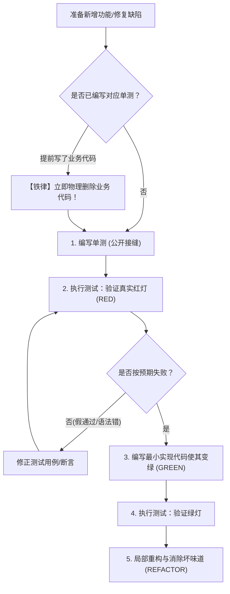

# 测试驱动红绿重构执行协议 (TDD Red-Green Protocol)

本文档规范了 `at-tdd` 技能在实施测试驱动开发时的铁律循环、删除代码惩罚机制、多模块双速验证与最小实现准则。

---

## 目录 (Table of Contents)

- [1. 核心铁律：未测先写立即删代码](#1-核心铁律未测先写立即删代码)
- [2. 经典三步循环：红 -> 绿 -> 重构](#2-经典三步循环红---绿---重构)
- [3. 公开接缝 (Public Seams) 定位原则](#3-公开接缝-public-seams-定位原则)
- [4. 最小实现与抗过度设计防御](#4-最小实现与抗过度设计防御)
- [5. 多模块与 Monorepo 双速测试执行规范 (Dual-Speed Testing)](#5-多模块与-monorepo-双速测试执行规范-dual-speed-testing)
- [6. 质量准出与断言完备性检验](#6-质量准出与断言完备性检验)

---

## 1. 核心铁律：未测先写立即删代码

TDD 的生命线是纪律。Agent 必须严格遵守以下执行红线：
- **无测试不编码**：严禁在未编写失败测试前直接输出业务逻辑代码；
- **惩罚性立即删代码 (Code Deletion Mandate)**：
  - 若 Agent 或开发者在未运行红灯测试的前提下提前写出了业务实现，**必须立即物理删除所有提前编写的代码**，绝不妥协；
  - 必须老老实实回退到红灯阶段，重新编写测试用例并真实运行报错，方可重新编写业务代码。

---

## 2. 经典三步循环：红 -> 绿 -> 重构

### 2.1 红灯阶段 (RED Phase)
1. 选取任务清单（`tasks.md`）中的单个原子切片；
2. 编写针对公开接口的测试用例；
3. **真实运行测试命令**：必须亲眼捕获断言失败报错，并核验失败原因确实是“该能力尚未实现”，而非环境配置或编译导入错误。

### 2.2 绿灯阶段 (GREEN Phase)
1. 编写刚好足以让该测试通过的最小生产代码；
2. 严禁提前编写未来任务才需要的扩展参数或空投逻辑；
3. 重新运行测试命令，亲眼见证测试变为绿灯（Passed）。

### 2.3 重构阶段 (REFACTOR Phase)
1. 在保持测试全部绿灯的前提下，清理魔法值、消除冗余重复、优化命名；
2. 任何重构动作后必须再次全量跑通当前测试套件。

---

## 3. 公开接缝 (Public Seams) 定位原则

测试用例只能挂接在**公开接缝 (Public Seams)** 上：
- **定义**：模块对外开放的公共接口、Controller 端点、公共 Service 方法；
- **禁区**：**绝对严禁测试私有方法 (Private Methods)**，绝对严禁通过反射强行探查内部私有状态；
- **健康检验标志**：若模块内部重构（如提取私有小方法、更换数据结构）导致已有测试崩溃，说明测试耦合了实现细节，属于劣质测试，必须重构测试用例挂回公开接口。

---

## 4. 最小实现与抗过度设计防御

在绿灯阶段，必须克制编码冲动：
- 哪怕直接返回固定常量或假桩能让当前单测变绿，也不要提前写复杂的分支引擎；
- 只有当下拔地而起的第二个测试用例（如异常参数或反向输入）迫使该常量失效时，才允许泛化（Generalize）为通用逻辑；
- 这正是测试驱动防止代码库过度膨胀与过度工程的核心法门。

---

## 5. 多模块与 Monorepo 双速测试执行规范 (Dual-Speed Testing)

在大型多模块项目中，执行测试必须实施**双速验证机制**以平衡敏捷反馈与全局质量：

### 5.1 快速开发态（TDD 红绿循环）
- **禁止裸跑全局测试**：严禁在根目录执行不带参数的 `mvn test` 或全量扫描；
- **禁止 `cd` 切换工作区**：保持在仓库根目录，必须使用参数裁剪：
  - Maven：`mvn test -pl <submodule-name> -am -Dtest=XxxTest`
  - Gradle：`./gradlew :<submodule-name>:test --tests XxxTest`
  - pnpm：`pnpm --filter <package-name> test`
- **反馈耗时控制**：单次红绿验证反馈必须在 2~5 秒内完成，确保 TDD 心流不被打断。

### 5.2 交付封版态（微任务全部打卡后）
- 在完成全部业务微任务、即将进入 `at-review` 前，执行一次关联子模块的冒烟测试与全量编译检查，拦截潜在的跨模块符号冲突。

---

## 6. 质量准出与断言完备性检验

单循环完成验收标准：
1. 测试命令执行退出码为 0；
2. 断言包含确定的预期值（来自于业务规范，而非直接调用被测代码反推）；
3. 移交突变反思门禁：遵循突变测试协议核查测试敏感度。
