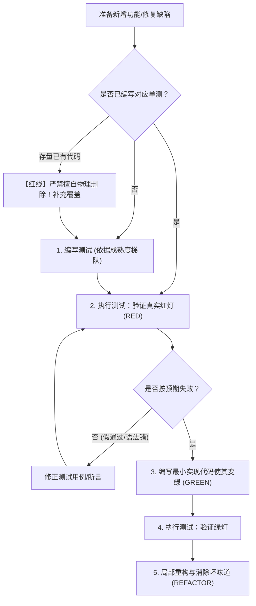

# 测试驱动红绿重构执行协议 (TDD Red-Green Protocol)

本文档规范了 `at-tdd` 技能在实施测试驱动开发时的核心红线、存量代码防误删保护、三级测试成熟度自适应、多模块双速验证与最小实现准则。

---

## 目录 (Table of Contents)

- [1. 核心执行红线与存量防误删保护](#1-核心执行红线与存量防误删保护)
- [2. 三级测试成熟度自适应梯队 (Test Maturity Tiers)](#2-三级测试成熟度自适应梯队-test-maturity-tiers)
- [3. 经典三步循环：红 -> 绿 -> 重构](#3-经典三步循环红---绿---重构)
- [4. 公开接缝 (Public Seams) 定位原则](#4-公开接缝-public-seams-定位原则)
- [5. 最小实现与抗过度设计防御](#5-最小实现与抗过度设计防御)
- [6. 多模块与 Monorepo 双速测试执行规范 (Dual-Speed Testing)](#6-多模块与-monorepo-双速测试执行规范-dual-speed-testing)
- [7. 质量准出与断言完备性检验](#7-质量准出与断言完备性检验)

---

## 1. 核心执行红线与存量防误删保护

TDD 的生命线是工程纪律与代码安全并重。Agent 必须严格遵守以下执行红线：
- **测试先行纪律**：严禁在未编写失败测试或验证探针前直接编写新业务逻辑；
- **存量代码防误删保护红线 (Anti-Deletion Guardrail)**：
  - 修改存量工程时，**Agent 严禁未经授权物理删除既有代码或已编写的功能实现**；
  - 严禁以“未遵循 TDD”为由擅自清空或物理删除开发者的工作区文件；任何破坏性清理必须经过人类显式授权；
  - 若任务开始时发现已存在未测先写的业务代码，应将其作为待验证假设，针对其公开接口补充红灯测试覆盖并核验，绝不擅自执行物理删除。

---

## 2. 三级测试成熟度自适应梯队 (Test Maturity Tiers)

现实工业项目中并非所有工程都具备开箱即用的单元测试套件。Agent 必须根据目标项目的测试基础设施现状自适应匹配策略，严禁因工程缺少单测而陷入无限卡死或报错：

### 2.1 Level 1 (完备单测工程)
- **适用场景**：项目拥有完整且运行顺畅的单元测试框架（如 JUnit 5、Pytest、Vitest、Jest 等），单测开箱即用；
- **执行策略**：
  - 严格执行公开接缝单测红绿循环；
  - 遵循 Given-When-Then 结构与权威真理断言；
  - 达成绿灯后，强制激活思维突变检验（Mutation Reflection）。

### 2.2 Level 2 (集成/慢速测试工程)
- **适用场景**：纯单元隔离困难（严重依赖 Spring 上下文、数据库连接池或外部中间件），单测套件运行缓慢（> 10 秒）或需轻量容器；
- **执行策略**：
  - 构建模块级轻量测试桩（Mock / Testcontainers / 内存 H2 / WireMock）；
  - 聚焦对外 API / Service 公开契约断言；
  - 多模块下使用 `-pl` / `--filter` 参数针对性验证单一测试类，避免触发全工程慢速套件。

### 2.3 Level 3 (无单测遗留工程)
- **适用场景**：历史遗留项目无任何单测框架配置，或启动单测需复杂未配置的远程外部依赖；
- **执行策略**：
  - **特征测试探针 (Characterization Test)**：编写自包含的局部验证测试或最小 `main` 方法执行探针；
  - **脚本化验证探针**：编写轻量 cURL 验证脚本、HTTP 请求探针或临时调用验证；
  - **严密静态走查与代码评审**：强化语法检查、类型检查、编译校验与静态分析；
  - **显式对齐确认**：向人类工程师展示验证方案并获取确认，严禁因测试套件缺失而阻断任务或擅自引入沉重外部依赖。

---

## 3. 经典三步循环：红 -> 绿 -> 重构

### 3.1 红灯阶段 (RED Phase)
1. 选取任务清单（`.specs/<feature-slug>/tasks.md`）中的单个原子切片；
2. 依据当前测试成熟度编写针对公开接口的测试用例或验证探针；
3. **真实运行测试命令**：必须亲眼捕获断言失败报错，并核验失败原因确实是“该能力尚未实现”，而非环境配置或编译导入错误。

### 3.2 绿灯阶段 (GREEN Phase)
1. 编写刚好足以让该测试通过的最小生产代码；
2. 严禁提前编写未来任务才需要的扩展参数或空投逻辑；
3. 重新运行测试命令，亲眼见证测试变为绿灯（Passed）。

### 3.3 重构阶段 (REFACTOR Phase)
1. 在保持测试全部绿灯的前提下，清理魔法值、消除冗余重复、优化命名；
2. 任何重构动作后必须再次全量跑通当前测试套件。

---

## 4. 公开接缝 (Public Seams) 定位原则

测试用例只能挂接在**公开接缝 (Public Seams)** 上：
- **定义**：模块对外开放的公共接口、Controller 端点、公共 Service 方法；
- **禁区**：**绝对严禁测试私有方法 (Private Methods)**，绝对严禁通过反射强行探查内部私有状态；
- **健康检验标志**：若模块内部重构（如提取私有小方法、更换数据结构）导致已有测试崩溃，说明测试耦合了实现细节，属于劣质测试，必须重构测试用例挂回公开接口。

---

## 5. 最小实现与抗过度设计防御

在绿灯阶段，必须克制编码冲动：
- 哪怕直接返回固定常量或假桩能让当前单测变绿，也不要提前写复杂的分支引擎；
- 只有当下拔地而起的第二个测试用例（如异常参数或反向输入）迫使该常量失效时，才允许泛化（Generalize）为通用逻辑；
- 这正是测试驱动防止代码库过度膨胀与过度工程的核心法门。

---

## 6. 多模块与 Monorepo 双速测试执行规范 (Dual-Speed Testing)

在大型多模块项目中，执行测试必须实施**双速验证机制**以平衡敏捷反馈与全局质量：

### 6.1 快速开发态（TDD 红绿循环）
- **禁止裸跑全局测试**：严禁在根目录执行不带参数的 `mvn test` 或全量扫描；
- **禁止 `cd` 切换工作区**：保持在仓库根目录，必须使用参数裁剪：
  - Maven：`mvn test -pl <submodule-name> -am -Dtest=XxxTest`
  - Gradle：`./gradlew :<submodule-name>:test --tests XxxTest`
  - pnpm：`pnpm --filter <package-name> test`
- **反馈耗时控制**：单次红绿验证反馈必须在 2~5 秒内完成，确保 TDD 心流不被打断。

### 6.2 交付封版态（微任务全部打卡后）
- 在完成全部业务微任务、即将进入 `at-review` 前，执行一次关联子模块的冒烟测试与全量编译检查，拦截潜在的跨模块符号冲突。

---

## 7. 质量准出与断言完备性检验

单循环完成验收标准：
1. 测试命令执行退出码为 0；
2. 断言包含确定的预期值（来自于业务规范，而非直接调用被测代码反推）；
3. 移交突变反思门禁：遵循突变测试协议核查测试敏感度。
