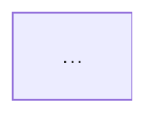

# 技术文档排版与格式规范基线 (Formatting Guidelines)

本规范定义了所有由 `at-tech-doc` 输出的技术文档所必须遵循的静态排版、元数据格式与 Mermaid 可视化硬性标准。

---

## 目录 (Table of Contents)

- [1. 文本与排版规范 (Typography)](#1-文本与排版规范-typography)
- [2. 图表与自包含可视化规范 (Mermaid)](#2-图表与自包含可视化规范-mermaid)
- [3. 代码块与配置规范 (Code Blocks)](#3-代码块与配置规范-code-blocks)
- [4. 表格与矩阵规范 (Tables)](#4-表格与矩阵规范-tables)
- [5. 文档头部元数据标准 (Metadata)](#5-文档头部元数据标准-metadata)
- [6. 链接引用与路径标准规范 (Links & Path Standards)](#6-链接引用与路径标准规范-links--path-standards)
- [7. 权威事实核实与防虚构规范 (Fact-Checking & Anti-Hallucination Standards)](#7-权威事实核实与防虚构规范-fact-checking--anti-hallucination-standards)
- [8. 实施计划阶段的大纲格式规范 (Plan Outline Standards)](#8-实施计划阶段的大纲格式规范-plan-outline-standards)

---

## 1. 文本与排版规范 (Typography)

### 1.1 盘古之白 (中英文半角空格)
- **汉字与西文/数字之间**必须保留一个半角空格。
  - 正确示例：`本接口支持高并发 Redis 缓存，提升了 30% 的吞吐量。`
  - 错误示例：`本接口支持高并发Redis缓存，提升了30%的吞吐量。`
- **专有名词大小写**保持严格准确（如：`Spring Boot`、`Redis`、`MySQL`、`PostgreSQL`、`TypeScript`、`Nginx`、`Docker`、`Kubernetes`、`Git`）。

### 1.2 标题层级规范
- 一级标题 (`#`)：全文唯一，作为文档总标题。
- 二级标题 (`##`)：主干模块与核心步骤（如：1. 方案背景、2. 系统架构设计、3. 接口契约等）。
- 三级标题 (`###`)：具体子系统、流程环节或功能明细。
- 四级标题 (`####`)：仅在细粒度参数或特定子项展开时使用，杜绝四级以下过深层级，深层逻辑改用无序列表呈现。

### 1.3 强调与引用块 (GitHub Alerts)
对于关键注意点、安全风险与兼容性预警，必须使用 GitHub 标准 Alerts 语法：
```markdown
> [!NOTE] 补充背景信息或设计上下文
> [!TIP] 性能优化技巧、最佳实践或提效建议
> [!IMPORTANT] 核心硬性要求、关键步骤或不可遗漏项
> [!WARNING] 潜在风险、破坏性变更 (Breaking Changes) 或版本兼容隐患
> [!CAUTION] 高危操作（如线上删库、重置生产凭据、数据迁移不可逆风险）
```

---

## 2. 图表与自包含可视化规范 (Mermaid)

技术文档采用纯自包含的 Markdown + Mermaid 体系，无需依赖外部图表平台。

### 2.1 图表触发条件
- **系统/服务间调用**：必须绘制时序图 (`sequenceDiagram`)。
- **业务流程/状态流转**：必须绘制业务流程图 (`flowchart TD` 或 `flowchart LR`) 或状态机 (`stateDiagram-v2`)。
- **系统架构/组件拓扑**：必须绘制架构拓扑分层图 (`flowchart TB`)。
- **数据实体建模**：必须绘制实体关系图 (`erDiagram`)。

### 2.2 Mermaid 防错与语法安全
- **特殊字符防御**：节点文本中若包含括号 `()`、方括号 `[]`、花括号 `{}`、斜杠或中文标点，**必须使用双引号包裹**。
  - 正确示例：`NodeA["网关服务 (Gateway API)"] --> NodeB["认证中心 [OAuth2]"]`
  - 错误示例：`NodeA[网关服务 (Gateway API)] --> NodeB[认证中心 [OAuth2]]`
- **时序图生命周期**：必须开启自动编号 (`autonumber`)，参与者激活与注销清晰标注（`activate` / `deactivate`），跨服务调用标注同步或异步消息（`->>` / `-->>`）。

---

## 3. 代码块与配置规范 (Code Blocks)

### 3.1 语法高亮与元信息
- 所有代码块必须明确标注文档语言标识符（如 `bash`, `java`, `sql`, `json`, `yaml`, `typescript`, `python` 等）。
- 关键配置文件或代码段正上方必须提供简短文件路径说明（如 `// 文件: src/main/resources/application.yml`）。

### 3.2 步骤与注释
- 涉及复杂执行逻辑的代码，按照 `// 1. ...`、`// 2. ...` 标注主干步骤。
- 关键参数与配置项必须在代码注释或下方 Markdown 表格中逐一解释其生产环境建议值。

---

## 4. 表格与矩阵规范 (Tables)

### 4.1 技术选型与权衡矩阵
对比两种及以上技术方案时，必须使用结构化对比矩阵：
| 方案名称 | 优势 (Pros) | 劣势 (Cons) | 复杂度 | 推荐指数 |
| :--- | :--- | :--- | :--- | :--- |
| **方案 A (自建)** | 高度可控、定制性强 | 维护成本高、缺乏成熟生态 | 高 | ⭐⭐⭐ |
| **方案 B (成熟组件)** | 开箱即用、社区成熟、高可用 | 存在少量冗余能力 | 低 | ⭐⭐⭐⭐⭐ (推荐) |

### 4.2 接口参数与错误码
必须采用表格式列出字段名称、类型、必填项、默认值及业务含义，严禁纯自然语言罗列。

---

## 5. 文档头部元数据标准 (Metadata)

每份技术文档起始必须包含标准化元数据块，作者默认统一标识为 `Ateng`：
```markdown
# [文档标题]

| 属性 | 详情 |
| :--- | :--- |
| **文档类型** | RFC 技术方案 / API 接口契约 / ADR 架构决策 / 运维手册 / 调研报告 / 数据库设计 |
| **当前状态** | 草稿 (Draft) / 评审中 (In Review) / 已归档 (Accepted) |
| **作者** | Ateng |
| **创建日期** | YYYY-MM-DD |
| **关联系统/模块** | [系统/服务/仓库名] |
```

## 6. 链接引用与路径标准规范 (Links & Path Standards)

为确保技术文档在任何开发环境、CI/CD 构建流水线、Git 托管平台（GitHub/GitLab）及静态站点生成器（VitePress/Docusaurus）中具备完美的可移植性与零死链体验，文档内部引用必须严格遵循以下规则：

### 6.1 绝对禁止宿主机物理路径 (Zero Absolute Path Policy)
> [!CAUTION]
> **绝对路径红线**：严禁在生成的文档正文、表格、代码注释或事实矩阵中写入任何宿主机物理绝对路径，包括但不限于：
> - `file:///C:/...`、`file:///D:/...`、`file:///Users/...`
> - `C:\Users\...`、`D:\My\...`、`C:/Users/...`
> 
> **使用场景严格隔离**：
> - `file:///` 格式**仅限在智能体与用户的即时聊天会话框 (Chat Turn Handoff)** 中输出，用于方便用户在本地 IDE 中快速点击预览；
> - **绝不允许将任何 `file:///` 或包含个人盘符的绝对路径写入 Markdown 交付物正文**！

### 6.2 文档间内部互链标准 (Internal Cross-References)
同一知识库或文档套件内部的文档跳转，必须统一使用**相对路径**或**站点根路径**：
- **同级/子级文档**：`[01 架构原理](./01-architecture-and-spec.md)`
- **上级/跨目录文档**：`[技能中心大厅](../index.md)` 或 `[Superpowers 专题](../superpowers/index.md)`
- **站点根路径 (如 VitePress)**：`[Anthropic 规范](/skills/anthropic/01-architecture-and-spec)`
- **严禁**：拼接当前机器的本地绝对盘符或绝对操作系统路径。

### 6.3 源码与配置路径提及 (Codebase Path References)
在正文中提及项目内的代码文件、配置文件或模板文件时，统一使用**工程根目录的相对路径，并用行内代码块包裹**：
- **正确示例**：`配置位于 src/main/resources/application.yml 中。`
- **正确示例**：`详见项目 docs/agents/triage-labels.md 规范。`
- **错误示例**：`配置位于 file:///D:/My/dev/project/src/main/... 中。`

### 6.4 外部信源与事实依据链接 (External Source Links)
引用第三方库、规范、RFC 或工具插件时，必须使用公开合法的标准 Web URL（`https://...`）：
- **正确示例**：`[Spring Boot 官方文档](https://docs.spring.io/...)`
- **正确示例**：`[Matt Pocock Skills 源码](https://github.com/mattpocock/skills/blob/main/plugin.json)`
- **错误示例**：`[Matt Pocock 插件](file:///C:/Users/admin/.gemini/config/plugins/...)`

### 6.5 多文档套件全局导航文件标准 (Global Navigation Standards)

凡是交付产物物理 Markdown 文件数 $> 1$ 的多文档套件（Multi-Document Suite），必须在交付目录根层级生成全局导航入口文件作为门面：

#### 6.5.1 命名与生成时机约定
- **自适应命名**：
  - **默认规范**：工程目录或 Artifact 下默认命名为 `README.md`（跨平台、Git 仓库与 IDE 打开目录默认渲染）。
  - **静态文档站**：若规划方案显式针对 VitePress / Docusaurus 等文档站点，自动适配为 `index.md`。
- **批次 1 首发交付**：在分批执行生命周期中，必须作为 **`批次 1`** 优先落盘交付，确立全局架构拓扑、模块导航矩阵与阅读路线。

#### 6.5.2 导航文件 6 大标准模块结构
```markdown
# [系统/特性名称] 技术文档套件总览 (Suite Overview)

| 属性 | 详情 |
| :--- | :--- |
| **套件类型** | 跨服务架构设计 / 全景落地实战套件 / 数据库与运维全方案 |
| **当前状态** | 评审中 (In Review) / 已归档 (Accepted) |
| **作者** | @author Ateng |
| **创建日期** | @since YYYY-MM-DD |
| **适用基准** | [JDK 21 / Spring Boot 3.2 / MySQL 8.0 / Redis 7.2] |

> [!CAUTION]
> **真实性核验受限声明 (Unverified Warning)**:
> （仅在离线且涉及外部参数时在此处集中插入一次，后序各子文档免除）

## 1. 架构全景拓扑 (System Topology)


## 2. 全套件交付模块导航矩阵 (Suite Navigation)

| 序号 | 交付物模块 | 核心内容定位 | 相对直达链接 |
| :---: | :--- | :--- | :--- |
| **01** | 架构基线与内核调优 | 选型兼容矩阵、Overcommit、THP 固化、系统账号与权限 | [01-architecture-and-baseline.md](./01-architecture-and-baseline.md) |
| **02** | 安装部署全实战 | APT/DNF 官方源安全配置、版本锁定、jemalloc 编译部署 | [02-installation-methods.md](./02-installation-methods.md) |
| **03** | 生产运维与安全加固 | 核心参数、ACL 权限、Systemd 服务、应急排障及全套件事实依据收口 | [03-production-ops-and-security.md](./03-production-ops-and-security.md#权威参考资料与事实依据) |

## 3. 推荐阅读路线 (Recommended Reading Routes)
- **快速上手实操线**：直达 `02 安装部署全实战` 完成集群初始化；
- **生产调优与合规线**：按 `01 架构基线` -> `03 生产运维` 顺序执行系统级固化；
- **架构决策与全景评估线**：通读本总览及各模块架构时序。

## 4. 全局事实依据收口说明 (Grounding Note)
本套件涉及的所有外部技术规范、官方权威信源清单及参数核查矩阵，统一收口归档于最终篇章：
👉 详见 **[03-production-ops-and-security.md#权威参考资料与事实依据](./03-production-ops-and-security.md#权威参考资料与事实依据)**。
```

---

## 7. 权威事实核实与防虚构规范 (Fact-Checking & Anti-Hallucination Standards)

为确保技术文档的可落地性与严谨性，`at-tech-doc` 生成的所有内容必须经过客观事实核查，严禁技术幻觉与虚构内容。

### 7.1 绝对禁止虚构的三大硬性红线
1. **配置键名与 API 签名防伪**：严禁凭空捏造不存在的配置参数名（例如捏造的 Spring Boot 配置属性、Redis 配置指令、Nginx 模块参数）、不存在的类名、方法名或注解。所有参数必须有官方权威文档背书。
2. **版本依赖与兼容性防伪**：引用的依赖坐标（Maven GAV、NPM 包名）及版本号必须在官方仓库真实存在；最低支持的运行时版本（如 JDK 21、Node 20、Python 3.11）必须与官方 Release Notes 保持一致。
3. **基准性能数据防伪**：严禁凭空编造带精确数值的假压测数据（如随便编造“P99 12ms, 吞吐量 30,000 QPS”）。未经过真实基准测试的数据，必须明确标明为“官方基准测试参考”或“理论估算值”，并附上对应出处。

### 7.2 权威信源可信度三级梯队 (Credibility Hierarchy)
联网核验信息时，必须严格筛选信源：
- **Tier 1 (黄金信源，强制首选)**: 官方文档 (Official Documentation)、官方 GitHub 仓库 (Tags/Releases/RFCs/Issues)、行业标准规范组织 (IETF RFC, W3C, CNCF, Apache, Eclipse)。
- **Tier 2 (白银信源，辅助论证)**: 主流公有云官方架构白皮书 (AWS Architecture Center, Google Cloud Docs, 阿里云最佳实践)、经同行评审的顶会论文、框架核心维护者技术专栏。
- **Tier 3 (黑名单信源，严禁采纳)**: CSDN、个人博客搬运贴、无官方依据的论坛问答及营销号文章。严禁将 Tier 3 内容作为正文事实依据。

### 7.3 标准化引用格式与单/多文档收敛规范 (Grounding & Reference Consolidation)
所有技术交付物必须提供可追溯的权威参考资料与事实核查矩阵，根据交付物文件数量（单文档 vs 多文档）严格执行收敛规范：

#### 7.3.1 单文档交付规范 (Single-Document Delivery, 物理文件数 = 1)
文末必须增设 `## 权威参考资料与事实依据 (References & Grounding)` 章节，包含条目引用与核查矩阵。

#### 7.3.2 多文档套件收敛规范 (Multi-Document Delivery, 物理文件数 > 1)
- **前序文档免除红线**：前序所有文档（第 1 篇至第 N-1 篇）**严格严禁在文末单独列出参考文献章节**。正文如需标注事实依据，一律采用行内超链接（如 `[Spring Boot 3.2 官方文档](https://...)`），末尾自然完结，不添加重复的文末引用导流块。
- **导航文件统领导流**：在套件根部全局导航文件（`README.md` / `index.md`）的模块导航矩阵表格与第 4 节收口说明处，明确声明全局信源依据归档位置（例如：`*本套件统一事实依据核查矩阵参见 [03-ops.md#权威参考资料与事实依据](./03-ops.md#权威参考资料与事实依据)*`）。
- **全套件统一收敛形态**：
  - **模式 A（默认形态，套件文件数 2~3 个）**：统一追加在**最后一个业务文档的最后一节**（如 `## N. 权威参考资料与事实依据 (References & Grounding)`），保持交付物紧凑无碎文件。
  - **模式 B（升级形态，套件文件数 $\ge 4$ 个或独立附录规划）**：作为独立文件落盘，文件名**遵循前序序号自然顺延**（例如前序为 `01-arch.md`, `02-api.md`, `03-db.md`，则顺延为 `04-references.md`；若前序无数字前缀，则命名为 `references.md`）。
- **模板使用约定**：`references/templates/` 下各模板文末自带的参考文献章节仅作为单文档交付时的参考；作为多文档套件的子模块嵌入时自动免除，统一收敛至最终收口位置。

#### 7.3.3 条目引用格式与核查表格语法
- **条目引用格式**：
  `- [[信源级别]] [文献/页面标题](真实URL) - 针对本方案核验的具体技术点 (核验日期: YYYY-MM-DD)`
- **核查摘要表格**：
  | 核查对象 (组件/配置/版本) | 官方基准事实 (Ground Truth) | 对应官方依据 (Tier 1 链接) | 状态 |
  | :--- | :--- | :--- | :--- |
  | 如：Spring Boot 3.2 虚拟线程 | 需要 JDK 21+，开启 `spring.threads.virtual.enabled=true` | [Spring Official Docs](https://...) | 已核实真实有效 |

### 7.4 离线与网络受限环境下的降级预警声明
若因内网隔离或网络工具故障导致无法联网检索，本地逆向代码不受影响；涉及外部技术栈时，允许基于内置知识生成，但必须插入警示块：
- **单文档交付**：在文档元数据正下方强制插入以下警示块。
- **多文档套件交付**：**仅在全局导航文件（README.md / index.md）元数据正下方强制插入一次**，后续各业务子文档不再重复插入。

```markdown
> [!CAUTION]
> **真实性核验受限声明 (Unverified Warning)**:
> 因当前环境网络检索不可用，本文档涉及的外部框架参数、中间件配置及版本基准数据未通过公网权威核验，严禁直接照搬用于生产环境，落地前请架构师参考官方文档逐项复核！
```

---

## 8. 实施计划阶段的大纲格式规范 (Plan Outline Standards)

在生成任何技术文档之前，`implementation_plan.md` 中呈现的文档大纲必须严格遵循以下格式标准：

### 8.1 三级层级与要点提纲语法
大纲必须展开至三级标题，并在每个三级标题（或无子项的二级标题）下方附带 1~2 条提纲说明（包含核心结论、拟采用的关键命令、配置项或技术选型）：
```markdown
### 4. 文档全景目录大纲 (Document Outline)
- **1. 架构拓扑与环境基线 (Architecture & Baseline)**
  - 1.1 容器引擎核心架构与调用链路
    - 要点：阐述 Docker CLI、dockerd、containerd、runc 分层关系与通信协议。
  - 1.2 系统基线要求与前置检查
    - 要点：内核版本要求（>= 3.10 / 5.x+）、CPU 架构支持及网络端口开放要求。
- **2. 部署与安装实战 (Deployment)**
  - 2.1 历史冲突版本卸载
    - 要点：清理系统旧源提供的 `docker.io`、`podman-docker` 等冲突包。
  - 2.2 官方仓库与 GPG 密钥配置
    - 要点：区分 Ubuntu/Debian (`/etc/apt/keyrings`) 与 CentOS/RHEL (`dnf-plugins-core`)。
```

### 8.2 杜绝纯字面量空壳大纲
严禁仅罗列无任何上下文的纯标题字面量。大纲要点提纲必须明确指出拟采用的技术参数或配置项，使用户在方案评审阶段即可研判技术路线是否正确。


