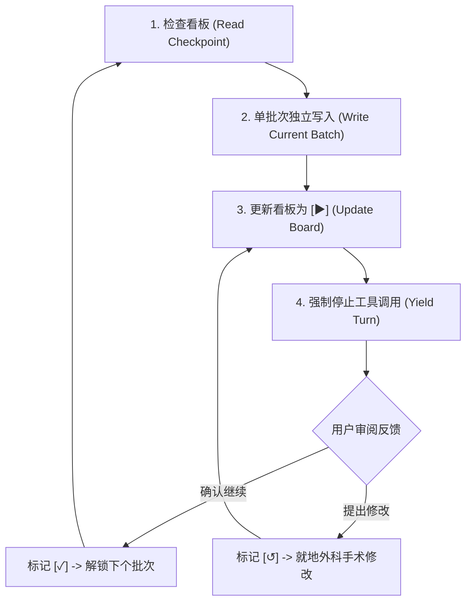

# 跨轮次交互分批执行协议 (Turn-Level Batching Protocol)

本协议专为 Tier 3（史诗级长文档或多文件套件）制定，通过严格的状态看板机与会话轮次中断控制，保证大型交付物的结构稳定、步步受控与零失控。

---

## 1. 触发条件与适用边界

- **强制触发**：多文件模块化文档套件（Multi-File Modular Suite）或预估行数 $> 500$ 行的复杂架构设计。
- **显式触发**：用户输入中包含 `--batch` 或 `--tier=3` 参数。

---

## 2. 状态看板与大纲映射契约 (Progress Board Schema)

在规划方案中，必须建立明确解耦的批次看板，并将每个批次与大纲树的具体章节序号严格绑定：

```markdown
### 批次执行进度状态看板 (Batch Progress Board)
- [ ] 批次 1: README.md 全套件交付总览与架构导航 (待执行 Pending)
- [ ] 批次 2: 01-architecture-and-baseline.md 架构基线与内核调优 (待执行 Pending)
- [ ] 批次 3: 02-installation-methods.md 安装部署全实战 (待执行 Pending)
- [ ] 批次 4: 03-production-ops-and-security.md 生产运维与安全加固 [含全套件权威参考资料与事实依据] (待执行 Pending)
```

> [!IMPORTANT]
> **多文档套件分批与参考文献收口契约**：
> - **批次 1 首发导航门面**：多文档套件必须将 `README.md`（或 `index.md`）规划为第 1 批次优先落盘，先向用户呈现全景拓扑、模块导航矩阵与推荐阅读路线。
> - **尾部追加模式（默认 2~3 个业务文件）**：看板最后一个业务批次必须显式标注 `[含全套件权威参考资料与事实依据]`。
> - **独立文件模式（$\ge 4$ 个业务文件或独立附录规划）**：独立参考文档作为看板最后一个独立执行批次（例如 `- [ ] 批次 5: 04-references.md 全局信源依据矩阵 (待执行 Pending)`）。

### 四大标准状态机 (Canonical States)
1. `[ ] 待执行 (Pending)`：前置依赖尚未完成，物理冻结，严禁超前执行。
2. `[▶] 待验收 (Awaiting Review)`：当前批次已落盘，看板更新就绪，等待用户审阅。
3. `[↺] 修改中 (Revising)`：用户提出批注或修改要求，就地修正中，后续批次保持冻结。
4. `[✓] 已验收 (Completed)`：用户显式确认通过，当前批次定稿归档，解锁下一批次。

---

## 3. 分批执行推进循环 (Execution Loop)

分批推进时，Agent 必须严格遵守以下 5 个原子步骤：



### Step 1: 强制前置读看板 (Pre-execution Checkpoint Reading)
- 在任何批次写入前，Agent **必须显式检查方案中的状态看板**，定位当前激活光标（`current_batch`）及对应大纲章节。
- 遇模糊指令（如“继续”、“改好了吗”、“下一步”），严格以看板当前状态为基准，禁止凭短期记忆盲目执行。

### Step 2: 单批次原子写入与微观核验 (Batch Execution & JIT Fact-Checking)
- 仅执行当前批次对应的大纲章节与目标文件，严禁越界撰写后续内容。
- **批次 1 门面执行原则**：批次 1 执行 `README.md` / `index.md` 写入时，聚焦输出全局元数据、离线警示（若有）、架构全景拓扑图、模块导航表格与阅读路线；事实依据部分仅保留指向最终篇章的导流锚点，严禁提前在此堆砌全量核查表格。
- **前序业务批次参考文献禁令**：中间各业务批次写入对应子文档时，**绝对严禁生成文末参考文献章节**；涉及外部依赖时仅在正文保留行内超链接。全套件事实依据核查矩阵严格由最后一批次完成。
- **JIT 细节检索**：遇到具体配置键名（YAML/properties）、API 参数或 CLI 命令时，若版本模糊必须即时发起原子搜索核验，杜绝参数脑补。

### Step 3: 更新看板状态为待验收
- 完成写入后，立即就地更新方案看板，将当前批次状态由 `[ ]` 改为 `[▶] 待验收 (Awaiting Review)`。

### Step 4: 强制停止工具调用与中断会话 (MANDATORY Turn-Yielding Rule)
> [!CAUTION]
> **交互硬性红线 (Hard Ceiling)**：
> 当前批次落盘并将看板更新为 `[▶]` 之后，**Agent 必须立刻停止调用任何工具 (MUST STOP CALLING TOOLS)**，强制结束当前会话轮次，把发言权交还给用户！
> **绝对禁止在同一会话轮次内连续调用工具偷跑下一批次！**

### Step 5: 会话交接汇报 (Chat Turn Handoff - 仅限对话框)
在聊天对话框中向用户输出精炼总结，格式如下：
1. **点击直达链接**：`[文件基名](file:///绝对路径)`（仅用于对话框供用户 IDE 快速预览，**严禁写入 Markdown 正文**）。
2. **本批交付摘要**：不超过 10 行的精炼要点说明。
3. **下批次预告**：1 行简要告知下一批次将覆盖的大纲章节。
4. **标准催审提示**：`"请审阅当前批次。确认无误请回复‘继续’推进下一批，若有调整意见请直接指出。"`

---

## 4. 就地纠偏与冻结规则 (In-Place Course Correction)

- 若用户对批次 $N$ 提出修改意见：
  1. 方案看板状态更新为 `[↺] 批次 N: 修改中 (Revising)`。
  2. 针对批次 $N$ 对应的文件进行外科手术式精准修改（Minimal Blast Radius）。
  3. 修改完成，状态切回 `[▶]`，再次交出轮次等待验收。
- **物理冻结红线**：只要批次 $N$ 处于 `[↺]` 或 `[▶]`，批次 $N+1$ 必须严格处于冻结状态，严禁擅自提前启动下一批次。
