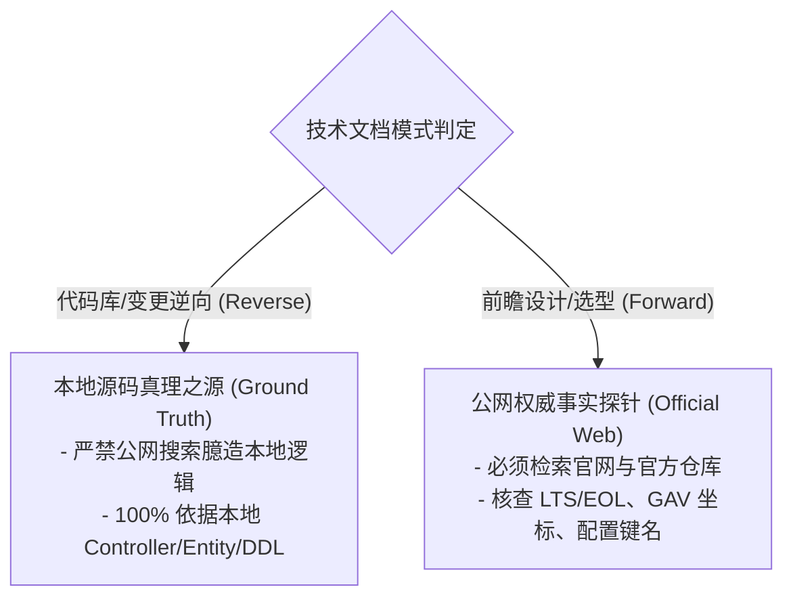

# 双源事实核验与抗幻觉协议 (Verification & Anti-Hallucination)

本协议定义了 `at-tech-doc` 在逆向分析与前瞻设计中必须遵循的双源事实探针机制与防虚构硬性闸门。

---

## 1. 双源事实探针分类 (Dual-Source Ground Truth)



### 1.1 逆向工程模式：本地代码库真理之源 (Local Ground Truth)
- **适用场景**：对现有工程编写 API 契约、数据字典、架构拓扑或排障手册。
- **信源红线**：
  - 针对工程自研的私有业务逻辑、Controller/Route 请求路径、Entity/DTO 字段以及数据库表 DDL，**必须严格以本地源码为唯一真理依据**。
  - **严禁**调用公网搜索工具去检索通用概念来替代或覆盖本地具体实现！

### 1.2 前瞻设计模式：公网权威技术探针 (Authoritative External Probe)
- **适用场景**：新特性技术选型 (Tech Spike)、ADR 架构决策、外部中间件接入。
- **信源红线**：
  - 凡涉及外部开源框架配置项、注解参数、Maven GAV / NPM 依赖包坐标及版本生命周期 (LTS/EOL)，**必须调用联网搜索工具检索官方权威文档或 Release Notes**。
  - 严格杜绝凭空捏造不存在的配置键名（如臆造的 Nginx 指令或 Spring Boot 属性）。

---

## 2. 网络受限与离线降级防御 (Air-Gapped / Network Fallback)

若当前环境处于纯离线状态或联网搜索工具不可用：
- **逆向模式**：正常执行，100% 依托本地源码。
- **前瞻/选型模式**：允许基于底层预训练知识生成，但**必须强制插入 `> [!CAUTION]` 警示块**：
  - **单文档交付**：在文档头部元数据下方插入；
  - **多文档套件交付**：**仅在全局导航入口文件（README.md / index.md）头部集中插入一次**，后续各业务子文档不再重复提示。
  ```markdown
  > [!CAUTION]
  > **外部技术参数未经联网核实声明**：
  > 当前环境联网检索工具受限，本文档中涉及的外部框架版本（如 LTS/EOL）、Maven/NPM 依赖坐标及具体中间件配置项未经官方最新文档实时在线核查，请架构师与实施团队在生产部署前逐项核对官方文档。
  ```

---

## 3. 防幻觉硬性指标与置信度梯队

### 3.1 真实性红线 (Four Zero-Tolerances)
1. **零虚构契约**：严禁捏造未实现的接口路径、字段名称或方法签名。
2. **零虚构配置**：严禁拼凑无依据的配置属性名与系统环境变量。
3. **零虚构基准**：严禁凭空编造带有精确小数点的基准性能 TPS/延迟数据。未实测数据一律标为“理论预估值”并附计算模型。
4. **零低质采信**：严禁采信未经同行审阅的营销搬运文章作为关键决策依据。

### 3.2 信源权威度分级 (Source Hierarchy)
- **Tier 1 (黄金信源 - 强制优先)**：官方文档、官方 GitHub 仓库、标准规范文档（RFC/W3C/ISO/JCP）、本地工程可验证源码。
- **Tier 2 (白银信源 - 辅助参考)**：权威云厂商白皮书、成熟开源社区工程博客（如 Netflix TechBlog、Uber Engineering）。
- **Tier 3 (青铜信源 - 严格禁止)**：非官方个人自媒体、未验证的 SEO 采集站、未经实操复现的问答帖。

---

## 4. 文档事实依据矩阵与多文档收敛标准 (References & Grounding)

所有生成的技术交付物必须包含标准化的事实依据核查矩阵，依交付物形态严格执行收敛：

### 4.1 单文档交付标准 (Single Document, 物理文件数 = 1)
生成的单篇文档末尾，必须包含标准化的事实依据章节与核查表格：

```markdown
## 权威参考资料与事实依据 (References & Grounding)

| 事实/决策点 | 采信依据/权威文档 | 信源等级 | 验证状态 |
| :--- | :--- | :--- | :--- |
| **Java 21 虚拟线程支持** | [Oracle JDK 21 Documentation](https://docs.oracle.com/en/java/javase/21/) | Tier 1 官方文档 | 已在线核实 |
| **Redis 7.2 持久化策略** | [Redis Official Docs - Persistence](https://redis.io/docs/management/persistence/) | Tier 1 官方文档 | 已在线核实 |
| **订单表 DDL 结构** | `src/main/resources/db/migration/V1__init_order.sql` | 本地源码真理 | 100% 依据本地 |
```

### 4.2 多文档套件收敛标准 (Multi-Document Suite, 物理文件数 > 1)
- **前序业务文档严格清空**：前序所有子文档（`01` 篇至倒数第二篇）严禁在文末放置事实依据章节与核查表格；正文一律采用行内超链接，末尾自然完结，不添加重复的导流尾注。
- **导航文件统领导流**：在全局导航文件（`README.md` / `index.md`）的模块导航表格与第 4 节收口说明中，通过相对路径及锚点注明全套件事实核查矩阵的归属位置（如指向 `./03-production-ops-and-security.md#权威参考资料与事实依据`）。导航文件本身不堆砌全量核查表格，保持门面整洁并规避分批时序冲突。
- **全套件统一收敛归口**：
  - **默认形态（2~3 篇业务文档）**：收口于**最后一个业务文档的最后一节**（如 `## N. 权威参考资料与事实依据 (References & Grounding)`），承载全套件的信源清单与汇总核查表格。
  - **升级形态（$\ge 4$ 篇业务文档或独立附录规划）**：以**编号自然顺延的独立文件**交付（例如前序为 `01-arch.md`, `02-api.md`, `03-db.md`，则顺延为 `04-references.md`；无数字前缀时命名为 `references.md`）。
