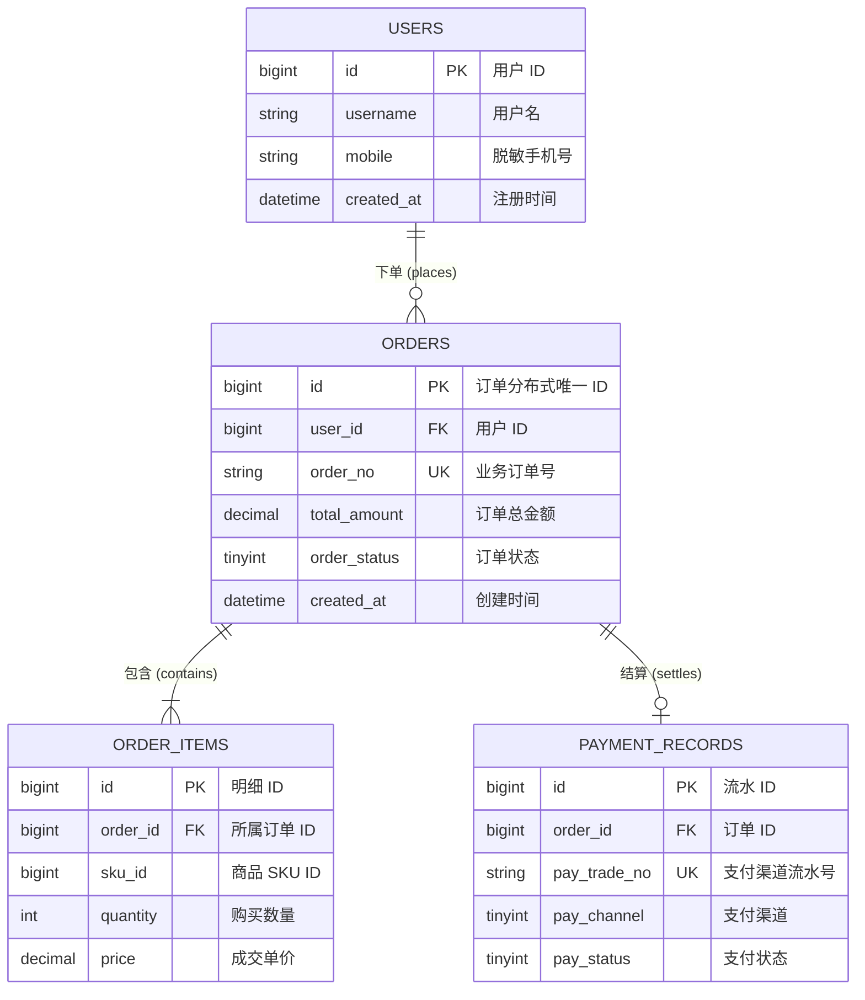

# [系统/业务域] 数据库设计与数据字典规范

| 属性 | 详情 |
| :--- | :--- |
| **文档类型** | 数据库设计与数据字典规范 (Database Schema Spec) |
| **当前状态** | 评审中 (In Review) |
| **设计人** | Ateng |
| **设计日期** | YYYY-MM-DD |
| **目标引擎** | MySQL 8.0+ (InnoDB) / PostgreSQL 16+ |
| **字符集规范** | `utf8mb4` / 排序规则: `utf8mb4_0900_ai_ci` |

---

## 目录 (Table of Contents)

- [1. 建模背景与容量预估](#1-建模背景与容量预估)
- [2. 概念模型与实体关系](#2-概念模型与实体关系)
- [3. 物理数据字典与表结构明细](#3-物理数据字典与表结构明细)
- [4. 索引规划与高频查询匹配分析](#4-索引规划与高频查询匹配分析)
- [5. 分库分表与冷热归档策略](#5-分库分表与冷热归档策略)
- [6. 数据安全、脱敏与审计合规](#6-数据安全脱敏与审计合规)
- [7. 权威参考资料与事实依据](#7-权威参考资料与事实依据)

---

## 1. 建模背景与容量预估

### 1.1 建模目标与业务范围
<!-- 阐述核心业务实体边界、生命周期与主从关系 -->

### 1.2 数据容量与并发预估
| 数据实体/表名 | 初始存量 | 日增行数预估 | 年增长体积 | 读写并发峰值 (QPS/TPS) |
| :--- | :--- | :--- | :--- | :--- |
| **订单主表 (orders)** | 100 万 | 10 万/天 | 约 36GB/年 | 读 3,000 / 写 800 |
| **订单明细表 (order_items)** | 300 万 | 30 万/天 | 约 90GB/年 | 读 5,000 / 写 800 |
| **支付流水表 (payment_records)**| 100 万 | 10 万/天 | 约 25GB/年 | 读 1,000 / 写 400 |

---

## 2. 概念模型与实体关系



---

## 3. 物理数据字典与表结构明细

### 3.1 订单主表 (`orders`)

- **业务用途**：记录交易核心主订单信息及状态变更。
- **存储引擎**：`InnoDB`
- **主键策略**：雪花算法 (Snowflake) 生成分布式 `BIGINT UNSIGNED`。

#### 字段定义清单
| 字段名称 | 物理类型 | 必填 | 默认值 | 约束/索引 | 业务含义与取值枚举 |
| :--- | :--- | :--- | :--- | :--- | :--- |
| `id` | `BIGINT UNSIGNED` | 是 | 无 | **PK** | 分布式唯一雪花 ID |
| `order_no` | `VARCHAR(64)` | 是 | 无 | **UK (`uk_order_no`)** | 业务订单编号（面向外部用户展示） |
| `user_id` | `BIGINT UNSIGNED` | 是 | 无 | **IDX (`idx_user_status`)** | 下单用户 ID |
| `order_status` | `TINYINT` | 是 | `0` | **IDX (`idx_user_status`)** | 状态：`0`:待付, `1`:已付, `2`:已发货, `3`:完成, `4`:已取消 |
| `total_amount` | `DECIMAL(12,2)` | 是 | `0.00` | 无 | 订单实付总额（单位：元） |
| `pay_time` | `DATETIME` | 否 | NULL | 无 | 支付成功到账时间 |
| `is_deleted` | `TINYINT` | 是 | `0` | 无 | 逻辑删除标记：`0`:未删, `1`:已删 |
| `created_at` | `DATETIME` | 是 | `CURRENT_TIMESTAMP` | **IDX (`idx_created_at`)** | 记录生成时间 |
| `updated_at` | `DATETIME` | 是 | `CURRENT_TIMESTAMP ON UPDATE CURRENT_TIMESTAMP` | 无 | 记录最后更新时间 |

#### 标准建表 DDL
```sql
CREATE TABLE `orders` (
  `id` BIGINT UNSIGNED NOT NULL COMMENT '分布式唯一订单ID',
  `order_no` VARCHAR(64) NOT NULL COMMENT '业务订单号',
  `user_id` BIGINT UNSIGNED NOT NULL COMMENT '买家用户ID',
  `order_status` TINYINT NOT NULL DEFAULT 0 COMMENT '订单状态: 0=待付款, 1=已付款, 2=已发货, 3=已完成, 4=已取消',
  `total_amount` DECIMAL(12,2) NOT NULL DEFAULT 0.00 COMMENT '实付总金额(元)',
  `pay_time` DATETIME DEFAULT NULL COMMENT '支付时间',
  `is_deleted` TINYINT NOT NULL DEFAULT 0 COMMENT '逻辑删除: 0=未删除, 1=已删除',
  `created_at` DATETIME NOT NULL DEFAULT CURRENT_TIMESTAMP COMMENT '创建时间',
  `updated_at` DATETIME NOT NULL DEFAULT CURRENT_TIMESTAMP ON UPDATE CURRENT_TIMESTAMP COMMENT '更新时间',
  PRIMARY KEY (`id`),
  UNIQUE KEY `uk_order_no` (`order_no`),
  KEY `idx_user_status` (`user_id`, `order_status`),
  KEY `idx_created_at` (`created_at`)
) ENGINE=InnoDB DEFAULT CHARSET=utf8mb4 COLLATE=utf8mb4_0900_ai_ci COMMENT='订单交易核心主表';
```

---

## 4. 索引规划与高频查询匹配分析

| 核心业务查询场景 | 匹配命中索引 | 复合索引列序设计考量 | 预期查询耗时 (P99) |
| :--- | :--- | :--- | :--- |
| 用户中心按状态查订单列表 | `idx_user_status` | `(user_id, order_status)` 等值匹配优先 | < 5ms |
| 财务按天/月汇总对账流水 | `idx_created_at` | `(created_at)` 覆盖时间范围扫描 | < 30ms |
| 外部回调按商户订单号防重查询 | `uk_order_no` | `(order_no)` 唯一索引常数级定位 | < 1ms |

---

## 5. 分库分表与冷热归档策略

### 5.1 分库分表规划 (分片键：`user_id`)
> [!NOTE]
> 当单表体量突破 `1,000 万行` 或存储突破 `20GB` 时启动分片。
- **Sharding Key**：统一采用 `user_id % 32` 切分至 32 张物理分表，杜绝跨库跨表广播查询。
- **商户端全局索引**：非 `user_id` 维度的运营检索统一同步至 Elasticsearch 构建二级宽表索引。

### 5.2 历史冷数据归档机制
- 超过 **180 天** 处于最终态（已完成/已取消）的历史订单，由后台定时任务平滑归档至历史冷库（MySQL 历史归档库或 ClickHouse/OSS 数据湖）。

---

## 6. 数据安全、脱敏与审计合规

- **敏感字段保护**：手机号、身份证等 PII 信息，应用层采用 AES-256 加密落盘，展示层采用掩码脱敏（如 `138****1234`）。
- **通用审计字段基线**：所有新建物理表必须强制携带 `created_at`, `updated_at`, `is_deleted` 字段，严格杜绝物理 Hard Delete。

---

## 7. 权威参考资料与事实依据

### 7.1 权威信源引用清单
- [[Tier 1]] [MySQL 8.0 官方参考手册 - 字符集与排序规则](https://dev.mysql.com/doc/refman/8.0/en/charset.html) - 核验 `utf8mb4_0900_ai_ci` 性能表现与兼容性边界 (核验日期: YYYY-MM-DD)
- [[Tier 1]] [MySQL InnoDB 存储引擎限制与行格式](https://dev.mysql.com/doc/refman/8.0/en/innodb-row-format.html) - 核验 `DYNAMIC` 行格式、B+树大字段溢出页行为及 65535 字节行长度限制 (核验日期: YYYY-MM-DD)
- [[Tier 1]] [ShardingSphere / 分库分表官方指南 (若涉及分片)](https://shardingsphere.apache.org/) - 核验分布式主键生成算法 (Snowflake) 与绑定表分片规则约束 (核验日期: YYYY-MM-DD)

### 7.2 事实核验矩阵
| 核查对象 (引擎/类型/特性) | 官方基准事实 (Ground Truth) | 对应权威依据 (Tier 1 链接) | 核验状态 |
| :--- | :--- | :--- | :--- |
| **字符集标准** | MySQL 8.0 默认且推荐 `utf8mb4`，支持完整 Emoji 存储 | [MySQL Docs](https://...) | 已核实官方规范 |
| **自增主键类型** | 生产核心大表强制采用 `BIGINT UNSIGNED` (8字节) | [MySQL Data Types](https://...) | 已核实避免整型溢出 |
| **JSON/虚拟列索引** | MySQL 8.0 支持多值索引 (Multi-Valued Index) 索引 JSON 数组 | [MySQL JSON Docs](https://...) | 已核实官方高级特性 |

