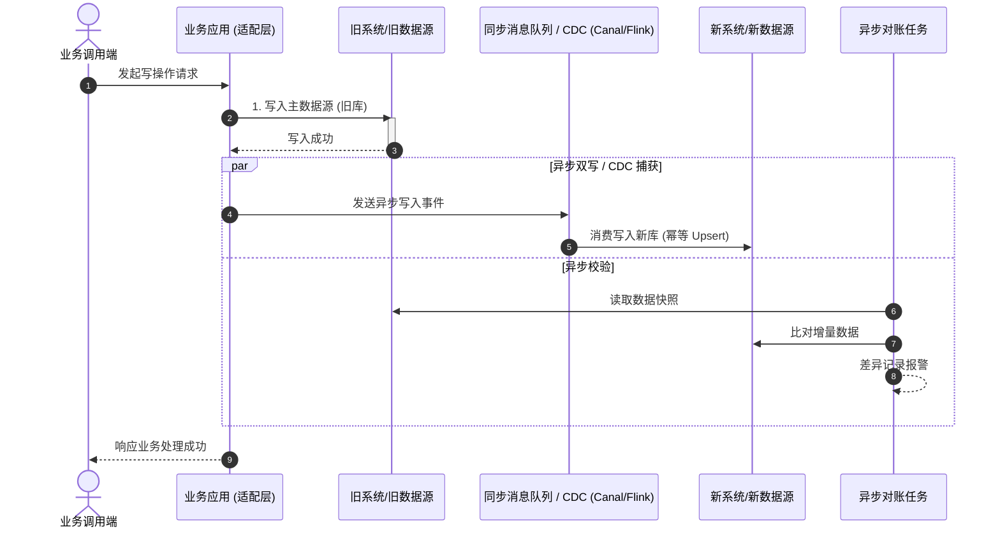

# [系统/数据割接名称] 割接迁移与重构方案

| 属性 | 详情 |
| :--- | :--- |
| **文档类型** | 割接迁移 / 系统重构 / 数据平滑迁移方案 |
| **当前状态** | 评审中 (In Review) |
| **作者** | Ateng |
| **创建日期** | YYYY-MM-DD |
| **关联模块** | [旧服务名 -> 新服务名 / 旧数据表 -> 新数据表] |

---

## 1. 割接背景与目标约束

### 1.1 割接背景与驱动力
<!-- 阐述为什么进行割接重构（如技术栈升级、分库分表、单体拆微服务、存储换型等） -->

### 1.2 核心目标与红线指标
- **业务可用性目标**：服务零停机 (Zero Downtime) 或计划内停机窗口 $\le X$ 分钟。
- **数据一致性目标**：新旧数据实现 100% 幂等同步与核对，容忍数据延迟 $\le X$ 秒，零丢失 (RPO=0)。
- **性能约束**：双写或旁路同步对现有线上业务接口耗时增量不超过 $5\%$。
- **明确非目标 (Non-Goals)**：
  - 本次迁移暂不涉及的边缘模块与历史归档数据。

---

## 2. 割接总体架构与演进拓扑

### 2.1 割接阶段演进全景

### 2.2 双写与数据流向时序

---

## 3. 详细迁移阶段与实施步骤

### 3.1 阶段一：环境就绪与存量数据全量迁移
1. **数据快照对齐**：记录全量迁移启动时的增量游标（Binlog Position 或时间戳点）。
2. **全量数据导出与导入**：
   - 采用分片并发导出导入策略，设置流控速率（限速 $N$ rows/s），避免击垮旧库。
3. **存量一致性校验**：通过 CRC32 / MD5 校验和对账，确保全量数据无遗漏。

### 3.2 阶段二：增量实时同步与双写
1. **双写/CDC 链路建立**：启动实时数据捕获链路，追赶全量迁移期间产生的增量数据差。
2. **幂等性与乱序防御**：新库写入强制采用依据版本号或最后更新时间的幂等覆盖机制。

### 3.3 阶段三：影子比对与一致性对账
1. **在线数据核对任务**：启动常驻对比任务，实时抽样比对新旧系统的输出结果与数据状态。
2. **长尾差异修复 (Reconciliation SOP)**：针对比对出的差异，制定自动与手动补偿脚本。

| 比对指标 | 目标基线 | 当前实测 | 达标状态 |
| :--- | :--- | :--- | :--- |
| **字段完全匹配率** | 100.00% | 99.999% | 持续追平 |
| **实时同步延迟** | $\le 500\text{ ms}$ | $120\text{ ms}$ | 已达标 |
| **异常报错率** | 0.00% | 0.00% | 已达标 |

### 3.4 阶段四：读写流量分级切流
- **4.1 读流量灰度倒换**：
  - 内部白名单测试 $\rightarrow$ 灰度 $10\%$ $\rightarrow$ 灰度 $50\%$ $\rightarrow$ 全量 $100\%$。
  - 发生任何异常秒级切回旧库读取。
- **4.2 写流量主备倒换**：
  - 选定业务低峰期割接窗口（如凌晨 02:00~04:00）。
  - 执行主写权倒换，新库设为主写，反向同步链路生效（新库写向旧库），保留回滚通道。

---

## 4. 故障应急与回滚预案

> [!CAUTION]
> 割接实施必须遵守“逢切必备回滚”原则。只要触发不可控异常或核心指标破线，必须在决策时限内执行回滚！

### 4.1 回滚触发红线
1. 核心接口错误率超过 $1\%$ 持续达 3 分钟；
2. 核心接口 P99 延迟劣化超过 $200\%$ 且无法自动降级恢复；
3. 发现无法自动补偿的脏数据污染且波及范围 $> 0.1\%$。

### 4.2 回滚步骤操作手册
| 步骤序号 | 执行动作 | 操作命令/途径 | 耗时预估 | 负责人 |
| :--- | :--- | :--- | :--- | :--- |
| **Step 1** | 配置中心切换读写流量开关至旧系统 | Apollo / Nacos 调整 `traffic.target=OLD` | 30 秒 | 运维 / 值班 |
| **Step 2** | 关闭新库写入权限，阻断外部请求 | 撤销新库应用写权限 | 1 分钟 | DBA |
| **Step 3** | 执行反向对账，补齐割接期间新库新增写入 | 执行补差脚本 `reconcile_rollback.sh` | 5 分钟 | 开发核心 |
| **Step 4** | 业务全量功能冒烟回归验证 | 执行自动化回归用例集 | 3 分钟 | QA |

---

## 5. 验收与收尾标准

- [ ] 新系统完全承接读写流量，平稳运行 $\ge 7\times 24$ 小时无 P3 及以上故障；
- [ ] 连续 3 天全量对账一致性达到 100.00%；
- [ ] 旧系统反向同步链路平稳解绑，只读归档；
- [ ] 割接临时配置与降级代码清理完成，合并归档上线。
