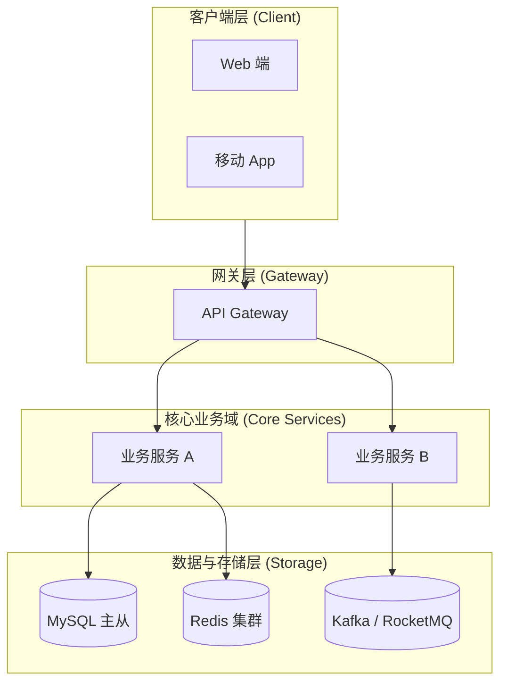
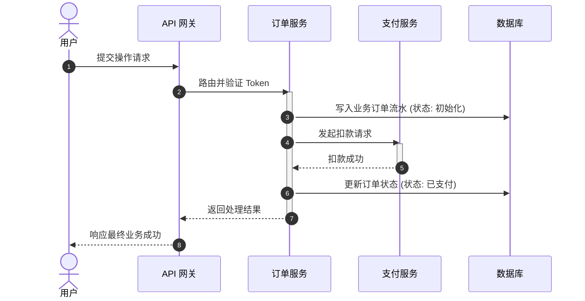
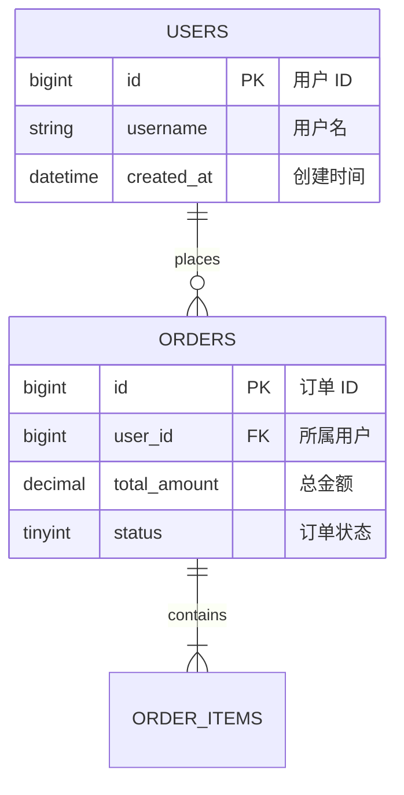
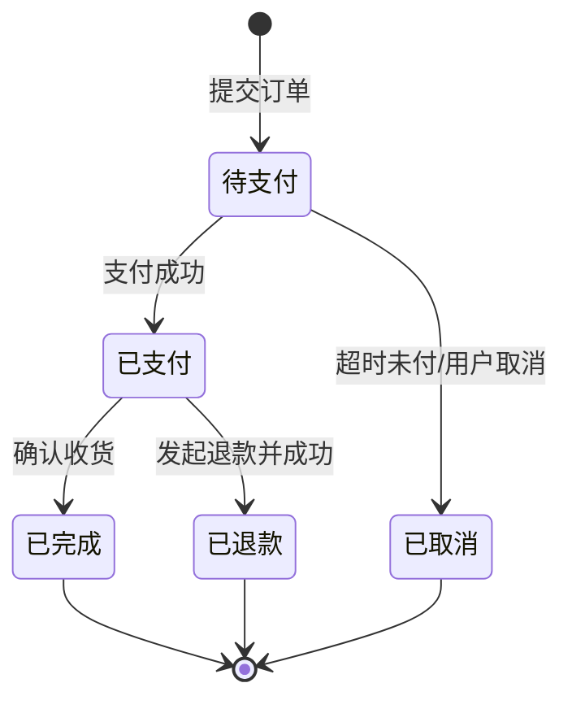

# [系统/方案名称] 技术设计方案 (RFC)

| 属性 | 详情 |
| :--- | :--- |
| **文档类型** | RFC 技术方案设计 (Request for Comments) |
| **当前状态** | 评审中 (In Review) |
| **作者** | Ateng |
| **创建日期** | YYYY-MM-DD |
| **关联模块** | [服务名/仓库名] |

---

## 1. 方案背景与业务目标

### 1.1 背景说明
<!-- 阐明为什么要做这个方案、解决了什么现有痛点或业务诉求 -->

### 1.2 核心目标与明确边界
- **核心目标**：
  - 目标 1：...
  - 目标 2：...
- **明确不做**：
  - 非目标 1：...

---

## 2. 技术选型与权衡对比

| 评估维度 | 方案 A: [备选方案] | 方案 B: [本案采用方案] |
| :--- | :--- | :--- |
| **实现原理** | ... | ... |
| **吞吐与延迟** | ... | ... |
| **运维与改造成本** | ... | ... |
| **决策结论** | 放弃理由：... | **最终采纳**。推荐指数：⭐⭐⭐⭐⭐ |

---

## 3. 总体架构与系统交互

### 3.1 架构拓扑分层图

### 3.2 核心业务调用时序

---

## 4. 详细技术实现设计

### 4.1 数据模型设计

### 4.2 核心接口与协议契约
<!-- 关键 API 契约简述，详细接口可交叉引用 API Spec -->

### 4.3 关键业务状态机

---

## 5. 防御性设计与边界处理

### 5.1 异常场景与降级容灾
- **下游依赖超时/宕机**：熔断降级策略，兜底返回默认数据。
- **并发与防重防刷**：分布式锁（Redis Redisson）与接口幂等 Token 机制。
- **数据一致性保证**：采用本地消息表 + MQ 最终一致性。

### 5.2 容量评估与性能基线
- **QPS/TPS 预估**：日常峰值预估 `5,000 QPS`，大促峰值预估 `20,000 QPS`。
- **存储增长预估**：单表日增 `100 万条`，单条约 `1KB`，预留 `100GB/年`，考虑分库分表或历史冷热归档。

---

## 6. 上线、发布与回滚方案

### 6.1 发布实施步骤
1. **执行数据库 DDL/DML 迁移脚本**（向后兼容，只加列不改旧列）。
2. **部署后端服务**（按灰度比例：10% -> 30% -> 100%）。
3. **线上健康巡检与关键业务指标观测**（错误率、P99 耗时）。

### 6.2 异常回滚预案
> [!WARNING]
> 一旦生产环境错误率超过 0.5% 或 P99 耗时超过 800ms，立即执行回滚。

- **应用回滚**：直接通过发布平台一键回退到上一稳定镜像版本。
- **数据回滚**：新字段由于向后兼容设计，回滚无需回退表结构；如产生脏数据执行清洗脚本 `scripts/clean-dirty-data.sql`。

---

## 7. 权威参考资料与事实依据

### 7.1 权威信源引用清单
- [[Tier 1]] [Spring Boot 官方配置与特性文档](https://...) - 核验方案引入的核心注解与配置项有效性 (核验日期: YYYY-MM-DD)
- [[Tier 1]] [Redis / Redisson 官方分布式锁指南](https://...) - 核验看门狗机制与集群红锁配置参数 (核验日期: YYYY-MM-DD)
- [[Tier 1]] [MySQL 官方参考手册](https://...) - 核验高并发隔离级别与 InnoDB 锁机制边界 (核验日期: YYYY-MM-DD)

### 7.2 事实核验矩阵
| 核查对象 (组件/配置/版本) | 官方基准事实 (Ground Truth) | 对应权威依据 (Tier 1 链接) | 核验状态 |
| :--- | :--- | :--- | :--- |
| **分布式锁看门狗参数** | 官方默认 `lockWatchdogTimeout=30000ms`，自动续期需无超时加锁 | [Redisson Docs](https://...) | 已核实官方原生实现 |
| **MQ 消费者幂等配置** | 框架支持手动 ACK 与死信队列配置属性真实存在 | [官方中间件规范](https://...) | 已核实参数真实有效 |
| **框架最低兼容版本** | 本案所用特性在 Spring Boot 3.x 及以上原生支持 | [Spring Release Notes](https://...) | 已核验兼容性正常 |

