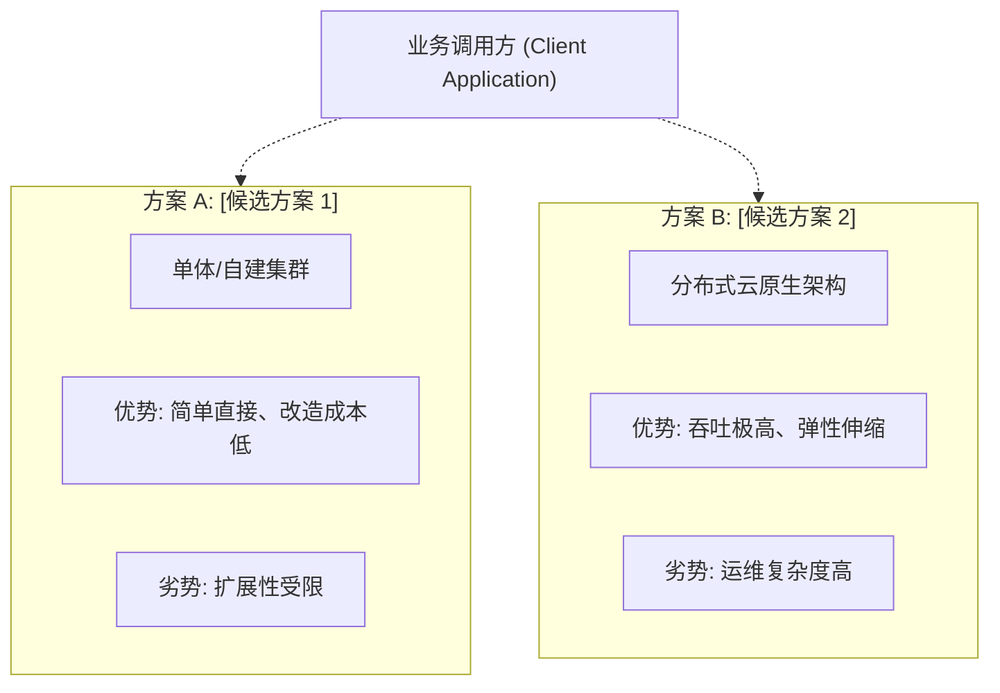

# [技术命题/组件] 选型调研与 PoC 评估报告

| 属性 | 详情 |
| :--- | :--- |
| **文档类型** | 技术调研与 PoC 评估报告 (Technical Spike) |
| **当前状态** | 调研中 (In Progress) / 已结题 (Concluded) |
| **调研人** | Ateng |
| **调研日期** | YYYY-MM-DD |
| **目标业务域** | [高并发缓存 / 消息中枢 / 向量检索 / 调度系统] |

---

## 目录 (Table of Contents)

- [1. 调研背景与核心命题](#1-调研背景与核心命题)
- [2. 评估维度与准入约束](#2-评估维度与准入约束)
- [3. 候选方案深度对比](#3-候选方案深度对比)
- [4. 原型验证与压测实测结果](#4-原型验证与压测实测结果)
- [5. 加权综合决策矩阵](#5-加权综合决策矩阵)
- [6. 调研结论与落地演进建议](#6-调研结论与落地演进建议)
- [7. 权威参考资料与事实依据](#7-权威参考资料与事实依据)

---

## 1. 调研背景与核心命题

### 1.1 现状挑战与痛点
<!-- 详细阐述当前架构遇到的性能瓶颈、成本问题或业务扩展障碍 -->

### 1.2 调研目标与非目标
- **核心攻关目标**：
  - 目标 1：...
  - 目标 2：...
- **明确边界 (Out of Scope)**：
  - 本次调研不覆盖：...

---

## 2. 评估维度与准入约束

| 评估维度 | 权重 (Weight) | 达标底线 (Hard Constraint) | 考察重点 |
| :--- | :--- | :--- | :--- |
| **性能与延迟** | 30% | 峰值 P99 耗时 < 20ms | 高并发读写吞吐、长尾延迟表现 |
| **高可用与容灾** | 25% | 支持跨可用区自动 Failover | 数据丢失容忍度 (RPO)、恢复时间 (RTO) |
| **运维与生态** | 20% | 容器化易部署、监控完备 | Prometheus / Grafana 支持、诊断工具链 |
| **技术栈契合度** | 15% | 团队具备 1~2 人掌控力 | Java/Spring Boot SDK 成熟度、排错学习曲线 |
| **开源许可证风险** | 10% | Apache 2.0 / MIT / BSD | 严禁 SSPL 等具有闭源传染风险的协议 |

---

## 3. 候选方案深度对比

### 3.1 方案横向特性矩阵
| 特性项 | 方案 A: [方案名] | 方案 B: [方案名] | 方案 C: [方案名] |
| :--- | :--- | :--- | :--- |
| **核心架构** | ... | ... | ... |
| **成熟度与社区** | ... | ... | ... |
| **持久化与一致性** | ... | ... | ... |
| **客户端生态支持** | ... | ... | ... |

---

## 4. 原型验证与压测实测结果

### 4.1 测试环境与基准配置
- **服务器配置**：4C 8G 虚拟机 3 节点，SSD 存储。
- **压测工具**：JMeter / Wrk / 自研压测脚本。
- **数据规模**：1,000 万基础测试数据集，模拟 7:3 读写比。

### 4.2 基准测试数据矩阵
| 指标项 | 方案 A | 方案 B | 方案 C | 对比结论 |
| :--- | :--- | :--- | :--- | :--- |
| **平均 QPS** | 8,200 | **18,500** | 12,100 | 方案 B 吞吐领跑 |
| **P99 响应延迟** | 45ms | **12ms** | 28ms | 方案 B 长尾延迟最稳 |
| **CPU 峰值占用** | 88% | **62%** | 79% | 方案 B 资源利用更优 |
| **故障转移耗时 (RTO)** | 35s | **3s** | 15s | 方案 B 自动 Failover 敏捷 |

---

## 5. 加权综合决策矩阵

| 评估项目 | 权重 | 方案 A 得分 | 方案 B 得分 | 方案 C 得分 |
| :--- | :--- | :--- | :--- | :--- |
| 性能与延迟 | 30% | 7.0 (2.1) | **9.5 (2.85)** | 8.0 (2.4) |
| 高可用与容灾 | 25% | 6.5 (1.63) | **9.0 (2.25)** | 7.5 (1.88) |
| 运维与监控 | 20% | 8.0 (1.6) | **8.5 (1.7)** | 7.0 (1.4) |
| 团队技术契合 | 15% | **9.0 (1.35)** | 7.5 (1.13) | 7.0 (1.05) |
| 协议安全 | 10% | 10.0 (1.0) | 10.0 (1.0) | 10.0 (1.0) |
| **综合加权得分** | 100% | 7.68 | **8.93** | 7.73 |

---

## 6. 调研结论与落地演进建议

### 6.1 最终结论
> [!TIP]
> **采纳方案 B**。综合压测与可用性验证，方案 B 在长尾延迟与集群弹性方面优势显著，全面满足未来 3 年业务翻倍需求。

### 6.2 下一步实施计划
1. **沉淀架构决策**：输出对应的 `ADR` 明确全团队技术规范。
2. **基础组件封装**：开发团队公共 Starter / SDK，统一配置连接池与限流熔断。
3. **试水试点**：选取低敏感度边缘业务灰度上线，平稳过渡后全面铺开。

---

## 7. 权威参考资料与事实依据

### 7.1 权威信源引用清单
- [[Tier 1]] [方案 B 官方架构白皮书与性能基准](https://...) - 核验高可用架构、Failover 机制与官方压测数据 (核验日期: YYYY-MM-DD)
- [[Tier 1]] [方案 A 官方文档与发布说明](https://...) - 核验最新稳定版本号与 EOL 生命周期 (核验日期: YYYY-MM-DD)
- [[Tier 2]] [云厂商组件最佳实践与高可用部署指南](https://...) - 辅助验证容器化集群拓扑与监控指标建议 (核验日期: YYYY-MM-DD)

### 7.2 事实核验矩阵
| 核查对象 (组件/版本/配置) | 官方基准事实 (Ground Truth) | 对应权威依据 (Tier 1 链接) | 核验状态 |
| :--- | :--- | :--- | :--- |
| **方案 B 核心依赖坐标** | 最新稳定版 `org.example:sdk:2.4.0`，适配 JDK 21 | [Maven Central](https://...) | 已核实真实存在 |
| **Failover 自动化支持** | 官方原生支持 Raft/Gossip 协议，无需引入外部协调者 | [官方架构文档](https://...) | 已核实官方原生特性 |
| **开源许可证属性** | Apache 2.0 协议，商业友好无闭源传染风险 | [GitHub License](https://...) | 已核验合规安全 |

