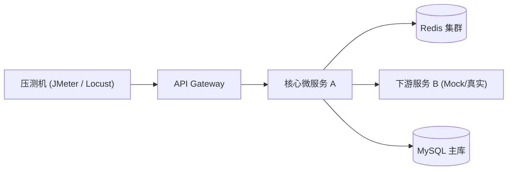
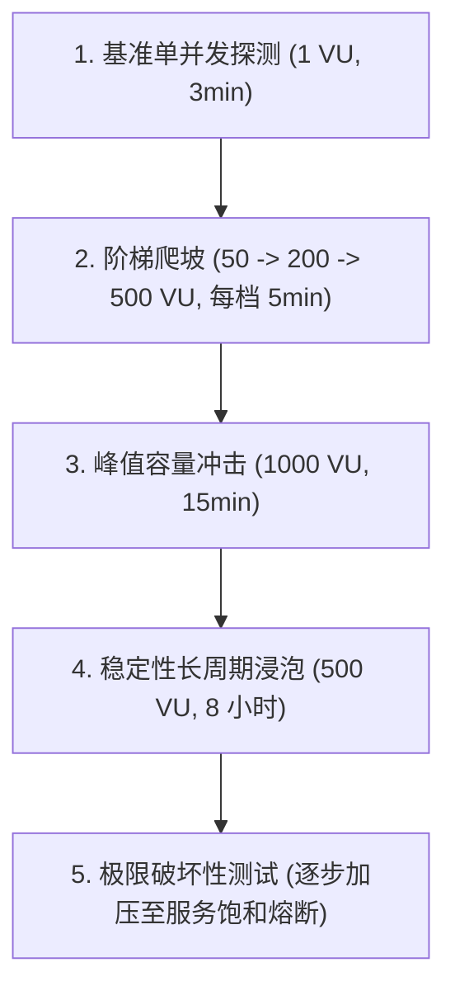

# [项目/功能名称] 联调契约与性能压测方案 (Test Plan)

| 属性 | 详情 |
| :--- | :--- |
| **文档类型** | 联调验证 / 性能压测 / 质量验收方案 |
| **当前状态** | 评审中 (In Review) |
| **作者** | Ateng |
| **创建日期** | YYYY-MM-DD |
| **关联模块** | [服务名/核心 API 列表] |

---

## 1. 测试背景与目标范围

### 1.1 背景与测试诉求
<!-- 说明本次测试的业务背景、涉及的核心变更与验证目的（如大促保障、架构改造压测、多团队多服务联调） -->

### 1.2 测试核心范围与明确免测项
- **重点覆盖范围**：
  - 核心业务主流程链路联调验证。
  - 核心接口高并发基线与极限容量压测。
  - 弱网、容灾与服务熔断降级演练。
- **明确免测范围**：
  - 非核心管理后台低频接口。

---

## 2. 被测链路与环境拓扑

### 2.1 被测链路调用全景

### 2.2 压测与联调环境基准
| 组件名称 | 实例规格 (CPU/内存) | 部署节点数 | 中间件配置版本 | 数据量基准 |
| :--- | :--- | :--- | :--- | :--- |
| **应用服务 A** | 4C 8G | 4 节点 | JDK 21 / Spring Boot 3.x | - |
| **MySQL 数据库** | 8C 32G (SSD) | 1 主 2 从 | MySQL 8.0 (InnoDB) | 存量数据 5000 万条 |
| **Redis 缓存** | 16G 内存 | 3 分片集群 | Redis 7.2 | 预热键值 100 万 |

---

## 3. 性能压测模型与性能指标契约

### 3.1 核心性能 SLO 达标基线
| 压测场景/接口 | 目标并发数 (VU) | 目标吞吐量 (TPS) | P95 响应时间 (RT) | P99 响应时间 (RT) | 最大容忍错误率 |
| :--- | :--- | :--- | :--- | :--- | :--- |
| **核心查询接口** | 1,000 | $\ge 5,000\text{ req/s}$ | $\le 50\text{ ms}$ | $\le 100\text{ ms}$ | $< 0.01\%$ |
| **核心下单接口** | 500 | $\ge 1,500\text{ req/s}$ | $\le 150\text{ ms}$ | $\le 300\text{ ms}$ | $< 0.05\%$ |
| **批量处理任务** | 50 | $\ge 200\text{ ops/s}$ | $\le 500\text{ ms}$ | $\le 1,000\text{ ms}$ | $0.00\%$ |

### 3.2 施压策略与阶梯爬坡曲线

---

## 4. 接口联调断言契约

### 4.1 联调用例与断言规则
| 用例编号 | 业务场景 | 请求方法与路径 | 关键入参特征 | 预期 HTTP 码 | 预期返回断言 (JSONPath) |
| :--- | :--- | :--- | :--- | :--- | :--- |
| **TC-01** | 正常下单 | `POST /api/v1/orders` | 真实合规用户 ID 与库存充足商品 | 200 | `$.code == 200 && $.data.orderId != null` |
| **TC-02** | 重复防刷拦截 | `POST /api/v1/orders` | 携带相同幂等 Token 重复提交 | 409 | `$.code == 409 && $.msg =~ /重复提交/` |
| **TC-03** | 余额不足异常 | `POST /api/v1/orders` | 账户余额清零 | 400 | `$.code == 40012 && $.data.retry == false` |

### 4.2 联调 Mock 桩与外部依赖解耦
- **第三方支付服务**：配置 WireMock / Nginx 挡板桩，模拟 200 成功、500 异常及 5 秒超时超时场景。
- **短信验证码通道**：开启联调环境通用后门验证码（如 `888888`），禁止外发短信。

---

## 5. 缺陷定级与上线准出红线

### 5.1 缺陷等级标准定义
- **P0 (阻断性缺陷)**：主流程瘫痪、数据错乱、资金安全风险或死锁崩溃。
- **P1 (严重缺陷)**：核心功能异常、未达到性能 SLO 底线要求、降级失效。
- **P2 (一般缺陷)**：非核心功能体验缺陷、边缘参数未校验。
- **P3 (轻微缺陷)**：文字提示不规范、轻微样式偏移。

### 5.2 质量准出核查清单
- [ ] P0、P1 级缺陷 100% 修复并回归验证通过；
- [ ] 核心接口吞吐量与 P99 响应耗时完全达到 SLO 基线指标；
- [ ] 8 小时稳定性浸泡测试期间，系统无内存泄漏 (OOM) 且 Full GC 频次 $\le 1$ 次/小时；
- [ ] 容灾熔断演练完成，下游故障时网关正常降级且不拖垮上游核心链路。
