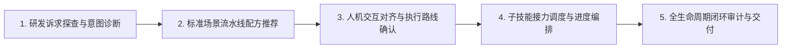

# 全生命周期研发工作流总控路由技能 (Master Workflow Orchestrator)

本技能作为全库 31 个 AI Agent 软件工程技能的总控调度中枢，提供开发者意图诊断、标准化流水线配方推荐与跨技能无缝调度。

## 执行流程状态机 (Execution State Machine)

### 阶段 1：研发诉求探查与意图诊断 (Intent Diagnosis)
- 优先响应 help / help <skill> 子命令或 --help 参数，直接渲染五段式技能卡片；
- 倾听并解析开发者提出的初始自然语言指令，识别核心业务与工程关注点；
- 运用意图诊断决策树判定任务类型（新特性/热修/重构/规范治理/发版）；
- 探查当前代码仓库状态、已有规范文件与 Git 分支上下文；
- 诊断决策树规则参考 [全局工作流总控路由协议](./references/protocols/workflow-routing-protocol.md)。

### 阶段 2：标准场景流水线配方推荐 (Recipe Recommendation)
- 匹配六大经典流水线配方（特性流、热修流、重构流、门面流、运维流、交接流）；
- 提取任务所必需的最小特权原子技能子集，规划拓扑调用顺序与交接契约；
- 输出结构化的场景诊断菜单与配方卡片；
- 菜单展示规范参考 [研发工作流交互向导模板](./references/templates/workflow-menu-template.md)。

### 阶段 3：人机交互对齐与执行路线确认 (Interactive Alignment)
- 向开发者展示建议的技能调用链路与关键阶段产出物预期；
- 针对模糊需求引导前置质询（`at-grill`），针对技术不确定项推荐可行性探针；
- 获取开发者显式确认后锁定本轮工作流执行蓝图；
- 经典交互编排参考 [全生命周期多技能协同实战样例](./examples/sample-workflow-orchestration.md)。

### 阶段 4：子技能接力调度与进度编排 (Skills Orchestration)
- 依据拓扑顺序渐进式激活子技能，管理各阶段输入输出产物跨技能传递；
- 实时渲染工作流推进状态看板，动态呈现当前节点与待办清单；
- 遇到意外阻塞或上下文逼近极限时，及时调用 `at-handoff` 保护现场；
- 技能依赖矩阵参考 [全局工作流总控路由协议](./references/protocols/workflow-routing-protocol.md)。

### 阶段 5：全生命周期闭环审计与交付 (Lifecycle Audit)
- 核对全链路交付物是否满足契约（文档、单测、实现、审查、标签 100% 齐备）；
- 执行全局排版门禁自检与零绝对路径审计，阻断不合规变更；
- 总结本次研发效能与工程质量收益，生成交付报告。

## 质量控制与合规自检 (Quality Checklist)
- [ ] 意图诊断准确，推荐的配方与技能子集严格遵循最小特权原则；
- [ ] 流水线推进过程透明，每个阶段向开发者提供清晰的状态看板与交付物说明；
- [ ] 阻断越级操作：未确认契约前严禁跳步编写业务代码；
- [ ] 严格遵守 Git 两级授权原则，代码提交与远端推送绝不越权自主执行；
- [ ] 所有文档输出严格服从盘古之白中西文排版与相对路径规范。

## 知识索引地图 (Knowledge Map)

| 知识模块 | 相对路径 | 核心内容说明 |
| :--- | :--- | :--- |
| 总控路由协议 | `./references/protocols/workflow-routing-protocol.md` | 四层金字塔模型、意图决策树、六大经典配方与契约矩阵 |
| 交互向导模板 | `./references/templates/workflow-menu-template.md` | 场景选择菜单、意图确认卡片与推进看板 Markdown 模板 |
| 实战案例样本 | `./examples/sample-workflow-orchestration.md` | 商城优惠券全生命周期 6 大技能协同串联实战全流程 |

## 交付成果规范 (Deliverables Benchmark)
- **工作流推进看板**：清晰展示当前步骤、完成项与待办项的 Markdown 进度看板；
- **场景定制路线图**：明确阶段顺序、子技能责任与交付契约的实施方案；
- **全生命周期产物包**：包含规范、代码、单测、审查报告与发版标签的完整成果；
- **效能复盘总结书**：记录缺陷拦截节点、测试覆盖度与交付效率的自检报告；
- **跨会话接力索引**：需要切会话时同步输出的开箱即用 `HANDOFF.md`。
