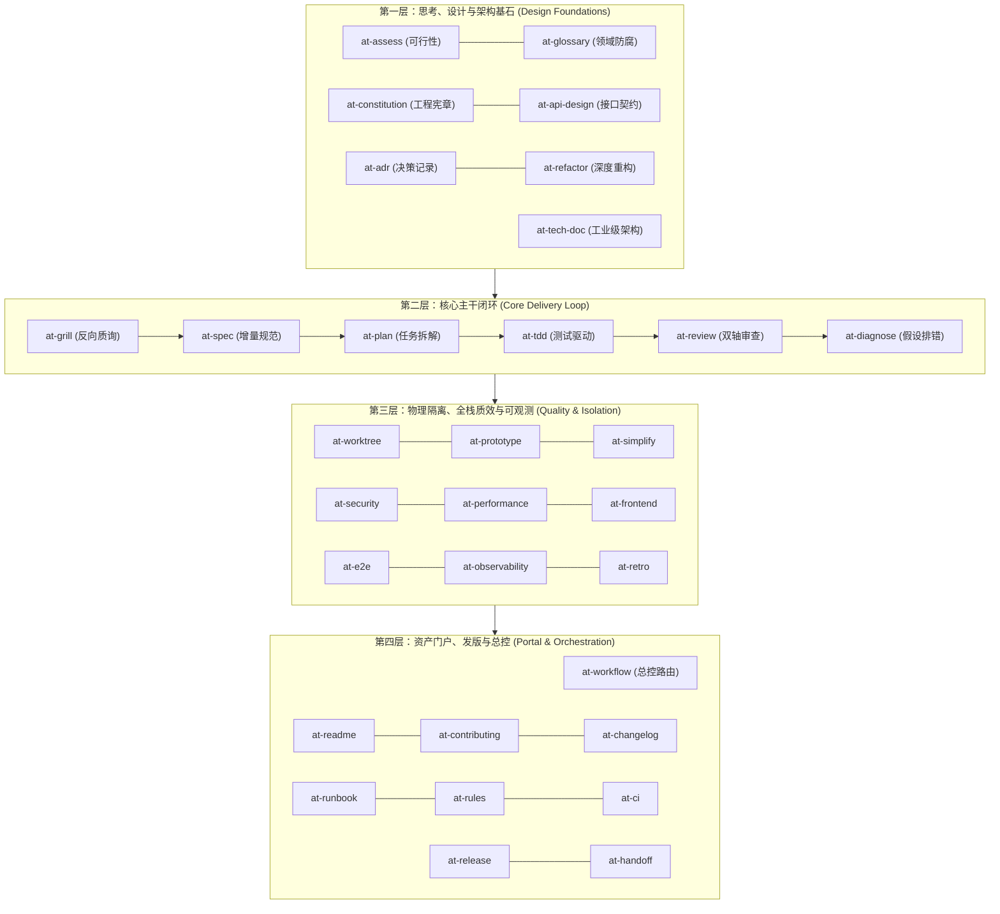
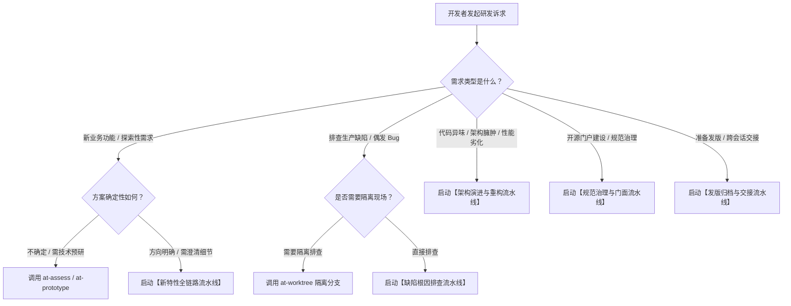

# 全局研发工作流总控路由协议 (Global Workflow Routing Protocol)

本文档定义全生命周期 31 个 AI Agent 软件工程技能的场景意图诊断决策树、经典协同配方流水线与调度路由契约。

---

## 目录 (Table of Contents)

- [1. 31 项技能全景拓扑与四层金字塔模型](#1-31-项技能全景拓扑与四层金字塔模型)
- [2. 开发者意图诊断决策树](#2-开发者意图诊断决策树)
- [3. 六大标准化协同流水线配方](#3-六大标准化协同流水线配方)
- [4. 技能链条输入输出契约矩阵](#4-技能链条输入输出契约矩阵)
- [5. 动态降级与自适应调度准则](#5-动态降级与自适应调度准则)

---

## 1. 31 项技能全景拓扑与四层金字塔模型

全库技能按照软件工程职责解耦为四层金字塔拓扑体系：

---

## 2. 开发者意图诊断决策树

当开发者向 Agent 提出诉求时，`at-workflow` 按照以下规则树引导意图收敛：

---

## 3. 六大标准化协同流水线配方

### 3.1 配方 1：全新特性研发流水线 (Feature Delivery Flow)
`at-assess` -> `at-grill` -> `at-spec` -> `at-api-design` -> `at-plan` -> `at-tdd` -> `at-review` -> `at-e2e` -> `at-release`
- 适用场景：高复杂度新模块上线，要求前置防腐、精确计划、严格单测与端到端验收。

### 3.2 配方 2：缺陷排查与热修流水线 (Hotfix & Diagnostic Flow)
`at-diagnose` -> `at-worktree` -> `at-tdd` -> `at-review` -> `at-release` -> `at-retro`
- 适用场景：生产紧急缺陷，以科学假设驱动快速复现，红灯用例保护，上线后 5 Whys 复盘。

### 3.3 配方 3：架构演进与极简重构流水线 (Refactoring Flow)
`at-adr` -> `at-glossary` -> `at-refactor` -> `at-simplify` -> `at-performance` -> `at-review`
- 适用场景：消除上帝类、深层嵌套与慢查询，在已有单测保护下小步快跑。

### 3.4 配方 4：开源门面与流水线门禁建设 (Governance & Portal Flow)
`at-constitution` -> `at-rules` -> `at-ci` -> `at-readme` -> `at-contributing` -> `at-changelog`
- 适用场景：新项目开荒或存量项目标准化改造，建立全套工程守卫与开发者门面。

### 3.5 配方 5：生产稳态与可观测运维流 (Observability & SRE Flow)
`at-observability` -> `at-runbook` -> `at-retro`
- 适用场景：生产服务上线前监控埋点设计、应急排错预案制定与故障复盘治理。

### 3.6 配方 6：长时自治跨会话接力流 (Autonomous Handoff Flow)
`at-handoff` -> 注入新 Agent -> 断点热启动续跑
- 适用场景：长任务超过上下文窗口阈值时，自动压缩去噪并无缝移交。

---

## 4. 技能链条输入输出契约矩阵

| 阶段 | 上游技能 | 核心产出物 | 下游衔接技能 |
| :--- | :--- | :--- | :--- |
| **需求输入** | `at-grill` | 结构化需求澄清提纲 | `at-spec` (转写契约) |
| **设计规范** | `at-spec` | 原子化增量变更规格书 | `at-plan` (任务依赖图) |
| **任务拆解** | `at-plan` | 拓扑依赖感知微任务清单 | `at-tdd` (逐项单测开发) |
| **编码实现** | `at-tdd` | 100% 绿灯且消除异味的代码 | `at-review` (双轴审查) |
| **质量门禁** | `at-review` | 审查通过报告 / 改进建议 | `at-e2e` / `at-release` |

---

## 5. 动态降级与自适应调度准则

1. **轻量任务快速通道**：对于纯文档修正或微小修复（< 10 行），允许跳过 `at-assess` 与 `at-plan`，直接采用 `at-tdd` -> `at-review`；
2. **阻断级前置卡点**：`at-spec` 未获确认前，严禁越级直接调用 `at-tdd` 编写业务源码；
3. **安全与两级授权**：任何涉及代码提交与远端推送的步骤，工作流总控必须挂起并等待人类显式指令。
