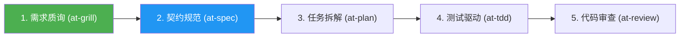

# 研发工作流交互向导与场景菜单模板 (Workflow Interactive Menu Template)

本文档提供面向开发者对话界面的交互式场景向导卡片、意图诊断菜单与流程推进状态看板模板。

---

## 1. 终端场景意图诊断菜单模板

当开发者输入较为模糊或需要全局编排时，Agent 输出此卡片供开发者选择：

```markdown
### 🧭 全生命周期软件工程工作流向导 (Workflow Orchestrator)

您好！为了以最高的工程质量和最清晰的依赖链路推进您的任务，请选择最契合您当前诉求的研发场景：

- **[1] 🚀 全新特性研发流 (Feature Flow)**
  *适用*：从需求澄清、契约制定到 TDD 编码与端到端验收
  *核心技能链*：`at-grill` -> `at-spec` -> `at-plan` -> `at-tdd` -> `at-review` -> `at-e2e`

- **[2] 🐛 线上缺陷排查与热修流 (Hotfix Flow)**
  *适用*：偶发 Bug 定位、假设驱动排查与测试护航紧急修复
  *核心技能链*：`at-diagnose` -> `at-worktree` -> `at-tdd` -> `at-review` -> `at-retro`

- **[3] ⚡ 架构演进与极简重构流 (Refactoring Flow)**
  *适用*：消除上帝类、圈复杂度压降、性能瓶颈排查与领域防腐
  *核心技能链*：`at-adr` -> `at-refactor` -> `at-simplify` -> `at-performance`

- **[4] 🛡️ 开源门面与流水线规范治理 (Governance Flow)**
  *适用*：项目门户建设、贡献指南、GitHub Actions CI 门禁与规则配置
  *核心技能链*：`at-rules` -> `at-ci` -> `at-readme` -> `at-contributing`

- **[5] 📦 安全发版与长时自治交接 (Release & Handoff)**
  *适用*：上线起飞核验、SemVer 归档、跨会话上下文压缩
  *核心技能链*：`at-release` / `at-handoff`

> 💡 **提示**：您可以直接回复编号（如 `1`）或简述您的需求，我将为您自动装载最佳技能组合！
```

---

## 2. 场景已确认与流水线推进看板模板

当开发者确认场景后，输出当前推进状态看板：

```markdown
### 📋 当前执行工作流：全新特性研发流水线 (Feature Flow)



- [x] **步骤 1：需求反向质询 (`at-grill`)** —— *已完成，已识别 3 处模糊边界*
- [ ] **步骤 2：增量规范制定 (`at-spec`)** —— ⏳ **当前正在执行**
- [ ] **步骤 3：任务拓扑拆解 (`at-plan`)** —— *待就绪*
- [ ] **步骤 4：测试驱动实现 (`at-tdd`)** —— *待就绪*
- [ ] **步骤 5：双轴代码审查 (`at-review`)** —— *待就绪*

---

#### 🎯 当前步骤目标：制定增量变更规范 (Delta Spec)
正在根据澄清结果编写 `specs/changes/005-feature/spec.md`，重点定义 API 契约与数据模型变更...
```
