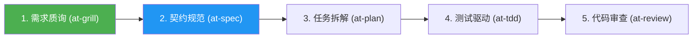

# 研发工作流交互向导与场景菜单模板 (Workflow Interactive Menu Template)

本文档提供面向开发者对话界面的交互式场景向导卡片、意图诊断菜单与流程推进状态看板模板。

---

## 1. 终端场景意图诊断菜单模板

当开发者输入较为模糊或需要全局编排时，Agent 输出此卡片供开发者选择：

```markdown
### 🧭 全生命周期软件工程工作流向导 (Workflow Orchestrator)

您好！为了以最高的工程质量和最清晰的依赖链路推进您的任务，请选择最契合您当前诉求的研发场景：

- **[1] 🚀 全新特性研发流 (Feature Flow)**
  *适用*：从需求澄清、契约制定到 TDD 编码与端到端验收
  *核心技能链*：`at-grill` -> `at-spec` -> `at-plan` -> `at-tdd` -> `at-review` -> `at-e2e`

- **[2] 🐛 线上缺陷排查与热修流 (Hotfix Flow)**
  *适用*：偶发 Bug 定位、假设驱动排查与测试护航紧急修复
  *核心技能链*：`at-diagnose` -> `at-worktree` -> `at-tdd` -> `at-review` -> `at-retro`

- **[3] ⚡ 架构演进与极简重构流 (Refactoring Flow)**
  *适用*：消除上帝类、圈复杂度压降、性能瓶颈排查与领域防腐
  *核心技能链*：`at-adr` -> `at-refactor` -> `at-simplify` -> `at-performance`

- **[4] 🛡️ 开源门面与流水线规范治理 (Governance Flow)**
  *适用*：项目门户建设、贡献指南、GitHub Actions CI 门禁与规则配置
  *核心技能链*：`at-rules` -> `at-ci` -> `at-readme` -> `at-contributing`

- **[5] 📦 安全发版与长时自治交接 (Release & Handoff)**
  *适用*：上线起飞核验、SemVer 归档、跨会话上下文压缩
  *核心技能链*：`at-release` / `at-handoff`

> 💡 **提示**：您可以直接回复编号（如 `1`）或简述您的需求，我将为您自动装载最佳技能组合！
```

---

## 2. 场景已确认与流水线推进看板模板

当开发者确认场景后，输出当前推进状态看板：

```markdown
### 📋 当前执行工作流：全新特性研发流水线 (Feature Flow)



- [x] **步骤 1：需求反向质询 (`at-grill`)** —— *已完成，已识别 3 处模糊边界*
- [ ] **步骤 2：增量规范制定 (`at-spec`)** —— ⏳ **当前正在执行**
- [ ] **步骤 3：任务拓扑拆解 (`at-plan`)** —— *待就绪*
- [ ] **步骤 4：测试驱动实现 (`at-tdd`)** —— *待就绪*
- [ ] **步骤 5：双轴代码审查 (`at-review`)** —— *待就绪*

---

#### 🎯 当前步骤目标：制定增量变更规范 (Delta Spec)
正在根据澄清结果编写 `specs/changes/005-feature/spec.md`，重点定义 API 契约与数据模型变更...
```

---

## 3. 全局技能帮助索引卡片模板 (/at-workflow help)

当开发者输入 `/at-workflow help` 时，Agent 在会话中渲染全景索引卡片：

```markdown
### 📚 工业级 AI Agent 软件工程技能库全景索引 (Skills Directory)

本技能库提供 31 项微内核技能，覆盖软件研发全生命周期：

- **第一层：思考、设计与架构基石 (Design Foundations)**
  `at-assess` · `at-glossary` · `at-constitution` · `at-api-design` · `at-adr` · `at-refactor` · `at-tech-doc`
- **第二层：核心主干闭环 (Core Delivery Loop)**
  `at-grill` · `at-spec` · `at-plan` · `at-tdd` · `at-review` · `at-diagnose`
- **第三层：物理隔离、全栈质效与可观测 (Quality & Isolation)**
  `at-worktree` · `at-prototype` · `at-simplify` · `at-security` · `at-performance` · `at-frontend` · `at-e2e` · `at-observability` · `at-retro`
- **第四层：资产门户、发版与总控 (Portal & Orchestration)**
  `at-workflow` · `at-readme` · `at-contributing` · `at-changelog` · `at-runbook` · `at-rules` · `at-ci` · `at-release` · `at-handoff`

💡 **快速查询提示**：输入 `/at-workflow help <技能名>`（如 `/at-workflow help at-tdd`）查看指定技能的详细卡片契约！
```

---

## 4. 单技能五段式帮助卡片模板 (/at-workflow help <skill-name>)

当开发者输入 `/at-workflow help <skill-name>` 或对任意技能使用 `--help` 参数时，Agent 输出标准化卡片：

```markdown
### 📌 [at-tdd] 测试驱动开发与坏味道消除技能

1. **核心定位**：践行严密红绿重构三步循环（Red-Green-Refactor），编写可靠业务实现并根除变异测试坏味道。
2. **触发场景**：编写单元测试、新功能 TDD 开发、修复缺陷编写复现用例、提高分支覆盖率、重构消除异味。
3. **执行状态机**：
   - 步骤 1：先写红灯测试（Red）并执行验证失败；
   - 步骤 2：编写最小足量代码使测试转为绿灯（Green）；
   - 步骤 3：重构优化设计并消除坏味道（Refactor）。
4. **交付物契约**：业务源码文件 + 100% 运行通过的单元测试类，无假桩 Mock，零破坏性变更。
5. **配套手册**：[at-tdd 伴随使用手册](../../../docs/skills/at-tdd.md)
```

